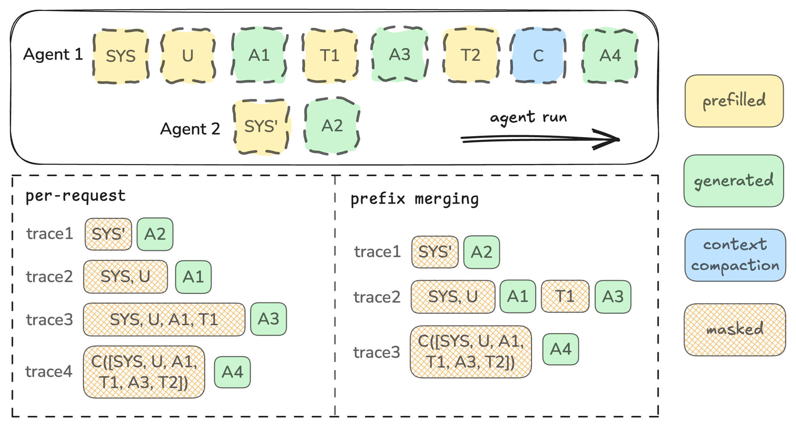

# Long-Horizon Credit Assignment & Behavior Supervision

## Contents

- [1. What Long-Horizon Agentic RL Must Hold Stable](#1-what-long-horizon-agentic-rl-must-hold-stable)
- [2. Choosing an RL Paradigm for Long-Horizon Harness Environments](#2-choosing-an-rl-paradigm-for-long-horizon-harness-environments)
  - [2.1 Why Not the GRPO Family](#21-why-not-the-grpo-family)
  - [2.2 Hindsight-Augmented Asymmetric Critic](#22-hindsight-augmented-asymmetric-critic)
- [3. Behavior Supervision: Why Bad Motions Emerge and How to Govern Them](#3-behavior-supervision-why-bad-motions-emerge-and-how-to-govern-them)
  - [3.1 Why a Handful of Extreme Trajectories Can Collapse Training](#31-why-a-handful-of-extreme-trajectories-can-collapse-training)
  - [3.2 Choosing Among Mask, Filter, and Reward Shaping](#32-choosing-among-mask-filter-and-reward-shaping)
  - [3.3 Fine-Grained Trajectory Management](#33-fine-grained-trajectory-management)
  - [3.4 Train-Eval Mismatch](#34-train-eval-mismatch)
- [4. Engineering Details](#4-engineering-details)
  - [4.1 Environment](#41-environment)
  - [4.2 A Reusable Roadmap for Diagnosing Reward Crash](#42-a-reusable-roadmap-for-diagnosing-reward-crash)
  - [4.3 Sample Efficiency and Exploration](#43-sample-efficiency-and-exploration)

## 1. What Long-Horizon Agentic RL Must Hold Stable

核心目标只有一个:在 **long-horizon** 场景下把训练做到稳定且可持续拉长 step。这里的 long-horizon 指单个 episode 交互 200+ step、context 256k 起跳的 agentic RL。稳定包含两层:一层是避免训练中后期常见的 reward crash,一层是让模型在更长的交互序列上持续拿到有效梯度,从而在 out-of-domain 场景上泛化得更好。

与此并行,还有一个来自训练前置阶段的遗留问题要处理。CPT / SFT 阶段的模型在蒸馏 off-policy 数据时,会引入一批**不良行为模式(bad behavior motion)**。这些模式在 on-policy rollout 中可能被偶发正样本进一步强化,是训练崩溃的重要诱因之一。

围绕上述目标，本文讨论三个层面的问题：

- **算法层**：什么样的 RL 算法更适合 long-horizon、真实 harness 环境下的 agentic 任务；
- **行为监督层**：对训练中不可避免的不良行为，分别用什么手段治理最优；
- **工程层**：terminal state、mask & filter 的实现细节，以及 reward crash 的排查方法论。

## 2. Choosing an RL Paradigm for Long-Horizon Harness Environments

### 2.1 Why Not the GRPO Family

以 GRPO 为代表的 episode-level 优势估计,把整条轨迹的所有 token 钉死在同一个标量优势上。其 loss function 为:

$$
\mathcal{L}_{GRPO}(\boldsymbol{\theta})=\mathbb{E}_{q \sim \rho(Q),\left\{\boldsymbol{o}_{i}\right\}_{i=1}^{G} \sim \pi_{\theta_{\text{old}}}}
\frac{1}{G} \sum_{i=1}^{G} \frac{1}{\left|\boldsymbol{o}_{i}\right|} \sum_{t=1}^{\left|\boldsymbol{o}_{i}\right|}\left[\min \left[\frac{\pi_{\boldsymbol{\theta}}\left(o_{i, t} \mid q, o_{i, t}\right)}{\pi_{\boldsymbol{\theta}_{\text{old}}}\left(o_{i, t} \mid q, o_{i, t}\right)}, \operatorname{clip}\left[\frac{\pi_{\boldsymbol{\theta}}\left(o_{i, t} \mid q, o_{i, t}\right)}{\pi_{\boldsymbol{\theta}_{\text{old}}}\left(o_{i, t} \mid q, o_{i, t}\right)}, 1-\epsilon, 1+\epsilon\right]\right]\right.
\left.\cdot A_{\pi}\left(q, o_{i, t}\right)-\beta \hat{K} \hat{\mathbb{L}}\left[\pi_{\boldsymbol{\theta}} \| \pi_{\boldsymbol{\theta}_{\text{ref}}}\right]\right]
$$

其中 advantage 为:

$$
\hat{A}_{i, t}=\hat{A}_{\pi}\left(q, \boldsymbol{o}_{i}\right)=\frac{r\left(\boldsymbol{o}_{i}\right)-\operatorname{mean}(\boldsymbol{R})}{\operatorname{std}(\boldsymbol{R})},
\qquad
\boldsymbol{R}=\left\{r\left(\boldsymbol{o}_{1}\right), \cdots, r\left(\boldsymbol{o}_{i}\right), \cdots, r\left(\boldsymbol{o}_{G}\right)\right\}
$$

**Long-horizon agentic RL 的 MDP 结构。** Agentic RL 是一个 turn-level POMDP:模型与环境交互 $T$ 轮,状态部分可观测,转移随机(工具、API、代码执行均带副作用),奖励稀疏且仅在终止处给出。相较于 reasoning RL 的 token-level MDP,它的信用分配是**双层**的——既要判断哪一轮关键,又要判断该轮内哪些 token 关键。

**问题 1：GRPO 的信用分配错误。** GRPO / GSPO 属于 trajectory-level credit assignment，所有 token equal gradient，在 agentic RL 中会产生两类问题：

- 只做 **sparse outcome reward** 时:
  - 结果正确、但过程轮次中存在不良行为模式时,这些模式也会被持续激励,放大训练中习得的坏习惯;
  - 结果错误时,由于没有 PRM / critic 等过程监督,整条轨迹学不到任何东西,样本效率低下。
- 引入 **dense reward shaping** 时(例如为纠正或约束模型行为——工具调用错误、并行调用次数过多、超长思考、输出乱码等):
  - 对 vanilla GRPO,这个 reward shaping 会作用在整条 trajectory 上,需要引入变体做 advantage reshaping。

对近两年的 Agentic RL 算法进行系统性调研（[A Surcey on Long Horizon Credit Assignment](refs/credit-assignment/README.md)），为实现 turn-level credit assignment：

- **REINFORCE-family / PPO-family**： 原生 token-level credit assignment 方法,本身可以做到细粒度过程监督：以 REINFORCE 为代表, advantage 为累积奖励,对应 turn 的 reward penalty 只会作用在前缀轮次,而不影响后续轮次。同期也有较多基于 REINFORCE / PPO 出发，在 importance ratio 和 advantage 聚合粒度上做变体的工作

- **GRPO-family**（GiGPO / Step-GRPO 等）：利用 anchor state 分组做 group relative advantage estimation，挖掘更细的组间相对优势。或者工业界常用的工程技巧为基于 penalty 进行 advantage reshape, 但在理论上并无收敛性证明。

**问题 2:black-box 场景的 RL 的样本结构是 1-episode(session) multi-sample(segments)。**:

Polar 的轨迹构造对这一区别有直观刻画:

**GRPO 如何处理 1-session multi-segments**: 通常业界应用 grpo 处理 1-session multi-segments 的两个 trick 为 (1) advatange 处理: 基于 last segment 作为 anchor state 参与 group advantage 计算再 broadcast 到整个 session 的所有 segments, 解决由于 session 拆分导致单个 group 内的样本数量不固定的问题. (2) gradient reweight: 需要保障 token-equal / session-equal 而不是 segment(sample)-equal, 因为 slime 默认的是 sample-equal, 对于该情况需要特殊处理为, token-equal 和 session-equal, 这两种各有利弊, 具体相关工作可以参考 dr.GRPO等。

**PPO** 然而实质上 agentic RL 场景无需太复杂的算法。(1) 基于朴素的 REINFORCE++ / PPO 并应用 segment-level advantage 或原生的 token-level advantage 都可实现良好的训练稳定滚行和样本效率, 并且相比于 grpo 的处理方式更自然一些。（2）gradient reweight 处理需要参考上文，这部分与算法本身无关。

**不走 GIGPO 这类算法的原因**：这类算法依赖高相似度 anchor state 从而得到无代价的对比信号, 在 ALFWorld 等学术榜单上效果优秀，但是 code / search 等工业任务与学术 benchmark 不同，不存在 anchor state。

$$
\mathcal{L}_{PPO}(\boldsymbol{\theta})=\mathbb{E}_{q \sim \rho(Q), \boldsymbol{o} \sim \pi_{\boldsymbol{\theta}_{\text{old}}}} \frac{1}{|\boldsymbol{o}|} \sum_{t=1}^{|\boldsymbol{o}|}\left[\min \left[\frac{\pi_{\boldsymbol{\theta}}\left(o_{t} \mid q, o_{: t}\right)}{\pi_{\boldsymbol{\theta}_{\text{old}}}\left(o_{t} \mid q, o_{: t}\right)}, \operatorname{clip}\left[\frac{\pi_{\boldsymbol{\theta}}\left(o_{t} \mid q, o_{: t}\right)}{\pi_{\boldsymbol{\theta}_{\text{old}}}\left(o_{t} \mid q, o_{: t}\right)}, 1-\epsilon, 1+\epsilon\right]\right] \cdot A_{\pi}\left(q, o_{t}\right)\right]
$$

其中 advantage 为:

$$
\hat{A}_{t}=-V\left(s_{t}\right)+r_{t}+\gamma r_{t+1}+\cdots+\gamma^{T-t+1} r_{T-1}+\gamma^{T-t} V\left(s_{T}\right)
$$

$t$ 为长度为 $T$ 的轨迹片段内的时间索引,取值范围 $[0, T]$。推广这一选择,可以使用截断版的 generalized advantage estimation(GAE),当 $\lambda = 1$ 时退化为上式:

$$
\hat{A}_{t}=\delta_{t}+(\gamma \lambda) \delta_{t+1}+\cdots+(\gamma \lambda)^{T-t+1} \delta_{T-1},
\qquad
\delta_{t}=r_{t}+\gamma V\left(s_{t+1}\right)-V\left(s_{t}\right)
$$

### 2.2 Hindsight-Augmented Asymmetric Critic

长程 POMDP 下,critic 仅凭 rollout 时可见的 harness 状态很难给出准确的价值估计。让 critic 使用相比 actor 更多的增量信息,在早期 RL 工作中是常见做法(参见 MARL 中的 CTDE 与 asymmetric actor-critic 相关工作)。因此我们在**训练时**让 critic 访问特权的**事后信息(hindsight context)** $c_t$,而 actor 在 rollout 时仍只观测正常的 harness 状态。这一设计只改善价值估计,不改变最终部署的策略。

具体地,rollout 时 actor 只能看到截至当前轮的交互历史;训练时 critic 额外获得 $c_t$,其中包含最终 pass/fail 奖励、单测结果分布、覆盖率信号、patch-level diff、任务元数据、轨迹统计量以及后续轮次。非对称价值函数因此写作 $V_\psi(s_t, c_t)$,仍以 MSE 训练:

$$
\mathcal{L}_{\mathrm{critic}}^{\mathrm{asym}}(\psi)
= \mathbb{E}_{(s_t,c_t,R_t)\sim\mathcal{D}}
\left[\bigl(V(s_t,c_t;\psi)-R_t\bigr)^2\right],
\qquad
R_t=\hat{A}_t+V'(s_t,c_t)
$$

GAE 的计算与上式一致,只是把每个价值项替换为非对称价值函数 $V(\cdot, c_t;\psi)$;actor 仍优化标准 PPO 目标。**推理时 critic 与 hindsight context 全部丢弃,只部署 actor。**

## 3. Behavior Supervision: Why Bad Motions Emerge and How to Govern Them

不良行为模式（bad behavior motion）有两个来源：CPT / SFT 阶段蒸馏 off-policy 数据时的注入，以及 on-policy rollout 中被偶发正样本激发。本节从三个层面处理它：**成因**——为什么极少量极端轨迹足以拖垮整个训练；**手段**——mask / filter / reward shaping 三类治理工具在什么条件下各自适用；**机制**——如何在样本进入优化器前重建并管理轨迹以支撑上述判定。

### 3.1 Why a Handful of Extreme Trajectories Can Collapse Training

极端轨迹的危害不在数量,而在于它会自我放大。一个 step 产生的少量极端样本若不及早处理,会在迭代中不断累积,最终使 entropy 骤降、模型收敛到单一模式。因此训练中的行为监督直接决定了模型能稳定训练多长时间。其失稳机制可拆为三点:

1. **正反馈自放大**。只看 outcome reward 时,某个极端行为一旦偶发拿到正样本就被激励,下一轮 rollout 中该行为出现得更多,又带来更多正样本,形成跨迭代的放大回路。少量极端样本是初始种子,崩塌是它随迭代放大的结果。

2. **梯度由低概率 token 主导**。进入优化的是 $A_t \cdot r_t \cdot \nabla_\theta\log\pi(a_t\mid s_t)$ 三项相乘:$A_t$ 被 0/1 reward 约束在 $O(1)$,$r_t$ 被 PPO 的 clip 限制在 $[1-\epsilon, 1+\epsilon]$,唯独 score function $\nabla_\theta\log\pi$ 不受约束。一个概率很低的极端 / 乱码 token,其 $\nabla_\theta\log\pi$ 的范数远大于正常 token,单个这样的 token 梯度就可能高出几个数量级。而 per-seq 归一化 $\frac{1}{|o|}\sum_t$ 只除以长度,压不下整条都由这类 token 组成的轨迹。结果是这类轨迹在样本数上是少数,在梯度范数上却是多数。

3. **失败方向没有纠正信号**。0/1 outcome reward 下,若一个 group 整体失败(全 0),则 $\sigma\to0$、advantage $\to0$,这条方向学不到任何东西(即前面 Why Not the GRPO Family 里讲的「结果错误则学不到」)。因此一旦策略被前两点推入退化模式,就没有梯度能把它拉回来,退化无法自行纠正,这也是致崩阈值很低的原因。

三点共同给出一个治理原则:**信号处理必须前置到样本进入优化器之前**。正反馈自放大要求尽早在训练信号里切断病态模式;梯度问题说明单靠 advantage 有界不足以防止极端 token 主导 batch,须在梯度回传层面处理;失败方向缺乏纠正信号,意味着事后补救几乎无效。

### 3.2 Choosing Among Mask, Filter, and Reward Shaping

对每条(或每个 token 段)轨迹,治理时要回答三个问题:失败是否策略责任、reward 是否可信、token 是否值得回传梯度。对应三类手段,其对样本的处理差异如下(首行为不做处理的基线):

| Method | Modify Reward | In Advantage Group | Backward? |
|---|:---:|:---:|:---:|
| Vanilla (no op) | No | Yes | Yes |
| Mask | No | Yes | No |
| Filter | N/A | No | No |
| Reward Shaping | Yes | Yes | Yes |

选择标准由坏模式的占比决定：千分位级别的少量极端样本用 mask / filter，剔除代价小且不干扰主目标；占比较高的坏模式（如前序阶段引入的 Giant think）用 reward shaping，逐条丢弃代价过大时从奖励信号层面纠偏。

**Loss Mask**：将该样本（或 token 段）的 loss 置零，切断梯度回传，但 advantage 归一化时仍计入，group baseline（μ / σ）与 reward 分布不受影响。适用于 reward 可信、只是 token 噪声大或长度极端的重尾样本。

**Filter**：在 loss mask 的基础上叠加 reward mask——样本既不回传梯度，也从 advantage 归一化中剔除，group baseline 的 μ / σ 不再包含它。Filter 会改变 reward 分布，只在 reward 本身不可信时才用（实践中仅对 harness error / harness 超时等非策略责任的失败做 filter）。过度 filter 会使 batch 偏向易在时限内完成的简单任务，等价于隐式 curriculum；为此设 dynamic max rollout time，将超时被 filter 的轨迹比例控制在 5% 以内。

**Reward / Advantage Shaping**：在奖励信号中显式加入行为惩罚（retry-loop penalty、turn-count penalty 等），把「该行为是差的」保留在训练信号里，信息利用最充分，但容易被 hacking 且分散模型对主目标的优化。粒度上，只对「特定 turn 中呈现该不良模式的 token」施加 advantage penalty，比 vanilla GRPO 作用于整条轨迹在 credit assignment 上更优。

### 3.3 Fine-Grained Trajectory Management

**观测到的典型退化模式。** 训练 Qwen-3.6-35B-A3B 时,我们记录到以下 case,按成因归为三类:

| 成因 | 退化模式 | 说明 |
|---|---|---|
| on-policy rollout 激发 | 并行工具调用数量爆炸 | 某 step 出现单条并发调用 80 轮的正样本后,该模式被迅速强化,行为走偏直至崩塌 |
| CPT / SFT 阶段注入 | Giant think | 超长思考且不调用工具的比例持续上升;CPT 后约 4%,RL 中因正样本被持续激励 |
| CPT / SFT 阶段注入 | 格式错误 / 乱码 / 多语种崩坏 | think、tool_call 格式错乱,成因同上 |
| environment setting 诱发 | 主动 submit 能力丢失 | 最长轮数设为 100 时,非主动 submit 同样能拿到 patch 正奖励,主动 submit 比例持续下降至丢失;增至 200 后规避 |

这些模式的共性正是前面讲的正反馈自放大：一旦被偶发正样本强化，就在后续 rollout 中自我放大，因此必须通过实时行为监控尽早在训练信号里切断。

**轨迹管理（TMM）。** Rollout 出的轨迹不直接进优化器。它们先落进 experience buffer，由 TMM 在 per-request 粒度上扫描行为 pattern，据此对每条轨迹、每个 token 段做 mask / filter / reward shaping。这一步把「一视同仁地喂梯度」换成「先看清、再区别处理」。

**与 Auto-Eval 协同。** 训练期的行为监督与训练后的评测由 [Auto-Eval](../eval/eval.md) 统一覆盖。Judge 离线扫描轨迹、归因失败模式，将稳定复现的病态行为固化为确定性规则后交 TMM 执行；TMM 以低延迟在训练流上实时运行这批规则。发现与治理分离：Judge 负责发现新 pattern，TMM 负责执行已知规则。

## 4. Engineering Details

如果说 reasoning RL 时期决定结果的核心是 algorithm > infra,那么 agentic RL 则是 environment > infra > algorithm。

在 harness environment 中,我们需要基于不同的 scaffold 去 on-policy rollout 训练 agentic RL:

- 不同的 scaffold 是不同的 environment,具有不同的特性,因此对 environment 的细粒度分析十分重要;
- 通过 docker 挂载不同版本的脚手架。

### 4.1 Environment

优化一个任务，首先要深度理解其 MDP。Harness environment 的每个 MDP 要素都会直接作用于训练信号，对其拆解是设计稳定 agentic RL 训练的前提：

- **Environment State**：agent 在每一轮可观测到什么；
- **Action Space**：agent 能执行哪些动作（即 toollist）；
- **Transition Dynamics**：一轮动作后状态如何演化，是否严格增量；
- **Reward Function**：奖励信号从何而来、是否可信；
- **Terminal**：一条 episode 因何终止。

**State Transition**：LLM 是 auto-regressive 的，因此 append-only 的状态转移对训练最友好。历史被丢弃、改写或截断（常见于脚手架的重试逻辑、query 重写、上下文 compaction）会破坏这种一致性。典型案例：SWE-Agent 在工具报错重试时会丢弃上一轮模型输出，导致非 append-only 轨迹；Claude Code 的自动 compaction（逼近 context 上限时用结构化摘要替换历史）同样打破 append-only，且不同版本触发时机有差异。即便同为 Claude Code，不同版本对模型而言也是不同的 environment，训练与泛化都要纳入版本差异。

**Terminal**：terminal 机制越复杂，agent 越容易学成「适应环境」而非「习得可泛化的解题能力」。以 SWE-Agent scaffold 为例，其 terminal 原因包括：

| exit_status | 触发源 |
|---|---|
| `submitted` | submit 命令 + patch 非空 |
| `exit_command` | `action == "exit"` |
| `exit_forfeit` | observation 含 forfeit token |
| `exit_format` | 格式错连 N 次（默认 3） |
| `exit_context` | 输入 tokens 超 `max_input_tokens` |
| `exit_cost` | instance cost 或 call 次数超限 |
| `exit_api` | litellm 重试耗尽 |
| `exit_environment_error` | `SwerexException` |
| `exit_command_timeout` | bash 连续 timeout |
| `exit_total_execution_time` | 累计执行时间超限 |
| `exit_error` | RuntimeError + 兜底 Exception |

**Action**：action space 的丰俭决定了环境的难度与噪声来源。工具越少，模型越依赖自身能力解题，转换层噪声越少；工具越多，affordance 越强，但更容易学成「适应工具」而非「可泛化解题」。

| 脚手架 | Action Space | 特点 |
|---|---|---|
| mini-agent | bash 单工具 | 训练信号干净；无 shell 状态持久化，需 `&&` 串命令；对模型基础能力要求高 |
| Claude Code | 完整工具套（文件读写、检索、Bash、子 agent、联网等） | affordance 强，面向真实用户场景；环境机制多，更难泛化 |

算力配置：70% 在 mini-agent（action / terminal / state transition 均极简）、20% 在 Claude Code（用户调用量最大）、10% 在其他脚手架。

**Reward**：code 任务的 reward 来自 exec-based verifier——真实跑测试、按 0/1 裁决，不用 LM-as-judge（不可复现，不能当训练信号）。判据是 F2P/P2P 测试差分：只打 test patch 时目标测试应失败，test 与 code 都打上时应通过，两项同时验证改动的有效性。

数据集来源影响 verifier 可信度：

- **[公开数据集](../env/env.md)**：SWE-bench Verified 人工去噪最干净，但趋饱和；SWE-rebench、R2E-Gym 等自动合成池规模大，verifier 干净程度参差，需额外筛。
- **自建数据集**（AutoBuilder）：弱 verifier 风险高，日志格式千差万别，正则匹配频繁误判。解法是独立日志解析器将真实执行输出解析成结构化信号，再以验证-修复闭环确认判据成立。

verifier 假阳会把错误行为标成正样本，假阴会丢掉有效梯度。verifier 的假阴假阳率是数据进 RL 前需要评估和控制的指标。

### 4.2 A Reusable Roadmap for Diagnosing Reward Crash

当发生 reward crash 时,有一条可复用的排查路径。我们的实践基线是:在 white-box RL 上已验证 Pro 的稳定涨分,说明 infra 层面的 algorithm 实现与 Megatron / SGLang 精度初步没有问题——因此排查应从数据与脚手架、而非算法实现入手。

以在 SWE-Agent 上训练 Flash 持续 reward crash 为例(SWE-Agent 本身偏 white-box 场景):

1. **先做 RFT，定位问题在正样本还是负样本**。若 RFT 不能涨分，说明 rollout 出来的正样本不够纯净、有噪声；若 RFT 能涨分，则反过来说明负样本不够纯净，可能存在 credit assignment 问题。
2. **排查训推一致性（TITO）**。发现 TITO 一致性仅 40%，即 60% 的 token 被改写——这需要优化，但经验证并非本次 RFT crash 的根因。
3. **排查沙箱干净程度**。最终定位到根因是 SWE-Agent 脚手架自身的问题（swerex 相关，详见 [sweagent-sandbox skill](refs/sweagent-sandbox/SKILL.md)）。换成 mini-agent 脚手架、规避 swerex 问题后，RFT 能涨分、GRPO 也能涨分。
4. **巩固训练稳定性**。优化 proxy server 保障 TITO 后，叠加 TIS / IcePop 等训推一致性控制手段进一步稳住训练。

### 4.3 Sample Efficiency and Exploration

在算力预算受限、rollout 成本高昂的前提下，提升 sample efficiency 与增强 exploration 是拉长训练的关键。两条互补路径：

**Hint 增强 Query。** 在 query 中注入适度提示，引导模型探索更有价值的动作空间，在同等 rollout 预算下获得更纯净、更多样的正样本。这是在不修改奖励函数的前提下降低探索难度的低成本路径。

**技能沉淀（Skills）。** 由 [Auto-Eval](../eval/eval.md) 的 LLM Judge 提炼：模型在训练过程中反复碰壁的卡点，经 Judge 分析后固化为可复用的技能描述，挂载到 harness 或注入 system prompt，在后续 rollout 直接生效。与 hint 的区别在于，技能沉淀是数据驱动的——它来自对实际失败轨迹的归因，而非人工先验。两者组合，共同构成探索效率的提升杠杆。

