- [Preliminary: From RLVR to Agentic RL](#preliminary-from-rlvr-to-agentic-rl)
  - [Markov Decision Processes](#markov-decision-processes)
  - [Environment State](#environment-state)
  - [Action Space](#action-space)
  - [Transition Dynamics](#transition-dynamics)
  - [Reward Function](#reward-function)
  - [Learning Objective](#learning-objective)
  - [Episode / Turn / Token: Three Granularities](#episode--turn--token-three-granularities)
- [Structural Differences Between RLVR and Agentic RL](#structural-differences-between-rlvr-and-agentic-rl)
- [Agentic RL: The Algorithmic Perspective](#agentic-rl-the-algorithmic-perspective)
  - [Algorithm Families: Overview](#algorithm-families-overview)
  - [REINFORCE-family](#reinforce-family)
  - [PPO-family](#ppo-family)
    - [Critic Hindsight Information](#critic-hindsight-information)
    - [Critic Size](#critic-size)
  - [GRPO-family](#grpo-family)
- [Agentic RL: The Process Reward Perspective](#agentic-rl-the-process-reward-perspective)
  - [PRM Families: Overview](#prm-families-overview)
  - [Turn-level PRM](#turn-level-prm)
  - [Segment-level PRM](#segment-level-prm)
  - [Token-level Reward Redistribution](#token-level-reward-redistribution)
- [Agentic RL: The Engineering Perspective](#agentic-rl-the-engineering-perspective)
  - [Trajectory Management](#trajectory-management)
    - [Token/Turn-Level Masking: CARL / RAGEN](#tokenturn-level-masking-carl--ragen)
    - [Attribution-based variants](#attribution-based-variants)
    - [Truncation-aware masking: MicroCoder-GRPO](#truncation-aware-masking-microcoder-grpo)
    - [Rollout-Level Filtering](#rollout-level-filtering)
  - [Curriculum \& Reward Shaping](#curriculum--reward-shaping)
  - [Off-Policy Stability \& Training Framework](#off-policy-stability--training-framework)
- [Discussion](#discussion)
- [References](#references)

## Preliminary: From RLVR to Agentic RL

LLM 最初通过 behavior cloning 与监督微调（SFT）在静态数据集上训练。随后强化微调（RFT）通过奖励函数优化模型，替代对示范数据的依赖：早期以 RLHF ([InstructGPT](https://arxiv.org/abs/2203.02155)) 与 [DPO](https://arxiv.org/abs/2305.18290) 为代表，用人类偏好或成对偏好数据训练；进一步地，可验证奖励（数学答案匹配、单测通过、代码执行结果）替代偏好奖励，形成本文所指的 **RLVR (Reinforcement Learning with Verifiable Rewards)**——在固定的单轮 prompt 上以标量结果奖励优化模型，代表工作包括 [DeepSeek-R1](https://arxiv.org/abs/2501.12948) 与 OpenAI o1。随着 OpenAI o3 等兼具推理与工具调用能力的模型出现，研究焦点从 RLVR 转向多轮交互、面向动态环境的 **Agentic RL**——在 [WebArena](https://arxiv.org/abs/2307.13854) 等真实环境中训练网页浏览、软件工程、多智能体协作等任务，轨迹跨度扩展到 10–100+ 轮、$10^5$–$10^6$ token。

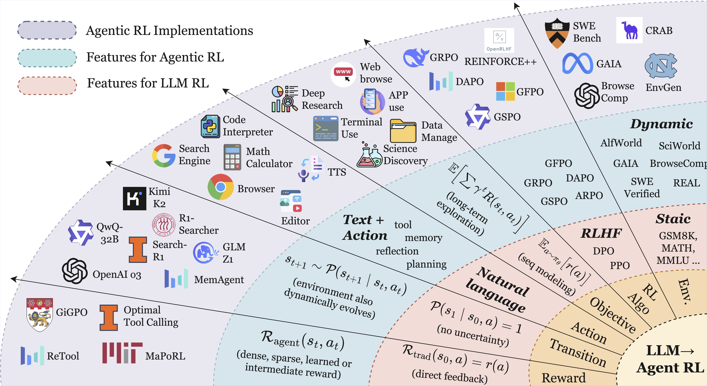

两者虽都属于 RL，但在潜在假设、任务结构与决策粒度上存在根本差异。本节形式化 RLVR 与 Agentic RL 的 MDP 抽象。与本文并行的综述从 agentic RL 生态（[Zhang et al., 2025a](https://arxiv.org/abs/2509.02547)）与 RLVR 方法（[Zhang et al., 2025b](https://arxiv.org/abs/2509.08827)）角度做过整体梳理，本文聚焦"信用分配在哪一层、用什么信号"。

### Markov Decision Processes

RL 微调过程的 Markov 决策过程（MDP）可形式化为一个七元组 $\langle\mathcal{S},\mathcal{O},\mathcal{A},\mathcal{P},\mathcal{R},T,\gamma\rangle$，其中 $\mathcal{S}$ 表示状态空间，$\mathcal{O}$ 是 agent 的观测空间，$\mathcal{A}$ 表示动作空间，$\mathcal{R}$ 定义为奖励函数，$\mathcal{P}$ 封装状态转移概率，$T$ 表示任务视野，$\gamma$ 是折扣因子。将基于偏好的 RFT 与 Agentic RL 都表述为 MDP 或 POMDP，可澄清将 LLM 视为静态序列生成器与嵌入动态环境的可交互、可决策 agent 的理论含义。

**RLVR.** RLVR 的 RL 训练过程被形式化为一个退化的 MDP：

$$
\langle\mathcal{S}_{\text{rlvr}},\mathcal{A}_{\text{rlvr}},\mathcal{P}_{\text{rlvr}},\mathcal{R}_{\text{rlvr}},T=1,\gamma=1\rangle.
$$

**Agentic RL.** Agentic RL 的 RL 训练过程被建模为一个 POMDP：

$$
\langle\mathcal{S}_{\text{agent}},\mathcal{A}_{\text{agent}},\mathcal{P}_{\text{agent}},\mathcal{R}_{\text{agent}},\gamma,\mathcal{O}\rangle.
$$

其中 agent 基于状态 $s_{t}\in\mathcal{S}_{\text{agent}}$ 收到观测 $o_{t}=O(s_{t})$。RLVR 与 Agentic RL 之间的主要区别列于下表。简而言之，RLVR 在全观测下的固定数据集中优化输出句子的序列，而 Agentic RL 则在部分观测下、在可变环境中优化语义级行为。

| Concept | RLVR | Agentic RL |
| --- | --- | --- |
| $\mathcal{S}$: State space | $\{s_{0}\}$（单个 prompt）；episode 立即终止 | $s_{t}\in\mathcal{S}_{\text{agent}}$；$o_{t}=O(s_{t})$；视野 $T>1$ |
| $\mathcal{A}$: Action space | 纯文本序列 | $\mathcal{A}_{\text{text}}\cup\mathcal{A}_{\text{action}}$ |
| $\mathcal{P}$: Transition | 确定性地转移到终止状态 | 动态转移函数 $P(s_{t+1}\mid s_{t},a_{t})$ |
| $\mathcal{R}$: Reward | 单一标量 $r(a)$ | 分步 $R(s_{t},a_{t})$；结合稀疏任务奖励与稠密子奖励 |
| $J(\theta)$: Objective | $\mathbb{E}_{a\sim\pi_{\theta}}[r(a)]$ | $\mathbb{E}_{\tau\sim\pi_{\theta}}[\sum_{t}\gamma^{t}R(s_{t},a_{t})]$ |

### Environment State

**RLVR.** 在训练过程中，每个 episode 从单个 prompt 状态 $s_{0}$ 开始；模型给出一次响应后 episode 立即终止。形式上，底层 MDP 退化为视野 $T=1$ 的*单步*决策问题。状态空间缩减为单个静态 prompt 输入：

$$
\mathcal{S}_{\text{rlvr}}=\{\text{prompt}\}.
$$

**Agentic RL.** LLM agent 在 POMDP 中跨多个时间步行动。令 $s_{t}\in\mathcal{S}_{\text{agent}}$ 表示完整世界状态，LLM agent 基于当前状态获得观测 $o_{t}=\mathcal{O}(s_{t})$。LLM agent 基于当前观测 $o_{t}$ 选择动作 $a_{t}$，状态随时间演变：

$$
s_{t+1}\sim P(s_{t+1}\mid s_{t},a_{t}).
$$

在此过程中，agent 累积中间信号，例如检索到的工具结果、用户消息或环境反馈。因此其交互本质上是动态且时间上扩展的。

### Action Space

在 Agentic RL 设定下，LLM 的动作空间包含两个不同的子空间：

$$
\mathcal{A}_{\text{agent}}=\mathcal{A}_{\text{text}}\cup\mathcal{A}_{\text{action}}.
$$

其中 $\mathcal{A}_{\text{text}}$ 表示通过自回归解码发射的自由格式自然语言 token 空间，而 $\mathcal{A}_{\text{action}}$ 表示抽象、非语言性动作的空间，通常在输出流中由特殊 token `<action_start>` 和 `<action_end>` 界定。根据任务需要，这些动作可能调用外部工具（如 `call("search", "Einstein")`）或与环境交互（如 `move("north")`）。

值得注意的是，$\mathcal{A}_{\text{action}}$ 是递归构造的，元素 $a\in\mathcal{A}_{\text{action}}$ 本身可能表示原始动作序列 $(a_{1},\dots,a_{k})$，从而在同一空间中统一了原始动作与复合动作。

形式上，这两个子空间在语义与功能角色上不同：$\mathcal{A}_{\text{text}}$ 定义了面向人类或机器解释、但不直接改变外部状态的输出空间；而 $\mathcal{A}_{\text{action}}$ 定义了与环境交互的行为空间，这些行为要么 (i) 通过工具调用获取新信息，要么 (ii) 修改物理或模拟环境的状态。这种区分使得单一策略能够在同一 RL 表述内联合建模语言生成与环境交互。

### Transition Dynamics

**RLVR.** 在 RLVR 中，转移动态是确定性的：一旦动作被采取，下一状态便被决定：

$$
\mathcal{P}(s_{1}\mid s_{0},a)=1,\quad\text{where there is no uncertainty.}
$$

**Agentic RL.** 在 Agentic RL 中，环境在不确定性下按下式演变：

$$
s_{t+1}\sim\mathcal{P}(s_{t+1}\mid s_{t},a_{t}),\quad a_{t}\in\mathcal{A}_{\text{text}}\cup\mathcal{A}_{\text{action}}.
$$

文本动作 $(\mathcal{A}_{\text{text}})$ 生成自然语言输出而不改变环境状态。由 `<action_start>` 与 `<action_end>` 界定的结构化动作 $(\mathcal{A}_{\text{action}})$ 可以查询外部工具或直接改变环境。这种序列化表述与 RLVR 的一次性映射形成对比，支持策略在通信、信息获取与环境操作之间迭代组合。

### Reward Function

**RLVR.** RLVR 通常采用可验证响应正确性的奖励函数，可通过基于规则的验证器或神经网络参数化的奖励模型来实现。无论实现方式如何，其核心遵循以下方程：

$$
\mathcal{R}_{\text{rlvr}}(s_{0},a)=r(a).
$$

其中 $r:\mathcal{A}\!\to\!\mathbb{R}$ 是由人类或 AI 偏好模型给出的标量分数，不含中间反馈。

**Agentic RL.** LLM agent 的奖励函数基于下游任务：

$$
\mathcal{R}_{\text{agent}}(s_{t},a_{t})=\begin{cases}r_{\text{task}}&\text{on task completion},\\[2.0pt]
r_{\text{sub}}(s_{t},a_{t})&\text{for step-level progress},\\[2.0pt]
0&\text{otherwise}.\end{cases}
$$

允许稠密、稀疏或学习得到的奖励（*例如*单元测试通过、符号验证器成功）。

### Learning Objective

**RLVR.** RLVR 的优化目标是在策略 $\pi_{\theta}$ 下最大化响应奖励：

$$
J_{\text{rlvr}}(\theta)=\mathbb{E}_{a\sim\pi_{\theta}}\bigl[r(a)\bigr].
$$

无需折扣因子；优化类似于最大期望奖励序列建模。

**Agentic RL.** Agentic RL 的优化目标是最大化折扣奖励：

$$
J_{\text{agent}}(\theta)=\mathbb{E}_{\tau\sim\pi_{\theta}}\left[\,\sum_{t=0}^{T-1}\gamma^{t}R_{\text{agent}}(s_{t},a_{t})\right],\qquad 0<\gamma<1.
$$

这一目标通过 policy-gradient 或 value-based 方法优化，并伴随探索与长期信用分配。

RLVR 关注不含显式规划、工具调用或环境反馈的单轮文本质量对齐，而 Agentic RL 涉及多轮规划、自适应工具调用、有状态记忆与长视野信用分配，使 LLM 得以作为自主决策 agent 运行。

### Episode / Turn / Token: Three Granularities

同一条 agentic 轨迹可在三种粒度上观察：

$$
\underbrace{\tau}_{\text{Episode}} = \underbrace{[\text{Turn}_1, \ldots, \text{Turn}_T]}_{\text{Turn level}} = \underbrace{[a_{1,1}, a_{1,2}, \ldots]}_{\text{Token level}}
$$

- **Episode**：一次完整任务，10–100+ turn、$10^5$–$10^6$ token。
- **Turn**：一次"LLM 响应 + 工具调用 + 环境反馈"，harness 下最自然的原子单元。
- **Token**：单个生成 token，RLVR 的最细粒度。

[GRPO](https://arxiv.org/abs/2402.03300) 在 Episode 层给统一优势；标准 PPO 通过 value function 在 Token 层提供隐式 baseline；Agentic RL 的核心问题是**如何把信号下沉到 Turn 甚至更细的合理粒度上**。

## Structural Differences Between RLVR and Agentic RL

Preliminary 已给出 RLVR 与 Agentic RL 在 MDP / POMDP 层面的形式化差异。本节说明这些差异从何而来：为什么 Agentic RL 具有下述四点特质，而 RLVR 不具有。

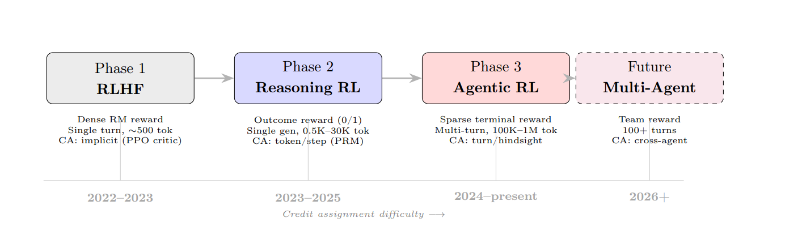

**（1）随机环境转移。**

- **RLVR.** 单步 MDP（$T=1$），一次映射即到达终止状态，转移随机性无从谈起；早期 RLVR 集中于数学等可自动判分的推理任务，本身也不涉及外部环境。
- **Agentic RL.** 多步交互引入策略之外的实体：文件系统被并发进程改动、检索 API 的返回随索引与网络波动、代码解释器在资源限制或含随机性库下结果不唯一。转移随机性来自"环境独立于策略演化"。

**（2）部分可观测。**

- **RLVR.** 早期 RLVR 的数学与推理任务上，状态即 prompt 加已生成前缀，模型输入即完整状态，属于全观测。
- **Agentic RL.** 完整状态包含 agent 无法直接访问的部分——远端数据库、他者内部状态、被 tool 抽象掉的底层系统状态；agent 只能通过 stdout、API 返回、页面渲染文本等通道获得状态的有损投影。远端服务无法全量下发状态，tool 抽象本身也是有限的信息压缩。

**（3）异构动作。**

- **RLVR.** 动作是词表 $\mathcal V$ 上的单个 token，类型同质。
- **Agentic RL.** 动作空间 $\mathcal A_{\text{text}}\cup\mathcal A_{\text{action}}$ 由两个功能不同的子空间构成：$\mathcal A_{\text{text}}$ 只写入对话流，$\mathcal A_{\text{action}}$ 调用工具或改动外部状态。同一轨迹因此混合了自然语言 token、检索 query、bash 命令、格式符号等成分，它们对任务结果的贡献可以相差数个数量级。

**（4）不可验证的中间状态。**

- **RLVR.** 单步任务，可谈论的"中间"只在响应内部的 token 前缀层面；早期 RLVR 的数学题在这一层面具有形式化正确性判据——某段前缀所代表的推理步骤是否有效可由 CAS 或规则 verifier 检查，PRM 正是据此把终端奖励稠密化到中间 token 段。
- **Agentic RL.** 中间动作是 tool call 返回、config 修改、页面跳转，本身没有独立于任务目标的正误定义：某条 query 好坏须通过它对最终答案的贡献间接评估。中间状态不可验证是任务定义的结果，而非奖励设计的疏漏。

## Agentic RL: The Algorithmic Perspective

本视角关注**算法骨架**——IS 在哪个粒度做、advantage 怎么从 $\{r^{i,k}\}$ 聚合——不讨论 reward 来源（留到 [Signal Perspective](#agentic-rl-the-signal-perspective) 的 PRM 一节）。早期 [POAD](https://arxiv.org/abs/2405.15821)（把一次 LLM 响应视为单个语义动作以缩短 horizon）与 [StepAgent](https://arxiv.org/abs/2411.03817)（step-wise RL + 模仿–强化两阶段）确立了可行性；此后骨架分化集中在"IS 粒度 $u$ 选 token / chunk / turn，advantage 如何在 $u$ 上聚合"。

### Algorithm Families: Overview

本综述涉及的 policy-gradient 算法按"是否用 critic、是否用组比较、advantage 粒度"归为三家。下表遵照 [Zhang et al., 2025a](https://arxiv.org/abs/2509.02547) Table 2 的 Method / Objective Type / Key Mechanism 三列格式，把出现过的算法按家族梳理，方便与后文对应到骨架方程。DPO / preference-optimization 家族（如 [DPO](https://arxiv.org/abs/2305.18290)、[Step-DPO](https://arxiv.org/abs/2406.18629)）不进入 turn-level CA 主线，此处略过；[SWEET-RL](https://arxiv.org/abs/2503.15478) 虽用 DPO 接口但引入 privileged critic，独立成节讨论。

| Method | Objective Type | Key Mechanism |
|---|---|---|
| _REINFORCE family (critic-free, no group)_ | | |
| [REINFORCE](https://arxiv.org/abs/1707.06347) (Williams, 1992) | Policy gradient | Baseline 归一化的对数似然梯度 |
| [RLOO](https://arxiv.org/abs/2402.14740) (Ahmadian et al., 2024) | Policy gradient | Episode-level leave-one-out baseline |
| [POAD](https://arxiv.org/abs/2405.15821) (Wen et al., 2024) | Policy gradient | 把一次响应视为单个语义动作 |
| [StepAgent](https://arxiv.org/abs/2411.03817) (Deng et al., 2024) | Policy gradient | Step-wise RL + 模仿→强化两阶段 |
| [IPA](https://arxiv.org/abs/2512.24873) (ROLL Team, 2025) | Policy gradient | Chunk-level IS 与 advantage |
| _PPO family (with critic)_ | | |
| [PPO](https://arxiv.org/abs/1707.06347) (Schulman et al., 2017) | Policy gradient | 策略比 clip + critic-based advantage |
| [GAE](https://arxiv.org/abs/1506.02438) (Schulman et al., 2016) | Advantage estimator | $\lambda$-加权的 TD 残差组合 |
| [VinePPO](https://arxiv.org/abs/2410.01679) (Kazemnejad et al., 2025) | Policy gradient | 用 MC rollout 替代 critic 做无偏 value |
| [Turn-PPO](https://arxiv.org/abs/2512.17008) (Li et al., 2025b) | Policy gradient | Turn-level critic + turn-level GAE |
| [SWEET-RL](https://arxiv.org/abs/2503.15478) (Zhou et al., 2025) | DPO-style + privileged critic | Critic 训练时可见 reference solution |
| [CriticSearch](https://arxiv.org/abs/2511.12159) (Zhang et al., 2025c) | Frozen retrospective critic | Critic 事后打分，不参与梯度更新 |
| _GRPO family (critic-free, group-relative)_ | | |
| [GRPO](https://arxiv.org/abs/2402.03300) (Shao et al., 2024) | Group-relative PG | Episode-level 组内标准化替代 critic |
| [GiGPO](https://arxiv.org/abs/2505.10978) (Feng et al., 2025) | Group-relative PG | Episode 组 + anchor-state 组双层加权 |
| [Step-GRPO](https://arxiv.org/abs/2603.10165) (OpenClaw, 2026) | Group-relative PG | 同 step-index 跨 rollout 列内标准化 |
| [LaRe](https://arxiv.org/abs/2412.11120) (Qu et al., 2025) | Group-relative PG | 用 LLM 从 episode 抽 latent reward 投射每步 |
| [SPO](https://arxiv.org/abs/2505.23564) (Guo et al., 2025) | Group-relative PG | Segment-level baseline，critic-free |
| [RAGEN](https://arxiv.org/abs/2504.20073) (Wang et al., 2025d) | Group-relative PG | 高方差 turn 降权，防 echo trap |
| [CARL](https://arxiv.org/abs/2512.04949) (Shen et al., 2025) | Group-relative PG | Entropy 阈值 mask 非关键 token |
| [MicroCoder-GRPO](https://arxiv.org/abs/2603.07777) (MicroCoder, 2026) | Group-relative PG | 截断 token mask + 多样性温度 |

*Table 1: 本综述涉及算法按 REINFORCE / PPO / GRPO 三家族梳理。三家族的分界依据是骨架层面的两个二值选择——是否维护 critic、是否用组比较替代 baseline。*

**统一骨架。** 对 prompt $x$ 采样 $G$ 条 rollout $\{\tau^i\}_{i=1}^G$，第 $i$ 条分 $T^i$ 个 turn，turn $k$ 的动作为 $y^{i,k}$（token $y^{i,k,t}$），历史 $h^{i,k}$，outcome $R^i$。所有方法共享同一个 clipped 目标：

$$
\mathcal L(\theta) = -\mathbb E\sum_{(i,u,t)}\min\!\bigl(\rho^{i,u,t}\hat A^{i,u},\ \mathrm{clip}(\rho^{i,u,t},1-\epsilon,1+\epsilon_{\text{hi}})\,\hat A^{i,u}\bigr) + \beta_{\text{KL}}\,\mathrm{KL}[\pi_\theta\|\pi_{\text{ref}}].
$$

这条式子看上去很密，但只需要理解三样东西：

**① $u$ 是"advantage 单元"——同一个 advantage 标量覆盖多长一段。** 一条 rollout 包含成千上万个 token，梯度更新时并不总给每个 token 单独算一个 advantage。多数方法会选一个粒度，让**同一段里所有 token 共用一个 $\hat A$**。$u$ 就是这个"段"，$\hat A^{i,u}$ 是给这段打的分。可能的取值：

| $u$ 取什么 | 一个 $\hat A$ 覆盖多少 | 代表算法 |
|---|---|---|
| `episode` | 整条 rollout（可能上万 token）共用一个 $\hat A^i$ | RLOO / GRPO |
| `turn` | 每个 turn 一个 $\hat A^{i,k}$ | Turn-PPO / GiGPO / Step-GRPO |
| `chunk` | 每个语义 chunk 一个 $\hat A^{i,c}$ | IPA |
| `token` | 每个 token 一个 $\hat A^{i,t}$ | 原始 token-level PPO |

$u$ 越粗，同段所有 token 拿到同一个信用，"到底哪个 token 有功"就分不清；$u$ 越细，方差越大但归因更精细。**这就是所谓 "advantage 粒度"。**

**② $\rho^{i,u,t}$ 是 importance sampling ratio——修正 off-policy 偏差用的。** rollout 是用采样时冻结的 $\pi_{\text{old}}$ 生成的，但梯度要更新当前 $\pi_\theta$。二者对同一个 token 给出不同概率，要乘上这个比值才无偏。**上标读法**：$i$ 是第几条 rollout，$u$ 定位这个 token 属于哪个单元，$t$ 是单元内部的第几个 token——$(i,u,t)$ 联合起来唯一确定一个 token 的位置。展开就是

$$
\rho^{i,u,t}=\frac{\pi_\theta(y^{i,u,t}\mid \text{history})}{\pi_{\text{old}}(y^{i,u,t}\mid \text{history})}.
$$

**③ IS 粒度 = ratio 在哪一级聚合。** 有的方法**逐 token 各算一个 ratio**（token-level IS），有的方法**把一整段里所有 token 的概率乘起来当成一个联合 ratio**（chunk/turn-level IS）——后者相当于把上标 $t$ 求积掉，只剩 $\rho^{i,u}$。粒度粗，方差低、clip 稳，但一次 clip 决定整段命运；粒度细，反之。

方法差异就落在这**两列**——IS 粒度、advantage 粒度：

| Family | 代表算法 | IS 粒度 | advantage 粒度 | $\hat A$ 聚合方式 |
|---|---|---|---|---|
| REINFORCE | RLOO | token | episode | 跨 rollout 的 LOO 均值 |
| REINFORCE | IPA | **chunk**（几何平均） | chunk | $\gamma^\Delta R_{\text{final}}$ 折扣广播（无 baseline） |
| PPO | Turn-PPO | turn | turn | critic + turn-level GAE |
| GRPO | GiGPO | token | turn | episode 组 + anchor-state 组的加权 |
| GRPO | **Step-GRPO** | token | turn | 同 $k$ 列内跨 rollout 标准化 |

沿这张表从上到下方差控制代价递增、对 $r^{i,k}$ 尺度稳定性的要求也递增。下面各子节里，$\rho^{i,t}$ 是 $\rho^{i,u,t}$ 在 $u$ 只取单一值时的省略写法（比如 RLOO 里 $u$ 恒等于 episode），不必单独当成新符号。

### REINFORCE-family

**[REINFORCE++](https://arxiv.org/abs/2501.03262)**（Hu, 2025）—— **token-level IS，token-level advantage（$u=\text{token}$）**。作为 REINFORCE-family 在 LLM RL 上的对照 baseline：去掉 critic、保留 PPO 式 clipped IS，token-level advantage 直接用"未来 return 减 batch baseline"再做归一化：

$$
\rho^{i,t}=\frac{\pi_\theta(y^{i,t}\mid h^{i,<t})}{\pi_{\text{old}}(y^{i,t}\mid h^{i,<t})},\qquad
G^{i,t}=\sum_{l\ge 0}\gamma^{l}\,r^{i,t+l},\qquad
\hat A^{i,t}=\frac{G^{i,t}-b}{\mathrm{std}(G)+\epsilon},
$$

其中 baseline $b$ 取 batch 内 return 均值（或滑动均值）。Loss 沿用 PPO clipped surrogate：

$$
\mathcal L_{\text{R++}}(\theta)=-\mathbb E\sum_{i,t}\min\!\bigl(\rho^{i,t}\hat A^{i,t},\ \mathrm{clip}(\rho^{i,t},1-\epsilon,1+\epsilon)\,\hat A^{i,t}\bigr).
$$

它相对朴素 REINFORCE 的差别是把"跨样本 baseline"从 group 内均值换成 batch 内标准化，相对 PPO 的差别是不训 critic——把 GRPO 的组比较归一改成 batch 级归一。作为 REINFORCE-family 骨架，方差比 RLOO 高、偏差更小。

**[RLOO](https://arxiv.org/abs/2402.14740)**（REINFORCE Leave-One-Out, Ahmadian et al., 2024）—— **token-level IS，episode-level advantage（$u=\text{episode}$）**。IS 比例逐 token 计算，advantage 在 episode 粒度上用 leave-one-out 组比较得到，episode 内所有 token 共享同一标量：

$$
\rho^{i,t}=\frac{\pi_\theta(y^{i,t}\mid h^{i,<t})}{\pi_{\text{old}}(y^{i,t}\mid h^{i,<t})},\qquad
\hat A^i = R^i - \tfrac{1}{G-1}\sum_{j\neq i} R^j,\qquad u=\text{episode},
$$

$$
\mathcal L_{\text{RLOO}}(\theta)=-\mathbb E\sum_{i,t}\min\!\bigl(\rho^{i,t}\hat A^i,\ \mathrm{clip}(\rho^{i,t},1-\epsilon,1+\epsilon)\,\hat A^i\bigr).
$$

它和 [GRPO](https://arxiv.org/abs/2402.03300) 骨架唯一的差别是"LOO 均值 vs. 组标准化"，仍停留在 trajectory 层——下面两类方法的起点。

**[IPA](https://arxiv.org/abs/2512.24873)**（Interaction-Perceptive Agentic Policy Optimization, 2025.12）—— **chunk-level IS，chunk-level return（$u=\text{chunk}$）**。把 IS 比例与 credit 都从 token 抬到 semantic interaction chunk——介于 token 与 turn 之间的语义单元（一次 reasoning-action segment 或一组紧密耦合的 tool-call + observation），不绑死 turn 边界。记第 $i$ 条 rollout 被切成 $\{c_1,\dots,c_{K^i}\}$，chunk $c_k$ 内 token 序列 $y^{i,k,t}$、历史 $h^{i,k}$。

**Credit 构造（Eq. 7）——没有 baseline，只用 discounted chunk return。** 论文里 $\hat A$ 位置直接放**终局奖励按 chunk 距离折扣**后广播给每个 chunk：

$$
G^{i,k}=\gamma^{\Delta(k)}\,R^i_{\text{final}},
$$

其中 $R^i_{\text{final}}$ 是终局任务奖励（unit-test 全过才给正号），$\Delta(k)$ 是 chunk $c_k$ 到"发奖 chunk"之间的 chunk 数。**中间 chunk 拿到的不是 0，而是被 $\gamma^\Delta$ 削弱的终局信号**——因为折扣在 chunk 粒度而非 token 粒度上作用、$K\ll T_{\text{token}}$，避免了 token-level $\gamma$ 指数消失的问题。IPA 不做"$r-b$"的方差缩减，只靠 $\gamma$ 塑形。

**IS 用几何平均（Eq. 8）** ——把 chunk 内 token log-prob 差取平均而非直接乘积，抑制离群 token、避免联合 ratio 爆炸：

$$
\rho^{i,k}=\Bigl(\prod_{t\in c_k}\frac{\pi_\theta(y^{i,k,t}\mid h^{i,k},y^{i,k,<t})}{\pi_{\text{old}}(\cdot)}\Bigr)^{1/|c_k|}.
$$

**Loss 形式是 REINFORCE 变体（不是 PPO-clip 的 $\min$），正负样本分开处理（Eq. 9）：**

$$
\mathcal L_{\text{IPA}}(\theta)=-\mathbb E\Bigl[\underbrace{\sum_{i\in\mathcal T^+,k}G^{i,k}\,m^{i,k}\,\nabla\!\log\pi_\theta(\cdot)}_{\text{正样本：SL-style，不加 IS}} + \underbrace{\sum_{i\in\mathcal T^-,k}[\rho^{i,k}]_{\text{clip}}\,G^{i,k}\,m^{i,k}\,\nabla\!\log\pi_\theta(\cdot)}_{\text{负样本：chunk-level clipped IS}}\Bigr],
$$

其中 $m^{i,k}$ 是 chunk-level mismatch mask（rollout backend 与 train backend 概率差过大时置 0，Eq. 9 原文用 $[\cdot]_{\text{10}}$ 表示 clip 阈值）。正例轨迹当监督样本用、不加 IS 修正；只有负例走 chunk-level clipped IS——这与 GRPO/PPO 的对称 clip 明显不同。

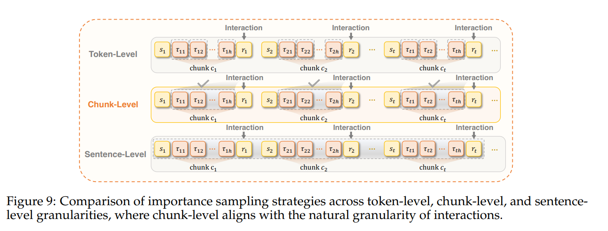

与下文 Turn-PPO / GiGPO 的本质差异是**不把 turn 当天然原子单元**——琐碎 turn 合并、复杂 turn 切细；IS 累积也从 token 量级（$10^5$+）压到 chunk 量级。开放问题：chunk 边界如何鲁棒识别（现靠启发式或 LLM 判定）？

### PPO-family

**[PPO](https://arxiv.org/abs/1707.06347)**（Schulman et al., 2017）—— **token-level IS，token-level advantage（$u=\text{token}$）**。作为对照 baseline：$\rho^{i,t}$ 逐 token 计算，critic $V_\phi(s^{i,t})$ 在 token 状态 $s^{i,t}=(x,y^{i,<t})$ 上学 value，TD 残差与 [GAE](https://arxiv.org/abs/1506.02438) 均在 token 粒度：

$$
\rho^{i,t}=\frac{\pi_\theta(y^{i,t}\mid s^{i,t})}{\pi_{\text{old}}(y^{i,t}\mid s^{i,t})},\qquad
\delta^{i,t}=r^{i,t}+\gamma V_\phi(s^{i,t+1})-V_\phi(s^{i,t}),\qquad
\hat A^{i,t}=\sum_{l\ge 0}(\gamma\lambda)^l\,\delta^{i,t+l}.
$$

$$
\mathcal L_{\text{PPO}}(\theta)=-\mathbb E\sum_{i,t}\min\!\bigl(\rho^{i,t}\hat A^{i,t},\ \mathrm{clip}(\rho^{i,t},1-\epsilon,1+\epsilon)\,\hat A^{i,t}\bigr),\qquad
\mathcal L_V(\phi)=\tfrac12\,\mathbb E\sum_{i,t}\bigl(V_\phi(s^{i,t})-\hat V^{i,t}_{\text{target}}\bigr)^2.
$$

在 agentic 场景直接使用时，$r^{i,t}$ 通常只有轨迹末端一个非零终端奖励，中间 $r^{i,t}=0$，advantage 完全靠 critic 平滑；跨 $\sim\!10^5$ token 累积 IS ratio、只靠一个 sparse terminal signal 训 critic，是它退化的两个主因，也是下面变体要处理的问题。

**[Turn-PPO](https://arxiv.org/abs/2512.17008)**（EACL'26）—— **turn-level IS，turn-level advantage（$u=\text{turn}$）**。把多轮交互显式重构为 Turn-Level MDP，以完整 turn 作宏观动作；奖励也按 turn 维度给出——$r^{i,k}$ 是第 $i$ 条 rollout 第 $k$ 个 turn 结束后拿到的即时奖励（比如这一 turn 的 tool call 是否成功、单测通过数增量等）。critic $V_\phi(h^{i,k})$ 学 turn-level value（以历史 $h^{i,k}$ 为条件，与前文记号一致），TD 残差与 [GAE](https://arxiv.org/abs/1506.02438) 均在 turn 粒度：

$$
\rho^{i,k}=\prod_{t}\frac{\pi_\theta(y^{i,k,t}\mid h^{i,k},y^{i,k,<t})}{\pi_{\text{old}}(\cdot)},\qquad
\delta^{i,k}=r^{i,k}+\gamma V_\phi(h^{i,k+1})-V_\phi(h^{i,k}),\qquad \hat A^{i,k}=\sum_{l\ge 0}(\gamma\lambda)^l\delta^{i,k+l}.
$$

$$
\mathcal L_{\text{Turn-PPO}}(\theta)=-\mathbb E\sum_{i,k}\min\!\bigl(\rho^{i,k}\hat A^{i,k},\ \mathrm{clip}(\rho^{i,k},1-\epsilon,1+\epsilon)\,\hat A^{i,k}\bigr).
$$

critic 的回归 target 取 GAE 反推的 turn-level $\lambda$-return，MSE 损失（$\phi_\text{old}$ 是当前采样批次对应的旧 critic 参数）：

$$
\hat V^{i,k}_{\text{target}}=\hat A^{i,k}+V_{\phi_\text{old}}(h^{i,k}),\qquad
\mathcal L_V(\phi)=\tfrac12\,\mathbb E\sum_{i,k}\bigl(V_\phi(h^{i,k})-\hat V^{i,k}_{\text{target}}\bigr)^2.
$$

与 token-level PPO 相比，$\sum_{i,k}$ 的规模从 token 数量级（$\sim\!10^5$）落到 turn 数量级（$\sim\!10^2$），critic 训练点变稀，但每个点对应的历史 $h^{i,k}$ 是完整前缀，$V_\phi$ 通常挂在 actor backbone 上、一次 forward 抽取所有 turn 边界处的 value。

IS ratio 与 value 都从 token-level 抬到 turn-level，避免跨 $\sim\!10^2$ 轮 token-level IS 的方差爆炸；代价是 critic 需要在 turn 这个更粗的粒度上稳定回归。

**[TARL](https://arxiv.org/abs/2509.14480)**（Tan et al., 2025）—— **token-level IS，token-level advantage（$u=\text{token}$），turn-level reward 由 LLM judge 给出**。与 Turn-PPO 把 IS 与 value 一起抬到 turn 层不同，TARL 保留标准 token-level PPO 骨架（$\gamma=\lambda=1$），只重构 reward 来源：冻结 LLM judge 在完整轨迹加 ground-truth 上给每 turn 打三值 $r^{i,k}\in\{-1,0,+1\}$（major deviation / minor / clean，且每条轨迹至多一次 $-1$）。turn-level 信号通过 **per-turn assignment** 注入 token 序列——把 $r^{i,k}$ 挂在 turn $k$ 最后一个 agent token 上，其余 agent token 位置 immediate reward 为 0，终端 verifier reward $R(\tau^i)$ 挂在轨迹末尾：

$$
R^{i,k,t+1}=r^{i,k}\cdot\mathbb 1[t=L^{i,k}] + R(\tau^i)\cdot\mathbb 1[(i,k,t)=\text{traj end}].
$$

IS 与 advantage 均在 token 级：

$$
\rho^{i,k,t}=\frac{\pi_\theta(y^{i,k,t}\mid h^{i,k},y^{i,k,<t})}{\pi_{\text{old}}(\cdot)},\qquad
\delta^{i,k,t}=R^{i,k,t+1}+\gamma V_\phi(s^{i,k,t+1})-V_\phi(s^{i,k,t}),\qquad
\hat A^{i,k,t}=\sum_{l\ge 0}(\gamma\lambda)^l\,\delta^{i,k,t+l}.
$$

$$
\mathcal L_{\text{TARL}}(\theta)=-\mathbb E\sum_{i,k,t}\min\!\bigl(\rho^{i,k,t}\hat A^{i,k,t},\ \mathrm{clip}(\rho^{i,k,t},1-\epsilon,1+\epsilon)\,\hat A^{i,k,t}\bigr).
$$

原文实验里这一 per-turn assignment 训练迅速崩溃、比仅用 $R(\tau)$ 的 vanilla PPO 还差——作者归因为 judge 分带噪，把稀疏 spike 挂在 turn 边界让噪声通过每个 turn 处的 advantage 阶跃被 clip 放大；实际可用的变体退到"trajectory-level broadcast"（把 judge 与 verifier 融成一个 quantized 轨迹分数，均匀铺到所有 agent token），在 τ-bench Retail 上相对 vanilla PPO 提升 pass\^1 4.3 pt。**结论与 Turn-PPO 相反**：把 turn-level reward 塞进 token-level PPO 骨架时，粒度下沉到 turn 边界反而放大了 judge 噪声——把信号先离散化再 broadcast 回 trajectory 级更稳。

Turn-PPO 假定 critic 与 actor 对称观测；一条与之互补的思路是**非对称 AC**——让 critic 在训练时访问 actor 看不到的特权信息（ground truth、参考解、完整未来轨迹、编译器/单测输出），推理时只用 actor。这一思路在经典 RL 的 centralized-training-decentralized-execution 范式中已被验证；迁移到 LLM agent 的核心动机是：**长程任务的 value baseline 极难学，给 critic 一些"作弊"信号能显著降低梯度方差**。围绕这条思路，[SWEET-RL](https://arxiv.org/abs/2503.15478)（Meta/FAIR, 2025）、[CriticSearch](https://arxiv.org/abs/2511.12159)（2025）、[VinePPO](https://arxiv.org/abs/2410.01679)（Kazemnejad et al., 2025）三项工作从两个正交维度做出选择——**critic 拿到什么特权信息**、**critic 用多大**。

#### Critic Hindsight Information

指 critic 训练时被喂入的、actor 在推理时看不到的信号。三项工作各代表一类特权：

- **SWEET-RL —— 参考解**。训练时 critic 看到 reference solution，据此给 actor 的每个 turn 生成 step-wise chosen/rejected 信号；actor 仍只用标准观测。原文接口是 [DPO](https://arxiv.org/abs/2305.18290) 风格的偏好优化——critic 不显式训练 $V$/$Q$，而是直接输出偏好差；在 ColBench Backend 相对 MT-DPO 提升 6 个百分点。[Rafailov et al., 2024](https://arxiv.org/abs/2404.12358)（"From $r$ to $Q^\star$"）给出理论桥梁：DPO 式偏好差可被解释为隐式 Q 函数，因此这条 log-prob 差在形式上等价于 turn-level 价值。**开放接口**：把同一 privileged critic 输出 scalar value、接入标准 PPO 的 GAE，是尚未充分验证的路径。
- **CriticSearch —— 事后环境反馈**。面向 search agent 的 **retrospective critic**：critic 是一个**冻结**的 LLM，在每一轮搜索结束后基于特权信息（标准答案、参考文档）事后给该轮 retrieval 打分。三个要点：(i) critic 不参与梯度更新，规避 critic-actor 协同训练的不稳定；(ii) "retrospective" 意味着看到 turn 之后的环境反馈再打分，比 on-policy critic 更准；(iii) 适合 search / tool-use 这类**单 turn 效用可独立判定**的任务。
- **VinePPO —— 未来轨迹 rollout**。走另一个极端：完全去掉 critic，用 MC rollout 直接估计 $V(s)$。"特权信息" 是**从当前 state 继续采样多条 rollout 得到的实际未来 return**——这在训练时能拿到、推理时拿不到，与 privileged critic 精神一致。在数学推理这类**确定性环境**上验证有效。

**开放问题**：harness 场景下"特权信息"具体是什么——编译器输出、单测 pass/fail、git diff、文件系统快照——这些信号目前没有系统化 ablation；参考解 / 事后反馈 / MC rollout 这三类特权在长程 agentic 任务上谁更划算，也没有横向对比。

#### Critic Size

经典 PPO 的惯例是配同尺寸 critic（7B actor + 7B critic），训练成本翻倍。在非对称 AC 下这一约定值得重新审视，三项工作实际都用了不大于 actor 的 critic：

- **VinePPO** 用 $0$ 参数 critic——完全 MC 估计，是"最小 critic"极端，前提是环境确定性且能重复采样。
- **SWEET-RL / CriticSearch** 用不大于 actor 的 LLM 作 critic。理由是：特权信息（参考解 / 事后反馈）已经包含大量答案相关结构，critic 理论上**只需学一个低维评估函数**，不需要与 actor 同等表达能力。
- **反向考虑**：长程 agentic 下特权上下文（完整 trace、单测日志、git 历史）可能极长，critic 也许需要更大的 **context window** 而非更多参数——"critic 缩小"这条路的瓶颈可能在长度而非容量。

### GRPO-family

GRPO 用组比较替代 critic，搬到 turn 粒度的难点是**怎么在 step 上定义组**。作为对照，原版 **[GRPO](https://arxiv.org/abs/2402.03300)**（Shao et al., 2024）—— **token-level IS，episode-level advantage**：$\rho^{i,t}=\pi_\theta(y^{i,t}\mid h^{i,<t})/\pi_{\text{old}}(\cdot)$，$\hat A^i=(R^i-\mu)/(\sigma+\epsilon)$ 由组内标准化得到，episode 内所有 token 共享。下面两种把 advantage 下沉到 turn/step 但 IS 仍在 token。

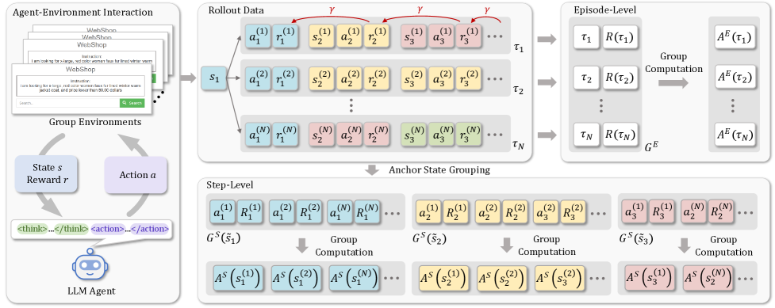

**[GiGPO](https://arxiv.org/abs/2505.10978)**（NeurIPS'25）—— **token-level IS，turn-level advantage（$u=\text{turn}$；episode 组 + anchor-state 组双层）**。anchor 把前缀相似的状态聚成一类，组内按未来 return 归一化得 $\hat A^{\text{step}}_{\mathrm{cluster}(i,k)}$，再与 episode 组 $\hat A^{\text{epi},i}$ 加权：

$$
\rho^{i,k,t}=\frac{\pi_\theta(y^{i,k,t}\mid h^{i,k},y^{i,k,<t})}{\pi_{\text{old}}(\cdot)},\qquad
\hat A^{i,k}=\hat A^{\text{epi},i}+\alpha\,\hat A^{\text{step}}_{\mathrm{cluster}(i,k)},
$$

$$
\mathcal L_{\text{GiGPO}}(\theta)=-\mathbb E\sum_{i,k,t}\min\!\bigl(\rho^{i,k,t}\hat A^{i,k},\ \mathrm{clip}(\rho^{i,k,t},1-\epsilon,1+\epsilon)\,\hat A^{i,k}\bigr).
$$

弱点：harness 下 observation 是 stdout/stderr 文本，前缀匹配几乎失效；组内样本稀疏时退化不稳。软替代 [LaRe](https://arxiv.org/abs/2412.11120)（AAAI'25）用 LLM 从 episodic 轨迹抽 latent reward 投射每一步，绕过前缀匹配但加 LLM 评估成本。

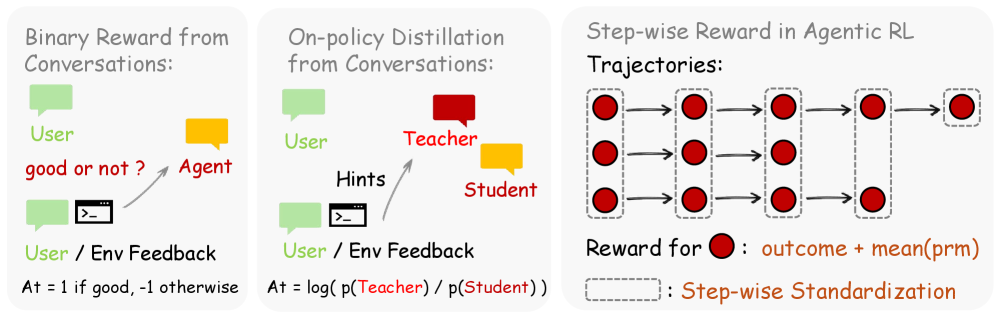

**Step-GRPO**（本综述给出的标签；[OpenClaw-RL](https://arxiv.org/abs/2603.10165) §3.3.2 提出，原文未命名, 2026）—— **token-level IS，turn-level advantage（$u=\text{turn}$；step-index 列内标准化）**。放弃状态聚类，改用同 prompt 的 $G$ 条 rollout 在第 $k$ 步动作天然构成一组。

**$r^{i,k}$ 怎么来（§3.3.2 原文，沿用 [RLAnything](https://arxiv.org/abs/2603.06888) 的整合方式）**：把 outcome reward 和 PRM 打分**直接相加**——

$$
r^{i,k}=o^i+\frac{1}{m}\sum_{j=1}^m r_j,\qquad r_j\stackrel{\text{iid}}{\sim}\text{PRM}(a^{i,k},s^{i,k+1}),
$$

其中 $o^i$ 是整条 rollout 的 outcome reward（RLVR 式可验证信号，比如 unit-test 通过 = 1），**同一 rollout 的所有 step 共享同一个 $o^i$**；PRM 是一个独立部署的过程奖励模型，输入"当前动作 + 下一状态"这对数据 $(a^{i,k}, s^{i,k+1})$，独立打分 $m$ 次后取平均（论文里 personal-agent 场景 PRM 输出 $\{+1,-1,0\}$ 三值，agentic 场景 §3.3 未明确取值范围，实现见其代码库）。这样每个 turn 都能拿到密集信号，同时保留终局的可验证锚点。

拿到 $r^{i,k}$ 后按 step-index 列内标准化：

$$
\rho^{i,k,t}=\frac{\pi_\theta(y^{i,k,t}\mid h^{i,k},y^{i,k,<t})}{\pi_{\text{old}}(\cdot)},\qquad
\hat A^{i,k}=\frac{r^{i,k}-\mu^k}{\sigma^k+\epsilon},\quad \mu^k=\tfrac1G\sum_{i}r^{i,k},\ \sigma^k=\sqrt{\tfrac1G\sum_i(r^{i,k}-\mu^k)^2}.
$$

$$
\mathcal L_{\text{Step-GRPO}}(\theta)=-\mathbb E\sum_{i,k,t}\min\!\bigl(\rho^{i,k,t}\hat A^{i,k},\ \mathrm{clip}(\rho^{i,k,t},1-\epsilon,1+\epsilon)\,\hat A^{i,k}\bigr).
$$

相比 GiGPO 显著简化：不需要状态相似度度量，只假设**同 $k$ 步的 rollout 大致可比**。开放问题：step-index grouping 隐含"轨迹对齐"假设——同 $k$ 步上不同 rollout 处于完全不同子任务（一条已开始测试、另一条还在 debug）时，列内标准化是否仍有意义？anchor 前缀匹配能否用语义 embedding 或 AST 替代？

## Agentic RL: The Process Reward Perspective

前一视角把 $r^{i,k}$ 当作外生输入；本视角集中讨论过程奖励**怎么来**——给定一条轨迹片段，$r^{i,k}$（turn 级）、$r^{i,s}$（segment 级）或 $r^{i,k,t}$（token 级）如何被算出来。我们只关心**过程奖励的数学形式**，不展开具体打分模型的训练 pipeline。LLM-as-judge（[TARL](https://arxiv.org/abs/2505.11821)、[Tan et al., 2025](https://arxiv.org/abs/2509.14480)）本质是把 $r^{i,k}$ 外包给一个强模型，没有独立的数学结构，此处略过。

### PRM Families: Overview

按注入粒度与所依赖的信号来源，本视角涵盖的方法可归为三档。下表沿用 [Algorithm Families 表](#algorithm-families-overview) 的三列格式，并补一列"下游 algorithm-family"——说明该 PRM 通常喂给哪一族上层算法作为 $r^{i,k}$。

| Method | 信号形式 | 依赖 / 关键机制 | 下游 algorithm-family |
|---|---|---|---|
| _Turn-level PRM_ | | | |
| [AgentPRM](https://arxiv.org/abs/2511.08325) (Xi et al., 2025) | $r^{i,k}=\alpha r_{\text{prom}}+(1-\alpha)\Delta r_{\text{prog}}$ | MC 成功率 + 任务定义 progress 差分 | PPO / GRPO |
| [IGPO](https://arxiv.org/abs/2510.14967) (Wang et al., 2025a) | gold answer 的条件对数似然增量 | 特权信号 $y^*$ + 参考模型 $\pi_{\text{ref}}$ | GRPO |
| [ITPO](https://arxiv.org/abs/2603.23550) (Wang et al., 2026) | $\log\pi_\phi-\log\pi_{\text{ref}}$ 再 softmax 归一 | 参考策略 log-prob 差 + outcome 归一化 | REINFORCE / GRPO / PPO |
| [iStar](https://arxiv.org/abs/2509.19199) (Liu et al., 2025) | DPO 目标训隐式 PRM，取策略 log-prob 差 | DPO 隐式奖励 | PPO / GRPO |
| _Segment-level PRM_ | | | |
| [AdaptSeg](https://arxiv.org/abs/2411.00809) (Li et al., 2024b) | $r^{i,s}=\hat V(h^{i,\text{end}(s)})-\hat V(h^{i,\text{start}(s)})$ | 学到的 critic + entropy / semantic-shift 切段 | PPO |
| [SPO](https://arxiv.org/abs/2505.23564) (Guo et al., 2025) | 同上，$\hat V$ 由组内 MC 均值给出 | critic-free，group baseline | GRPO |
| [Self-Guided PRO](https://arxiv.org/abs/2507.01551) (Fei et al., 2025) | 用相同思想重定义 step-wise advantage | 同 SPO 系 | GRPO |
| _Token-level Reward Redistribution_ | | | |
| [RED](https://arxiv.org/abs/2411.08302) (Li et al., 2024a) | $r^{i,k,t}=w^{i,k,t}\cdot R^i$，$w$ 由网络拟合 | reward redistribution 网络 | PPO / GRPO |
| [T-REG](https://arxiv.org/abs/2412.02685) (Zhou et al., 2024b) | 同上，$w$ 从偏好差读出 | DPO / 偏好优化框架内正则 | DPO |
| [CAPO](https://arxiv.org/abs/2508.02298) (Xie et al., 2025) | 同上，$w$ 由 generative CA 网络生成 | 生成式 CA | PPO / GRPO |

*Table 2: PRM 方法按注入粒度分档，并标注其下游对接的 algorithm-family。粒度越粗（turn），对轨迹语义边界的假设越强、方差越小；越细（token），越易被高频琐碎位置稀释。*

### Turn-level PRM

Turn-level PRM 把 outcome-only 信号"下沉"到每一 turn，分歧在于**用什么信号**来估计 $r^{i,k}$：环境侧的 MC 与 progress 标量、特权 gold answer、还是策略自身的 log-prob 差。

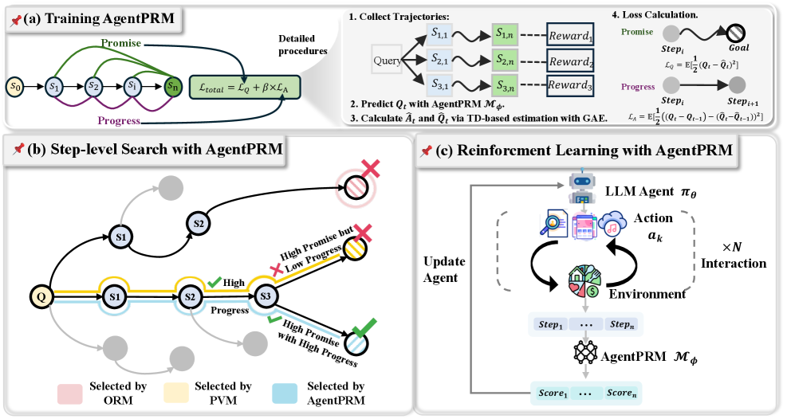

**MC + progress（[AgentPRM](https://arxiv.org/abs/2511.08325)，2025）。** 假设环境允许 (i) 从任意中间历史 $h^{i,k}$ 继续 rollout 以估计 MC 成功率，(ii) 任务本身给出 progress 标量 $g(\tau^i_{1:k})$（如子目标数、单测通过比例）。两个 head 分别学：

$$
r^{i,k}_{\text{prom}}=\hat{\mathbb P}[\,\text{success}\mid h^{i,k}\,],\qquad r^{i,k}_{\text{prog}}=\hat{\mathbb E}\bigl[\,g(\tau^i_{1:k})\mid h^{i,k}\,\bigr].
$$

promise head 沿用 Math-Shepherd 的 MC 训练方式（agent 版），progress head 直接监督到任务完成度标量。接入上层算法时取

$$
r^{i,k}=\alpha\,r^{i,k}_{\text{prom}}+(1-\alpha)\bigl(r^{i,k}_{\text{prog}}-r^{i,k-1}_{\text{prog}}\bigr),
$$

progress 差分使"零和"直接对应"这一 turn 没进步"。

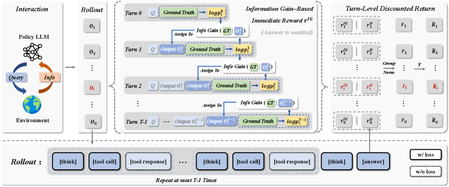

**特权信号（[IGPO](https://arxiv.org/abs/2510.14967)，2025）。** 假设训练时可访问 gold answer $y^*$ 与固定参考模型 $\pi_{\text{ref}}$。把 turn-level 信用定义为 gold answer 的条件对数似然增量：

$$
r^{i,k}=\log P_{\pi_{\text{ref}}}(y^*\mid h^{i,k+1})-\log P_{\pi_{\text{ref}}}(y^*\mid h^{i,k}).
$$

含义：这一 turn 让 $\pi_{\text{ref}}$ 对 $y^*$ 的信念升高多少。形式上是 KL 分解的逐步贡献——turn-aligned、可微、累加到 $R^i=\log P(y^*\mid h^{i,T})-\log P(y^*\mid\emptyset)$。因为需要 $y^*$，本质上是**特权 PRM**。

**隐式信号（[ITPO](https://arxiv.org/abs/2603.23550) 与 [iStar](https://arxiv.org/abs/2509.19199)，2025–2026）。** 假设不需要 $y^*$、也不需要 value model，只要有一个参考策略 $\pi_{\text{ref}}$，一 turn "好不好" 就用**策略自身 vs 参考策略的 log-prob 差**代理：

$$
\mathcal R_\phi^{i,k}=\log\pi_\phi(y^{i,k}\mid h^{i,k})-\log\pi_{\text{ref}}(y^{i,k}\mid h^{i,k}),
$$

再做尺度归一化使 per-turn 和严格等于 outcome $R^i$：

$$
\tilde{\mathcal R}_\phi^{i,k}=R^i\cdot\frac{\exp(\mathcal R_\phi^{i,k}/T)}{\sum_{k'}\exp(\mathcal R_\phi^{i,k'}/T)}.
$$

softmax 归一有两个作用：(i) $\sum_k\tilde{\mathcal R}_\phi^{i,k}=R^i$ 使其作为 $r^{i,k}$ 输入任何 turn-level 算法都与 outcome-only 基线接口相容；(ii) 保持尺度稳定，对需要 value 回归的 Turn-PPO 尤为关键。iStar 走相关路线：用 DPO 目标训隐式 PRM，step-level reward 取两个策略 log-prob 差，再叠加 episode advantage 接入 PPO / GRPO。

### Segment-level PRM

Turn 边界与"决策语义边界"并不总是对齐——一个 turn 可能包含多个决策，多个琐碎 turn 也可能等价于一个决策。Segment-level PRM 先按语义信号（entropy 峰、topic shift、tool 调用等）把连续 token 切成 segment $\{s_1,\dots,s_M\}$，再在每个 segment **首尾状态的 value 差**上定义 reward：

$$
r^{i,s}=\hat V(h^{i,\text{end}(s)})-\hat V(h^{i,\text{start}(s)}).
$$

直观上，若一个 segment 让"离目标的距离"缩小，$\hat V$ 就该升高，差分即该 segment 的贡献——本质是 GAE 的 TD 残差搬到 segment 粒度。$\hat V$ 的来源决定具体方法：

- [AdaptSeg](https://arxiv.org/abs/2411.00809)（2025）：学一个 critic，切段准则用 entropy / semantic-shift；
- [SPO](https://arxiv.org/abs/2505.23564)（2025）：critic-free，$\hat V$ 用同组其他 rollout 从相近位置继续的未来 return 均值（MC + group baseline，GRPO 风格）；
- [Self-Guided PRO](https://arxiv.org/abs/2507.01551)：同思想，用来重新定义 step-wise advantage。

形式上，segment 层与 IPA 的 chunk 层是同一件事的不同名字——**粒度选择本身就是一种 PRM 设计**。

### Token-level Reward Redistribution

Token-level 方案把 outcome $R^i$ 按一组学到的权重 $w^{i,k,t}$（$\sum_{k,t}w^{i,k,t}=1$）归因回每个 token：

$$
r^{i,k,t}=w^{i,k,t}\cdot R^i.
$$

$w$ 从哪来是各方法的分水岭：

- [RED](https://arxiv.org/abs/2411.08302)：训练一个 reward redistribution 网络直接拟合 $w$；
- [T-REG](https://arxiv.org/abs/2412.02685)：在 DPO / 偏好优化框架内加 token-level 正则，从偏好差里读出 $w$；
- [CAPO](https://arxiv.org/abs/2508.02298)：用 generative CA 网络直接生成 $w$。

**局限**：$10^5$+ token 的超长 agentic 轨迹上，$w$ 极易被高频琐碎 token 稀释——这正是 IPA 抬到 chunk、AdaptSeg / SPO 抬到 segment 的动机。粒度过细时方差与噪声反而压过信号。

## Agentic RL: The Engineering Perspective

前两视角讨论的是"在哪一层做 CA、用什么信号做"；本视角回到工程现实——同样的算法与信号，在长程 agentic 场景下能不能**稳定训到收敛**。三条主线正交但都不可省：轨迹样本先过一层门（Trajectory Management）、任务/奖励按课程编排（Curriculum & Reward Shaping）、off-policy 重放与执行—训练解耦的基建（Off-Policy Stability & Training Framework）。

### Trajectory Management

前两视角给定了 $r^{i,k}$ 与 $\hat A^{i,u}$，默认把所有采样到的 token / turn / rollout 都灌进 loss。实际上很多样本**不该拿来训练**——被截断的残段、未成形的 tool-call、group 内全对或全错导致方差为 0 的 rollout、模型"自己打自己"的 echo-trap turn。本节就是在 loss 前加一层**样本门**：决定哪些 token / turn / 轨迹进入梯度，哪些被 mask 掉或整条丢弃。

#### Token/Turn-Level Masking: CARL / RAGEN

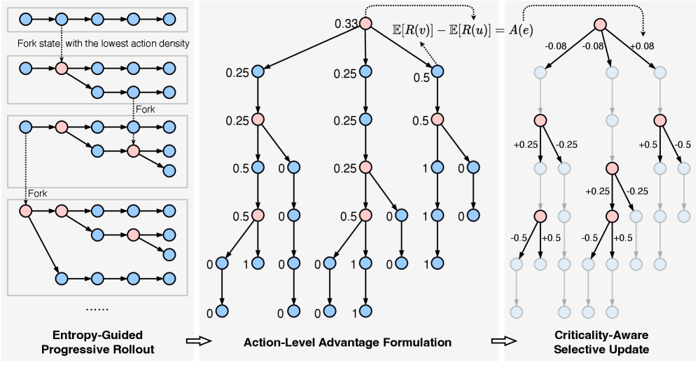

[CARL](https://arxiv.org/abs/2512.04949)（NeurIPS'25）用 token-level entropy 峰值识别 critical action，仅对这部分 token 回传梯度，非关键部分优势置 0——端到端性能不退、gradient update 量降约 72%。

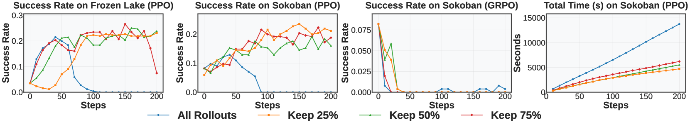

[RAGEN](https://arxiv.org/abs/2504.20073) 思路相反但形式类似：对信用估计方差高的 turn **降权**（而非保留），避免 echo trap（模型反复复读高奖励模式）。两者都是在已有 $\hat A$ 之上加软 mask：

$$
\hat A^{i,k,t}\leftarrow m^{i,k,t}\cdot \hat A^{i,k,t},\quad m\in[0,1].
$$

区别只在 $m$ 的取法（CARL: entropy 阈值；RAGEN: 1/方差）。开放问题：entropy 是关键性的必要非充分条件——有些关键动作模型其实"自信地选错"；过滤比例是否应随训练阶段动态调整？

#### Attribution-based variants

把"哪一步关键"从 entropy 代理换成显式归因。[Tran et al., 2025](https://arxiv.org/abs/2509.18314) 利用 rollout 的**树形结构**（共享前缀分支）在节点估优势，把组比较信号沉到 step；[Yin et al., 2025](https://arxiv.org/abs/2510.08899) 用 attribution score（类似 saliency）识别关键 step 并加权。信号更贴近因果贡献，代价是需要大量树形重执行或可靠的 attribution 估计器。

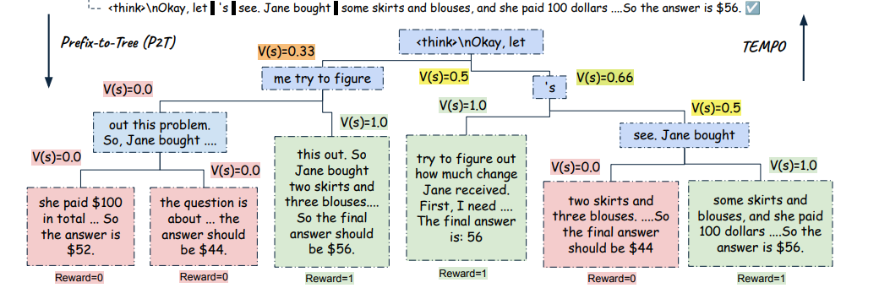

#### Truncation-aware masking: MicroCoder-GRPO

[MicroCoder-GRPO](https://arxiv.org/abs/2603.07777)（2026）针对**长输出截断引入的虚假信用**：被 context / tool-call 限制提前截断的尾段其实不是"完整决策"，用它回传梯度会污染 advantage。核心是 **conditional truncation masking**——把截断 token 从 loss 排除（$m^{i,k,t}=0$ for truncated suffix）；外加 diversity-aware 温度与松弛 KL / clip。原文场景是单轮长输出代码生成，但同一 mask 直接适用于 harness 下的 turn 截断——与 CARL 互补：CARL 关注关键性，MicroCoder 关注完整性。

#### Rollout-Level Filtering

更粗一层的门：整条 rollout 是否进入这一轮更新。典型判据：(i) **group 方差为 0**——GRPO 组内全对或全错，advantage 恒为 0，留着只浪费显存，直接丢弃并重采；(ii) **信用估计不确定度过高**（RAGEN 的方差门也可用在 rollout 层）；(iii) **format/工具调用失败**直接 mask 出 advantage 计算。这类过滤不改 loss 形式，但对长程 agentic 的有效样本密度影响极大——rollout 本身昂贵时一条高质量样本胜过十条噪声。

### Curriculum & Reward Shaping

CA 之外的另一条正交线：同样的算法，用不同的任务/奖励顺序也能显著影响信号质量。两项代表工作：

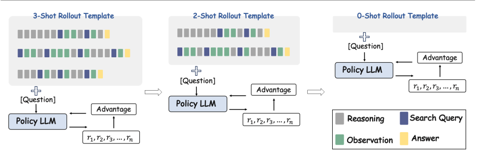

- **[ICRL](https://arxiv.org/abs/2603.08068)**（In-Context RL, 2026）把课程放在 **prompt scaffolding** 维度：跳过 SFT 冷启动直接 RL，但 rollout prompt 中先注入若干 in-context demonstration 教模型调用工具；训练推进时逐步抽减 demonstration，最终回到 zero-shot。把"难度"从任务侧搬到 prompt 侧——早期 demo 提供低成本成功 rollout 稳定初期 reward 信号，后期撤掉 scaffolding 强迫策略内化。对 harness 场景特别相关：SFT 合成成本高，而 demo prompt 可从单测、文档或既有轨迹自动构造。

- **[PRS + VSPO](https://arxiv.org/abs/2512.07478)**（2025）把 **Progressive Reward Shaping** 与 **Value-based Sampling Policy Optimization** 结合。PRS 是"稠密 → 稀疏"的奖励课程：训练早期用塑造奖励（子目标达成、格式正确等）稠密打分加速收敛，后期线性退化到只剩 outcome，避免模型长期依赖 shaping 而产生 reward hacking。VSPO 是配套的 rollout 采样策略——用当前 value 估计对候选 prompt 打分，优先采样**当前策略 value 方差大**（即"学得不稳、还有信息可挖"）的 prompt，而非无差别均匀采样。两者合起来既降前期噪声又降后期样本浪费。

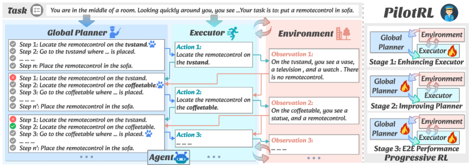

- **[PilotRL](https://arxiv.org/abs/2508.00344)**（2025）**全局规划引导的渐进式 RL**：先用规划策略提供高层骨架，再逐步把执行子任务交还给 actor。从"易"（规划外给）过渡到"难"（全部自做），把 horizon 从第一个训练日开始就保持在可学习范围内。

这两项工作与 CA 算法是**相乘**关系：把 CA 方法换成更细粒度的 turn-level/PRM，curriculum 仍然是决定收敛速度与最终上限的独立维度，尤其在 harness 下 rollout 昂贵时更为关键。

### Off-Policy Stability & Training Framework

超长程 agentic RL 的梯度方差本身就大，再叠加 rollout 昂贵、off-policy 偏差累积，训练过程的工程稳定性比算法细节更常见地成为瓶颈。这类工作不提供新的 CA 范式，而是让 CA 训练**能跑起来、能复现**——一支是算法侧的 off-policy 稳定化，一支是架构侧的执行—训练解耦。

- **[SORL](https://arxiv.org/abs/2511.20718)**（2025）专门处理 long-horizon LLM agent 的 **off-policy** 训练不稳定：通过 turn-level importance sampling 把跨轮的 IS ratio 聚合到 turn 粒度，并配合 **clipping-triggered normalization** 防止个别 turn 的极端 ratio 主导更新。在 harness 下 rollout 昂贵、必须复用历史轨迹的场景中，SORL 是让 off-policy replay 与 turn-level CA 协同工作的关键组件。
- **[Agent Lightning](https://arxiv.org/abs/2508.03680)**（Microsoft Research, 2025）不提出新算法，而是提供**解耦的训练架构**：把 agent 执行（rollout）与模型训练（gradient update）解耦，用轻量协议串联，使任意既有 agent 框架都能接入 RL 训练。价值在于让 CA 研究者把精力集中在算法上，而不必重复搭建 sandbox / 工具链桥接。

两者分别对应 agentic RL 工程现实的两面：off-policy replay 的算法稳定化（SORL）与执行-训练解耦的架构基建（Agent Lightning）。这类"非 CA 原创但必不可少"的工作中，哪一部分应由社区标准化、哪一部分留给具体项目，仍是悬而未决的问题。

## Discussion

把前面各节的方法放回"在哪一层做信用分配、靠什么信号做"这张坐标上：

| 类别 | CA 粒度 | 是否需要 critic | 是否需特权信息 | 主要代价 |
|---|---|---|---|---|
| Turn-PPO | turn | 是 | 否 | turn-level critic 训练成本 |
| GiGPO / LaRe / Step-GRPO | turn / step（前缀或 step-index 分组） | 否 | 否 | 前缀匹配 / LLM 评估 / rollout 步对齐假设 |
| IPA | semantic chunk | 否（REINFORCE） | 否 | chunk 边界识别 + off-policy 校正 |
| SWEET-RL / CriticSearch | turn | 是（asymmetric） | 是 | 推理时 critic 不可用；特权信号构造 |
| CARL / RAGEN / Tree-CA / Pinpointing | token / turn 软掩码或归因 | 与底层算法解耦 | 否 | 阈值调参或重执行/归因成本 |
| AgentPRM / IGPO / ITPO / iStar / AdaptSeg / SPO / SPA-RL / TARL | turn / segment（reward shaping） | 否 | 部分（IGPO 需 $y^*$） | judge 偏置、对齐假设或 MC 估计成本 |
| RED / T-REG / CAPO | token | 否 | 否 | 在 $10^5$+ token 轨迹下权重易被稀释 |
| ICRL / PilotRL / PRS+VSPO | 与 CA 正交（课程/塑造） | 视底层算法 | 否 | 阶段切换调度 |
| SORL / Agent Lightning | 与 CA 正交（稳定化/架构） | 视底层算法 | 否 | 工程复杂度 |

**几条可以看出来的共同趋势。** 一是**粒度在持续下沉，但落点不统一**：episode → turn → chunk → segment → token 各有代表工作，没有哪一层一致胜出，选择更多由任务结构（turn 边界是否天然）与 rollout 预算决定。二是**信号来源从"外部给"转向"内部挖"**：早期依赖独立 reward model 或 LLM-as-judge，近期的 ITPO / iStar / IGPO 都从策略自身 log-prob 或参考模型的似然差里榨出 turn-level 信号，不再加一个评分器。三是**特权信息被重新接受**：经典 AC 要求 actor-critic 对称观测，但 SWEET-RL、CriticSearch、IGPO 事实上都在训练时偷看了答案或参考解——这与 harness 场景"训练时有 ground truth、推理时没有"的天然不对称契合。四是**算法与工程被解耦**：SORL（off-policy 稳定化）、Agent Lightning（执行-训练分离）、curriculum 这些与 CA 正交的维度，经验上对最终性能的影响常常不逊于 CA 算法本身。

**尚未打通的几条接口。** 第一，**asymmetric critic 接入 turn-level GAE**——SWEET-RL 的 privileged critic 目前只喂给 DPO 式偏好差，是否能作为 $V(s)$ 插进标准 PPO 并在 long-horizon 上稳定，还没系统验证；[Rafailov et al., 2024](https://arxiv.org/abs/2404.12358) 的 $r \to Q^\star$ 给了形式化桥梁但缺实证。第二，**privileged critic 的 scaling law**——用 0.5B–1.5B critic 监督 7B+ actor 是否足够？harness 里的"特权信息"（单测日志、编译输出、git diff、文件系统快照）哪些真正有效、哪些只是噪声，目前没有系统 ablation。第三，**PRM 的横向基准**——LLM-judge / 隐式 log-prob / 信息增益 / 语义分段 / progress 这五类 turn-level 信号，谁在什么任务上更好，至今没有在同一 harness benchmark 上严格对比过；这既是方法学空白，也是社区基准的缺口。第四，**chunk / segment 边界识别**——IPA、AdaptSeg 都指向"语义自然单元"这个方向，但目前仍靠启发式或 LLM 判定，一个稳定、可训练的边界识别器是 turn-free 方法能否规模化的瓶颈。

**一条更大的判断。** RLVR 的核心挑战是"怎么把终端奖励摊到数千 token"；agentic RL 真正困难的地方在于**环境随机、部分可观测、动作异构**——这三点决定了 reasoning 里行之有效的 MC value 估计和 step-level PRM 不能直接搬过来。与其把 agentic RL 当成 RLVR 的长程版本继续加 batch、加 PRM 头，不如承认它是一个结构上不同的问题：信用分配的信号既不必来自 reward model、也不必来自 critic，而可以来自策略自身的似然、来自事后的环境反馈、来自特权侧信道，甚至来自 curriculum 对 horizon 的主动控制。把这些异质信号在同一套 turn-level 目标下组合起来，可能才是长程 agentic RL 的真正形态。

## References

- Arjona-Medina, J. A., Gillhofer, M., Widrich, M., Unterthiner, T., Brandstetter, J., & Hochreiter, S. (2019). [RUDDER: Return Decomposition for Delayed Rewards](https://arxiv.org/abs/1806.07857). *NeurIPS*.
- Cao, M., Zhang, S., Chang, X.-W., & Precup, D. (2025). [SCAR: Shapley Credit Assignment for More Efficient RLHF](https://arxiv.org/abs/2505.20417). *arXiv:2505.20417*.
- Chen, Y., Sun, Y., Wang, H., Zhang, X., Shen, X., Li, W., & Zhang, W. (2026). [Contextual Counterfactual Credit Assignment for Multi-Agent Reinforcement Learning in LLM Collaboration](https://arxiv.org/abs/2603.06859) (**C3**). *arXiv:2603.06859*.
- Cheng, J., Xiong, G., Qiao, R., Li, L., et al. (2025). [Stop Summation: Min-Form Credit Assignment Is All Process Reward Model Needs for Reasoning](https://arxiv.org/abs/2504.15275) (**PURE**). *ICML*.
- DeepSeek-AI. (2025). [DeepSeek-R1: Incentivizing Reasoning Capability in LLMs via Reinforcement Learning](https://arxiv.org/abs/2501.12948). *arXiv:2501.12948*.
- Deng, Z., Dou, Z., Zhu, Y., Wen, J.-R., Xiong, R., Wang, M., & Chen, W. (2024). [From Novice to Expert: LLM Agent Policy Optimization via Step-Wise Reinforcement Learning](https://arxiv.org/abs/2411.03817) (**StepAgent**). *arXiv:2411.03817*.
- Fei, W., Kong, H., Liang, S., Lin, Y., et al. (2025). [Self-Guided Process Reward Optimization with Redefined Step-Wise Advantage for Process Reinforcement Learning](https://arxiv.org/abs/2507.01551). *arXiv:2507.01551*.
- Feng, L., Xue, Z., Liu, T., & An, B. (2025). [Group-in-Group Policy Optimization for LLM Agent Training](https://arxiv.org/abs/2505.10978) (**GiGPO**). *NeurIPS*.
- Feng, L., Zheng, L., He, S., Zhang, F., & An, B. (2026). [Dr. MAS: Stable Reinforcement Learning for Multi-Agent LLM Systems](https://arxiv.org/abs/2602.08847). *arXiv:2602.08847*.
- Guo, Y., Xu, L., Liu, J., Ye, D., & Qiu, S. (2025). [Segment Policy Optimization: Effective Segment-Level Credit Assignment in RL for Large Language Models](https://arxiv.org/abs/2505.23564) (**SPO**). *arXiv:2505.23564*.
- Harutyunyan, A., Dabney, W., Mesnard, T., Azar, M. G., Piot, B., Heess, N., van Hasselt, H., Wayne, G., Singh, S., Precup, D., & Munos, R. (2019). [Hindsight Credit Assignment](https://arxiv.org/abs/1912.02503). *NeurIPS*.
- Hong, H., Yin, J., Wang, Y., Liu, J., et al. (2025). [Multi-Agent Deep Research: Training Multi-Agent Systems with M-GRPO](https://arxiv.org/abs/2511.13288). *arXiv:2511.13288*.
- Huang, M., Zhang, L., Li, Y., Wu, Y., & Liu, J. (2026). [SketchVL: Policy Optimization via Fine-Grained Credit Assignment for Chart Understanding and More](https://arxiv.org/abs/2601.05688). *arXiv:2601.05688*.
- Jiang, Y., & Ferraro, F. (2026). [SCRIBE: Structured Mid-Level Supervision for Tool-Using Language Models](https://arxiv.org/abs/2601.03555). *arXiv:2601.03555*.
- Kazemnejad, A., Aghajohari, M., Portelance, E., Sordoni, A., Reddy, S., Courville, A., & Le Roux, N. (2025). [VinePPO: Refining Credit Assignment in RL Training of LLMs](https://arxiv.org/abs/2410.01679). *ICML*.
- Li, C., Elmahdy, A., Boyd, A., et al. (2025a). [Stabilizing Off-Policy Training for Long-Horizon LLM Agent via Turn-Level Importance Sampling and Clipping-Triggered Normalization](https://arxiv.org/abs/2511.20718) (**SORL**). *arXiv:2511.20718*.
- Li, E., Ren, J., & Yan, C. (2026a). [Scaling Multiagent Systems with Process Rewards](https://arxiv.org/abs/2601.23228) (**MAPPA**). *arXiv:2601.23228*.
- Li, J., Li, L., Chang, T.-w., Kuang, K., et al. (2024a). [RED: Unleashing Token-Level Rewards from Holistic Feedback via Reward Redistribution](https://arxiv.org/abs/2411.08302). *arXiv:2411.08302*.
- Li, J., Zhou, P., Meng, R., Vadera, M. P., Li, L., & Li, Y. (2025b). [Turn-Level Optimized Policy Optimization for Multi-Turn LLM Agents](https://arxiv.org/abs/2512.17008) (**Turn-PPO**). *EACL 2026*.
- Li, Y., Zhang, X., Lu, W., Tang, Z., Wu, M., Luo, H., Wu, T., Peng, Z., Mi, H., Feng, Y., Tan, N., Huang, C., Chen, H., & Shen, L. (2026b). [Who Deserves the Reward? SHARP: Shapley Credit-Based Optimization for Multi-Agent System](https://arxiv.org/abs/2602.08335). *arXiv:2602.08335*.
- Li, Y., Xiong, S., Chen, G., Li, X., et al. (2024b). [Adaptive Segment-Level Reward: Bridging the Gap Between Action and Reward Space in Alignment](https://arxiv.org/abs/2411.00809) (**AdaptSeg**). *arXiv:2411.00809*.
- Li, Y., Jiang, Z., Zhang, B., Zhang, M., Zhao, J., & Xu, Z. (2025c). [Do We Really Need a Mixing Network for Credit Assignment in Multi-Agent Reinforcement Learning?](https://arxiv.org/abs/2504.12961) *arXiv:2504.12961*.
- Li, Z., Tian, W., Ban, Y., Chen, J., Zhang, H., Liu, Y., & Zhuang, F. (2026c). [Counterfactual Credit Policy Optimization for Multi-Agent Collaboration](https://arxiv.org/abs/2603.21563) (**CCPO**). *arXiv:2603.21563*.
- Liu, X., Wang, K., Wu, Y., Huang, F., et al. (2025). [Agentic Reinforcement Learning with Implicit Step Rewards](https://arxiv.org/abs/2509.19199) (**iStar**). *arXiv:2509.19199*.
- Lu, K., Chen, C., Wang, X., Cui, B., Liu, Y., & Zhang, W. (2025). [PilotRL: Training Language Model Agents via Global Planning-Guided Progressive Reinforcement Learning](https://arxiv.org/abs/2508.00344). *arXiv:2508.00344*.
- Luo, J., et al. (2026). [In-Context Reinforcement Learning for Tool Use in Large Language Models](https://arxiv.org/abs/2603.08068) (**ICRL**). *arXiv:2603.08068*.
- Luo, L., Xu, Y., Sahoo, A., Lu, C., Hsu, K., Li, H., Patel, R., & Wu, T.-W. (2024). [Improve Mathematical Reasoning in Language Models by Automated Process Supervision](https://arxiv.org/abs/2406.06592) (**OmegaPRM**). *arXiv:2406.06592*.
- Luo, X., Zhang, Y., He, Z., Wang, Z., Zhao, S., Li, D., Qiu, L. K., & Yang, Y. (2025). [Agent Lightning: Train Any AI Agents with Reinforcement Learning](https://arxiv.org/abs/2508.03680). *Microsoft Research, arXiv:2508.03680*.
- MicroCoder Team. (2026). [MicroCoder-GRPO: Stabilizing GRPO for Long-Output Code Generation via Conditional Truncation Masking and Diversity-Aware Sampling](https://arxiv.org/abs/2603.07777). *arXiv:2603.07777*.
- Nagpal, K., Dong, D., Bouvier, J.-B., & Mehr, N. (2025). [Leveraging Large Language Models for Effective and Explainable Multi-Agent Credit Assignment](https://arxiv.org/abs/2502.16863). *arXiv:2502.16863*.
- OpenClaw Team. (2026). [OpenClaw-RL: Train Any Agent Simply by Talking](https://arxiv.org/abs/2603.10165). *arXiv:2603.10165*.
- Ouyang, L., Wu, J., Jiang, X., Almeida, D., Wainwright, C., Mishkin, P., Zhang, C., Agarwal, S., Slama, K., Ray, A., et al. (2022). [Training Language Models to Follow Instructions with Human Feedback](https://arxiv.org/abs/2203.02155) (**InstructGPT**). *NeurIPS*.
- Pignatelli, E., Ferret, J., Geist, M., Mesnard, T., van Hasselt, H., & Pietquin, O. (2023). [A Survey of Temporal Credit Assignment in Deep Reinforcement Learning](https://arxiv.org/abs/2312.01072). *arXiv:2312.01072*.
- Qu, Y., Jiang, Y., Wang, B., Mao, Y., Wang, C., Liu, C., & Ji, X. (2025). [Latent Reward: LLM-Empowered Credit Assignment in Episodic Reinforcement Learning](https://arxiv.org/abs/2412.11120) (**LaRe**). *AAAI*.
- Rafailov, R., Sharma, A., Mitchell, E., Ermon, S., Manning, C. D., & Finn, C. (2023). [Direct Preference Optimization: Your Language Model Is Secretly a Reward Model](https://arxiv.org/abs/2305.18290) (**DPO**). *NeurIPS*.
- Rafailov, R., Sharma, A., Mitchell, E., Ermon, S., Manning, C. D., & Finn, C. (2024). [From r to Q*: Your Language Model Is Secretly a Q-Function](https://arxiv.org/abs/2404.12358). *arXiv:2404.12358*.
- ROLL Team. (2025). [ROME: Training Long-Horizon LLM Agents with Interaction-Perceptive Agentic Policy Optimization](https://arxiv.org/abs/2512.24873) (**IPA**). *arXiv:2512.24873*.
- Schick, T., Dwivedi-Yu, J., Dessì, R., Raileanu, R., Lomeli, M., Hambro, E., Zettlemoyer, L., Cancedda, N., & Scialom, T. (2024). [Toolformer: Language Models Can Teach Themselves to Use Tools](https://arxiv.org/abs/2302.04761). *NeurIPS*.
- Schulman, J., Moritz, P., Levine, S., Jordan, M., & Abbeel, P. (2016). [High-Dimensional Continuous Control Using Generalized Advantage Estimation](https://arxiv.org/abs/1506.02438) (**GAE**). *ICLR*.
- Schulman, J., Wolski, F., Dhariwal, P., Radford, A., & Klimov, O. (2017). [Proximal Policy Optimization Algorithms](https://arxiv.org/abs/1707.06347) (**PPO**). *arXiv:1707.06347*.
- Shao, Z., Wang, P., Zhu, Q., Xu, R., Song, J., Li, X., Zhang, H., Zhang, M., Li, Y. K., Wu, Y., & Guo, D. (2024). [DeepSeekMath: Pushing the Limits of Mathematical Reasoning in Open Language Models](https://arxiv.org/abs/2402.03300) (**GRPO**). *arXiv:2402.03300*.
- Shen, L., Zhang, Y., Ling, C. K., Zhao, X., & Chua, T.-S. (2025). [CARL: Focusing Agentic Reinforcement Learning on Critical Actions](https://arxiv.org/abs/2512.04949). *NeurIPS*.
- Su, J., Zeng, X., Liu, L., Luo, C., Chen, Y., & Zhuang, Z. (2025). [Enhancing Agentic RL with Progressive Reward Shaping and Value-Based Sampling Policy Optimization](https://arxiv.org/abs/2512.07478) (**PRS + VSPO**). *arXiv:2512.07478*.
- Tan, H.-Z., Yang, X.-W., Chen, H., Shao, J.-J., Wen, Y., Shen, Y., Luo, W., Du, X., Guo, L.-Z., & Li, Y.-F. (2026). [Hindsight Credit Assignment for Long-Horizon LLM Agents](https://arxiv.org/abs/2603.08754) (**HCAPO**). *arXiv:2603.08754*.
- Tan, W., Qu, X., Tu, M., et al. (2025). [Process-Supervised Reinforcement Learning for Interactive Multimodal Tool-Use Agents](https://arxiv.org/abs/2509.14480). *arXiv:2509.14480*.
- Tran, H., Yao, Z., & Yu, H. (2025). [Exploiting Tree Structure for Credit Assignment in RL Training of LLMs](https://arxiv.org/abs/2509.18314). *arXiv:2509.18314*.
- Wang, G., Dai, S., Ye, G., Gan, Z., et al. (2025a). [Information Gain-Based Policy Optimization: A Simple and Effective Approach for Multi-Turn Search Agents](https://arxiv.org/abs/2510.14967) (**IGPO**). *arXiv:2510.14967*.
- Wang, H., Leong, C. T., Wang, J., Wang, J., & Li, W. (2025b). [SPA-RL: Reinforcing LLM Agents via Stepwise Progress Attribution](https://arxiv.org/abs/2505.20732). *arXiv:2505.20732*.
- Wang, H., Chen, Y., Luo, L., et al. (2026). [Implicit Turn-Wise Policy Optimization for Proactive User-LLM Interaction](https://arxiv.org/abs/2603.23550) (**ITPO**). *arXiv:2603.23550*.
- Wang, H., Xu, Q., Liu, C., Wu, J., Lin, F., & Chen, W. (2025c). [Emergent Hierarchical Reasoning in LLMs through Reinforcement Learning](https://arxiv.org/abs/2509.03646) (**HICRA**). *arXiv:2509.03646*.
- Wang, P., Li, L., Shao, Z., Xu, R. X., Dai, D., Li, Y., Chen, D., Wu, Y., & Sui, Z. (2024). [Math-Shepherd: Verify and Reinforce LLMs Step-by-Step Without Human Annotations](https://arxiv.org/abs/2312.08935). *ACL*.
- Wang, Z., Wang, K., Wang, Q., Zhang, P., Li, L., Yang, Z., et al. (2025d). [RAGEN: Understanding Self-Evolution in LLM Agents via Multi-Turn Reinforcement Learning](https://arxiv.org/abs/2504.20073). *arXiv:2504.20073*.
- Wei, Q., Zeng, S., Li, C., Brown, W., et al. (2025). [Reinforcing Multi-Turn Reasoning in LLM Agents via Turn-Level Reward Design](https://arxiv.org/abs/2505.11821) (**TARL**). *NeurIPS*.
- Wen, M., Wan, Z., Zhang, W., Wang, J., & Wen, Y. (2024). [Reinforcing Language Agents via Policy Optimization with Action Decomposition](https://arxiv.org/abs/2405.15821) (**POAD**). *arXiv:2405.15821*.
- Xi, Z., Liao, C., Li, G., Yang, Y., et al. (2025). [AgentPRM: Process Reward Models for LLM Agents via Step-Wise Promise and Progress](https://arxiv.org/abs/2511.08325). *arXiv:2511.08325*.
- Xie, G., Shi, Y., Tian, H., Yao, T., & Zhang, X. (2025). [CAPO: Towards Enhancing LLM Reasoning Through Generative Credit Assignment](https://arxiv.org/abs/2508.02298). *arXiv:2508.02298*.
- Yang, M. Y. R., Bai, H., Wu, I., Yang, G., Setlur, A., & Kumar, A. (2026). [INT: Self-Proposed Interventions Enable Credit Assignment in LLM Reasoning](https://arxiv.org/abs/2601.14209). *arXiv:2601.14209*.
- Yao, J., Wang, R., & Zhang, T. (2026). [PRL: Process Reward Learning Improves LLMs' Reasoning Ability and Broadens the Reasoning Boundary](https://arxiv.org/abs/2601.10201). *arXiv:2601.10201*.
- Yin, J., Luo, H., Li, Z., Liu, Y., Liu, D., Li, Z., & Xu, X. (2025). [Pinpointing Crucial Steps: Attribution-Based Credit Assignment for Verifiable Reinforcement Learning](https://arxiv.org/abs/2510.08899). *arXiv:2510.08899*.
- Zhang, G., Zheng, L., Zhang, Z., Yu, G., Wen, Z., & Li, K. (2025a). [The Landscape of Agentic Reinforcement Learning for LLMs: A Survey](https://arxiv.org/abs/2509.02547). *arXiv:2509.02547*.
- Zhang, K., Zuo, Y., He, B., Sun, Y., et al. (2025b). [A Survey of Reinforcement Learning for Large Reasoning Models](https://arxiv.org/abs/2509.08827). *arXiv:2509.08827*.
- Zhang, Y., Huang, H., Song, Z., Zhu, Y., Zhang, Q., Zhao, Z., & Zhao, D. (2025c). [CriticSearch: Fine-Grained Credit Assignment for Search Agents via a Retrospective Critic](https://arxiv.org/abs/2511.12159). *arXiv:2511.12159*.
- Zhou, S., Xu, F. F., Zhu, H., Zhou, X., Lo, R., Sridhar, A., Cheng, X., Bisk, Y., Fried, D., Alon, U., et al. (2024a). [WebArena: A Realistic Web Environment for Building Autonomous Agents](https://arxiv.org/abs/2307.13854). *ICLR*.
- Zhou, W., Zhang, S., Zhao, L., & Meng, T. (2024b). [T-REG: Preference Optimization with Token-Level Reward Regularization](https://arxiv.org/abs/2412.02685). *arXiv:2412.02685*.
- Zhou, Y., Zanette, A., Pan, J., Levine, S., & Kumar, A. (2024c). [ArCHer: Training Language Model Agents via Hierarchical Multi-Turn RL](https://arxiv.org/abs/2402.19446). *ICML*.
- Zhou, Y., Jiang, S., Tian, Y., Weston, J., Levine, S., Sukhbaatar, S., & Li, X. (2025). [SWEET-RL: Training Multi-Turn LLM Agents on Collaborative Reasoning Tasks](https://arxiv.org/abs/2503.15478). *arXiv:2503.15478*.

