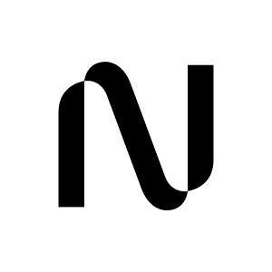

# Code Benchmarks

编码是 GPT-5.6 model card 里竞争最激烈的战场，也是 Claude 系与 GPT 系分差最大的地方。下表覆盖从 SWE-bench 奠基到 2026 年长程演化的完整谱系；表下对每一项关键 benchmark 做统一结构的深挖——它是什么、一个可交互的任务卡片（切页签看输入 / 判据 / 判分方式）、它的特性、能提升模型哪种能力、合成训练环境时有哪些可参考的做法。任务卡片按各 benchmark 公开的任务形态重构，内容为示意，非某道题的原文照搬。

| 发布日期 | Benchmark | Download | 任务形态 | 编程语言 | 题目数量 | 影响力 | 考察能力 / 可补强方向 |
|---|---|---|---|---|---|---|---|
| 2023 |  [SWE-bench](https://arxiv.org/abs/2310.06770) | [GitHub](https://github.com/SWE-bench/SWE-bench) | Issue→Patch | Python | 2294 | [5.4k star](https://github.com/SWE-bench/SWE-bench) | **缺陷定位 + 多文件修改的原型**：issue→patch 形态的根 |
| 2023 | [RepoBench](https://arxiv.org/abs/2306.03091) | [GitHub](https://github.com/Leolty/repobench) | 代码补全 | Python / Java | 10K+ | — | **跨文件依赖感知**：仓库级 next-line 补全，match-based |
| 2023 |  [CrossCodeEval](https://arxiv.org/abs/2310.11248) | [GitHub](https://github.com/amazon-science/cceval) | 代码补全 | Python / Java / TS / C# | 2665 | — | **跨文件上下文利用**：每题强制依赖跨文件上下文 |
| 2024 |  [SWE-bench Multilingual](https://huggingface.co/datasets/SWE-bench/SWE-bench_Multilingual) | [HF](https://huggingface.co/datasets/SWE-bench/SWE-bench_Multilingual) | Issue→Patch | ~9 种语言 | ~300 | [136k 下载](https://huggingface.co/datasets/SWE-bench/SWE-bench_Multilingual) | **多语言泛化基线**：首个系统化多语言 issue→patch |
| 2024/8 |  [SWE-bench Verified](https://openai.com/index/introducing-swe-bench-verified/) | [HF](https://huggingface.co/datasets/SWE-bench/SWE-bench_Verified) | Issue→Patch | Python | 500 | [73.9k 下载 / 107 likes](https://huggingface.co/datasets/SWE-bench/SWE-bench_Verified) | **干净信号的缺陷定位**：人工去噪 500 题，已趋饱和 |
| 2025/4 |  [Multi-SWE-bench](https://arxiv.org/abs/2504.02605) | [GitHub](https://github.com/multi-swe-bench/multi-swe-bench) | Issue→Patch | Java / TS / JS / Go / Rust / C / C++ | 1632 | [352 star](https://github.com/multi-swe-bench/multi-swe-bench) | **非 Python 泛化**：补 Pro 缺失的 Rust / Java / C++ |
| 2025/4 |  [SWE-PolyBench](https://arxiv.org/abs/2504.08703) | [GitHub](https://github.com/amazon-science/SWE-PolyBench) | Issue→Patch | Java / JS / TS / Python | 2110 | [89 star](https://github.com/amazon-science/SWE-PolyBench) | **多任务类型**：bug fix / feature / refactor，exec + AST 双指标 |
| 2025/4/19 | [R2E-Gym](https://arxiv.org/abs/2504.07164) | [GitHub](https://github.com/R2E-Gym/R2E-Gym) | 代码补全 / RL 环境 | Python | 8700+ | — | **RL 训练环境**：反向合成问题描述，双验证器 |
| 2025/5/10 |  [SWE-rebench V1](https://arxiv.org/abs/2505.20411) | [HF](https://huggingface.co/datasets/nebius/SWE-rebench) | Issue→Patch / RL 环境 | 多语言 | — | [82.4k 下载 / 68 likes](https://huggingface.co/datasets/nebius/SWE-rebench) | **训练+评测双用池**：自动 setup agent 合成可执行任务 |
| 2025/5/19 | [Terminal-Bench](https://www.tbench.ai/) | [GitHub](https://github.com/laude-institute/terminal-bench) | 终端 / CLI 代理 | 语言无关 | 80（1.0）/ 89（2.0） | — | **终端环境端到端任务**：真实终端里探索、装依赖、跑命令、验证，2.1 为当前活跃版 |
| 2025/9 |  [SWE-bench Pro](https://arxiv.org/abs/2509.16941) | [HF](https://huggingface.co/datasets/ScaleAI/SWE-bench_Pro) | Issue→Patch | 4 语言类 / 11 仓库类 | <1K | [59.3k 下载 / 152 likes](https://huggingface.co/datasets/ScaleAI/SWE-bench_Pro) | **真实工程长程能力**：企业级高难度，本文对照系 |
| 2025/9/18（2026/5/16 更新） |  [SWE-bench Live](https://arxiv.org/abs/2505.23419) | [GitHub](https://github.com/SWE-bench-Live/SWE-bench-Live) | Issue→Patch | Python；MultiLang | 1319 | [208 star](https://github.com/SWE-bench-Live/SWE-bench-Live) | **持续新鲜度 + 跨平台**：月度滚动新仓库，含 Windows 切片 |
| 2025/10/15 | Agentic-Multi-SWE-RL | [HF](https://huggingface.co/datasets/II-Vietnam/Agentic-Multi-SWE-RL) | Issue→Patch / RL 环境 | 14 种语言 | 7526 | — | **长 patch + 宽语言**：14 语言，LOC 323 远超 Pro 160 |
| 2026/1 | SWE-bench++ | [HF](https://huggingface.co/datasets/TuringEnterprises/SWE-Bench-plus-plus) | Issue→Patch | 9 种语言 | 500（已公开） | — | **大规模长程多文件修改**：平均编辑 120+ 行、7+ 文件 |
| 2026/1/16 | [ABC-Bench](https://arxiv.org/abs/2601.11077) | [GitHub](https://github.com/OpenMOSS/ABC-Bench) | 后端服务部署 | 8 种语言 | 224 | — | **真实服务行为**：容器化部署 + HTTP API 端到端测试 |
| 2026/2/9 | [ProjDevBench](https://arxiv.org/abs/2602.01655) | [GitHub](https://github.com/zsworld6/projdevbench) | 全流程开发 | 多语言 | 20 | — | **全流程规划**：需求 → 完整 codebase，含 LM-judge |
| 2026/2/27 |  [SWE-rebench V2](https://arxiv.org/abs/2602.23866) | [HF](https://huggingface.co/datasets/nebius/SWE-rebench) | Issue→Patch / RL 环境 | 20 种语言 | 32000+ | — | **训练+评测双用池（最大）**：3600+ 仓、自动 setup agent 动态切片 |
| 2026/3 | [PostTrainBench](https://arxiv.org/abs/2603.08640) | [GitHub](https://github.com/aisa-group/PostTrainBench) | AI 研发自动化 | Python | 4 模型 × 7 基准 | — | **能否自动化后训练**：CLI agent 用 SFT/GRPO/LoRA 等在限时限卡内提升模型分，K3 blog 用 Lite 变体 |
| 2026/4 | Monthly-SWEBench-2026 | [HF](https://huggingface.co/datasets/UnipatAI/Monthly-SWEBench-2026-03) | Issue→Patch | 以 Go 为主 | 600 | — | **企业级新鲜切片**：kubernetes / envoy 等，Go 为主 |
| 2026/4/9 | [SWE-EVO](https://arxiv.org/abs/2512.18470) | [HF](https://huggingface.co/datasets/Fsoft-AIC/SWE-EVO) | 长程演化 | Python | 48 | — | **长程多文件演化**：平均改 21 文件，GPT-5.4 仅 25% |
| 2026/5 | [SWE-Cycle](https://arxiv.org/abs/2605.13139) | [HF](https://huggingface.co/datasets/tubehhh/SWE-Cycle) | 全流程开发 | 多语言 | 489 | — | **全周期能力**：环境重建 + 实现 + 测试生成四模式 |
| 2026/5/5 | [ProgramBench](https://arxiv.org/abs/2605.03546) | [GitHub](https://github.com/facebookresearch/ProgramBench) | 全流程重建 | Go / Rust / C / C++ / Java 等 | 200 | — | **从零重建程序**：仅给编译产物 + 文档，重建完整 codebase，248k 行为测试判分 |
| 2026/5/6 | [SWE Context Bench](https://arxiv.org/abs/2602.08316) | — | Issue→Patch | 9 种语言 | 1476 | — | **上下文复用效率**：shared-context 任务对（未公开数据） |
| 2026/5/9 | [MLS-Bench](https://arxiv.org/abs/2605.08678) | [GitHub](https://github.com/Imbernoulli/MLS-Bench) | ML 科学 | Python | 140（Lite 30） | — | **能否发明可泛化的 ML 方法**：单次约束编辑，测泛化与扩展性，K3 blog 用 Lite |
| 2026/5/14 | [SWE-Chain](https://arxiv.org/abs/2605.14415) | [GitHub](https://github.com/CUHK-ARISE/SWE-Chain) | 长程演化 | Python | 1660 | — | **版本升级链**：链式评测，上一步输出作下一步输入 |
| 2026/5/26 | [DeepSWE](https://deepswe.datacurve.ai) | [GitHub](https://github.com/datacurve-ai/deep-swe) | Issue→Patch | 多语言 | 113（v1.1） | — | **活跃开源仓长程任务**：程序化隔离判分，GPT-5.6 model card 采用 |
| 2026/6/5 | [SWE-Marathon](https://arxiv.org/abs/2606.07682) | [GitHub](https://github.com/abundant-ai/swe-marathon) | 超长程开发 | 多语言 | 20 | — | **数小时级自主开发**：库复现 / 全栈克隆 / 编译器 / 内核优化，多层验证防捷径 |
| 2026/7 | [FrontierSWE](https://frontierswe.com) | [GitHub](https://github.com/Proximal-Labs/frontier-swe) | 前沿工程 | Zig / Rust / Haskell / Mojo / 汇编 | 17 | — | **人类能力边缘的工程**：实现 / 研究 / 性能优化三类，复合评分 |

三家在编码类的核心数字（GPT-5.6 model card）给出三个不一致的排名，这正说明它们测的不是同一种能力：SWE-Bench Pro 上 Claude Mythos 5 拿 80.3%、把 GPT-5.6 Sol 的 64.6% 甩开约 16 个百分点；DeepSWE v1.1 上 GPT-5.6 Sol 反超到 72.7%、压过 Claude Fable 5 的 69.7%；Terminal-Bench 2.1 上 GPT-5.6 Sol Ultra 的 91.9% 领先 Claude Mythos 5 的 88%。同一批模型三个排名，只可能是三种能力。下面逐项拆开。

## SWE-bench: The Root of Issue-to-Patch

SWE-bench 是整条 issue→patch 主线的根。它从真实 GitHub 仓库抓取已合并的 bug 修复 PR，把 PR 里的 issue 描述当输入、把附带的测试当判据，模型要在完整仓库里定位并改对代码。2294 题全是 Python，判分靠真实跑测试，是最早把"真实软件工程任务"标准化成可复现评测的工作。

<iframe src="demos/task-demo.html#swe-bench" style="width:100%;height:430px;border:none;border-radius:12px;" title="SWE-bench 典型任务：issue → patch" loading="lazy"></iframe>

它的特性是 exec-based 判分加 Fail-to-Pass / Pass-to-Pass 双判据：一个补丁既要让目标测试从失败变通过，又要保证原本通过的测试不回归。这套判据后来被几乎所有 SWE 系 benchmark 继承。它提升模型的缺陷定位与多文件协同修改能力——模型必须读懂 issue、在大仓库里检索相关代码、理解上下游依赖再动手。

合成环境可参考：SWE-bench 立起的范式是"PR 天然自带标准答案"。一条已合并的修复 PR，把它拆成 test patch 与 code patch 两半，只打 test patch 测试应失败、两者都打应通过——这个关系本身就是可验证性的定义。想批量造 issue→patch 环境，从合并 PR 反向切分是成本最低的起点。

## SWE-bench Verified: A Clean but Saturated Signal

SWE-bench Verified 是 OpenAI 联合原作者对 SWE-bench 做的人工去噪版。原集里有相当比例的题存在问题——测试描述模糊、任务本身有歧义、甚至有无法判定的题。Verified 人工筛出 500 道确定可解、判据干净的题，此后成为事实上的标准评测集。

<iframe src="demos/task-demo.html#swe-bench-verified" style="width:100%;height:430px;border:none;border-radius:12px;" title="SWE-bench Verified 典型任务：人工验证后的干净判据" loading="lazy"></iframe>

它的特性是干净信号：正因去掉了假阴，Verified 的分数更能反映模型真实的缺陷定位能力。但也正因如此，它现在饱和了——顶级模型都挤在 80 分上下，剩下做不对的题多是真难或仍有歧义，训练增量有限。它提升的能力与 SWE-bench 一致，只是信噪比更高，适合当能力下限的确认，而非区分前沿模型。

合成环境可参考：Verified 的价值在于示范了"评测集的信噪比比规模更重要"。2294 题里挑 500 道干净的，比留着全部但带噪声更有用——因为噪声会同时污染评测与训练奖励。造环境时宁可人工验一遍砍掉一半，也别把判据不可靠的题喂进训练。

## Multi-SWE-bench and the Multilingual Line

issue→patch 最初只有 Python。SWE-bench Multilingual 第一次把它系统扩到约九种语言，Multi-SWE-bench（字节跳动）再补上 Java / TS / JS / Go / Rust / C / C++ 七种，1632 题，专门测非 Python 的泛化。SWE-PolyBench（Amazon）则在多语言之上再加多任务类型，把 bug fix、feature、refactor 分开，并用 exec 加 AST 双指标判分。

<iframe src="demos/task-demo.html#multi-swe-bench" style="width:100%;height:430px;border:none;border-radius:12px;" title="Multi-SWE-bench 典型任务：Rust 上的定位与修复" loading="lazy"></iframe>

它们的特性是把"语言"变成一个受控变量：任务形态不变，只换语言，就能测出模型的编码能力有多少是 Python 专属、多少能迁移。SWE-PolyBench 的 AST 指标还能在测试之外，从语法结构上判断改动是否落在正确的位置。它们提升模型的多语言泛化能力，逼训练覆盖非 Python 语料。

合成环境可参考：多语言环境的真正难点不在题，在判分基础设施——每种语言的构建工具链、测试框架、日志格式都不同。Multi-SWE-bench 的做法是为每种语言预置一套容器化的构建与测试流程，把语言差异吸收在环境层而非判分逻辑里。想扩语言，先把每种语言的"装依赖—编译—跑测试—解析结果"这条链固化下来。

## SWE-bench Live: Fighting Data Contamination With Freshness

SWE-bench Live（微软）解决的是数据泄漏。任何静态 benchmark，一旦发布，题目就可能进入下一代模型的训练语料，分数随之失真。SWE-bench Live 的对策是每月滚动抓取新出现的仓库与 issue，1319 题持续更新，还切出一个 Windows 平台的子集。

<iframe src="demos/task-demo.html#swe-bench-live" style="width:100%;height:430px;border:none;border-radius:12px;" title="SWE-bench Live 典型任务：比模型更新的题目 + Windows 切片" loading="lazy"></iframe>

它的特性是时间新鲜度当作抗污染手段：用"比模型新"保证"模型没见过"。Windows 切片则补上跨平台维度——很多环境依赖在 Windows 上的行为与 Linux 不同。它提升的能力仍是 issue→patch，但测的是真实泛化而非记忆。

合成环境可参考：滚动更新的工程代价是自动化。SWE-bench Live 必须做到从抓取新 PR 到构造出可执行环境全程无人工，否则月度更新跟不上。这和自建产线的诉求一致——环境合成的自动化程度，直接决定了能否持续产出新鲜、抗污染的训练数据。

## SWE-Bench Pro: The Benchmark That Still Separates Models

企业级仓库上的 issue→patch，难度和长程性远超 SWE-bench Verified。SWE-Bench Pro 由 Scale AI 构造，用私有或强 copyleft 仓库避免训练数据泄漏，单题平均改动约 160 行、跨多个文件。它是当前唯一能明显拉开顶级编码模型档次的 exec-based 主指标，也是本系列的核心对照。

<iframe src="demos/task-demo.html#swe-bench-pro" style="width:100%;height:430px;border:none;border-radius:12px;" title="SWE-Bench Pro 典型任务：跨模块并发缺陷" loading="lazy"></iframe>

它的特性是难度与抗泄漏兼顾：私有 / copyleft 仓库保证题目没进过训练语料，160 行的平均改动量把任务拉到长程。正因如此它没饱和——Claude Mythos 5 在这里拿 80.3%、Fable 5 80%，把 GPT-5.6 Sol 的 64.6% 甩开约 16 个百分点，这个差距在饱和的 Verified 上完全看不到。它提升模型在陌生大仓库里的长程工程能力：检索、理解跨模块依赖、协同改多个文件。

合成环境可参考：Pro 示范了"难度靠仓库选择而非题目堆砌"。选企业级、强耦合、多模块的仓库，题目自然长程；选私有 / copyleft 仓库，自然抗泄漏。造高区分度环境时，仓库的选择比题目的数量更决定天花板。

## DeepSWE v1.1: An Isolated Judge on Live Repos

先澄清一个高频歧义。DeepSWE 有两个完全不同的东西：一个是 Agentica / Together 在 2025/07 发布的 RL 训练**模型**（从 Qwen3-32B 纯 RL 训练），另一个是 Datacurve 在 2026 发布的**评测集**。GPT-5.6 model card 里的 "DeepSWE v1.1" 指后者。它从活跃开源仓抽取长程 SWE 任务，113 题、91 个仓库，用程序化验证做隔离判分。

<iframe src="demos/task-demo.html#deepswe" style="width:100%;height:430px;border:none;border-radius:12px;" title="DeepSWE v1.1 典型任务：活跃开源仓 + 隔离判分" loading="lazy"></iframe>

它的特性是取自活跃开源仓而非封闭企业仓，加上隔离判分。这让它与 Pro 形成互补：同样测长程能力，但仓库来源不同，模型的相对排名也随之翻转——GPT-5.6 Sol 在这里反超到 72.7%，与 Claude Fable 5 的 69.7% 互有胜负。它提升的能力是开源仓库上的长程缺陷修复。

合成环境可参考：DeepSWE v1.1 相对 v1 的改进全在判分的隔离性上。同一道题，判分环境若与其它题共享状态，就会出现"别的题污染了这道题的测试结果"的假阳。造环境时每道题都该有独立、可重置的执行沙盒，判分的隔离性和判据本身一样重要。

## Terminal-Bench 2.1: The Agent in a Real Terminal

把模型放进真实终端，测它在命令行环境下端到端解决任务的成功率，覆盖软件工程、机器学习、安全、数据科学。初代 80 题，2.0 扩到 89 题，2.1 是当前活跃版本，由 Stanford 与 Laude 合作维护，构建在 Harbor 框架上。

<iframe src="demos/task-demo.html#terminal-bench" style="width:100%;height:430px;border:none;border-radius:12px;" title="Terminal-Bench 2.1 典型任务：只给终端和目标" loading="lazy"></iframe>

它的特性是只给终端和目标，不给任务边界：SWE-Bench Pro 与 DeepSWE 给定 issue 描述、边界清晰，Terminal-Bench 要模型自己探索文件系统、装依赖、跑命令、验证结果，判分看真实执行结果（内核能不能启动、模型精度达没达标）。它提升的是代理的环境操作能力而非单纯补丁生成——GPT-5.6 Sol Ultra 在这里拿 91.9%，是 GPT 系少数明确领先 Claude 的编码维度，说明它的终端代理调度比补丁定位更强。

合成环境可参考：Terminal-Bench 的判据是"结果状态"而非"过程正确"。内核能在 QEMU 里启动，就算过，不管你怎么编译的。这种"给目标、验结果、不管过程"的设计，天然容纳多样解法，也最贴近真实的 agent 训练——奖励信号来自环境的真实反馈，而非对某条标准路径的匹配。

## ProgramBench: Rebuild the Whole Program From Its Binary

给你一个编译好的 `grep` 命令行工具，外加一份描述它行为的文档，没有源码，任务是把整份能通过测试的 C 源码树写出来。这是 ProgramBench 的一道题——200 题覆盖 Go / Rust / C / C++ / Java 等系统级语言，判分靠真实跑约 248k 行测试，纯 exec-based。它测的不是补丁，是从规格到完整实现的重建。

<iframe src="demos/task-demo.html#programbench" style="width:100%;height:430px;border:none;border-radius:12px;" title="ProgramBench 典型任务：从二进制反推完整源码" loading="lazy"></iframe>

它的特性是"给二进制反推源码"这个任务方向本身抗数据泄漏——源码可能早进过训练语料，但参考答案是可执行的行为而非某段文本，模型背不下来。它提升模型从规格理解到完整程序实现的能力，覆盖比"改几个文件"大得多的范围。

合成环境可参考：ProgramBench 最值得抄的是防泄漏的手法——找一个输入公开、答案却无法记忆的转换方向。编译产物公开可得，但"从产物到源码"的映射不是模型能死记的，判据又完全可执行。想造抗污染的题，先找这样一个方向。

## FrontierSWE: Engineering at the Edge of Human Ability

用 Zig 实现一个前沿的无锁并发队列，再把它的吞吐压到给定的性能线以下——通不过性能门槛，正确也不算过。FrontierSWE 只有 17 题，全落在 Zig / Rust / Haskell / Mojo / 汇编这些训练语料稀薄的语言上，分实现、研究、性能优化三类，复合评分同时看正确性与速度。

<iframe src="demos/task-demo.html#frontierswe" style="width:100%;height:430px;border:none;border-radius:12px;" title="FrontierSWE 典型任务：Zig 无锁队列 + 性能门槛" loading="lazy"></iframe>

它的特性是用低资源语言抬高天花板：主流语言上顶级模型早已挤在饱和区，换成模型没见够的语言，同一道算法题立刻拉开差距；题量小到反常（17 题），但每题信息量极大。它提升模型在低资源语言上的深度工程能力，逼训练覆盖冷门语言与性能优化这类硬骨头。

合成环境可参考：造 benchmark 常默认"区分度靠加长任务、加大题量"，FrontierSWE 给了另一条路——换一个低资源语言或冷门领域，17 道题也能把前沿模型筛出层次。当主流方向饱和时，换维度比加规模更有效。

## SWE-Marathon: Hours-Long Autonomous Builds

一道题是"从零克隆一个功能完整的全栈待办应用，前端后端数据库都要跑通"，另一道是"实现一个能编译目标语言子集的编译器"。SWE-Marathon 的 20 道题，每一道都相当于人类工程师数小时到一天的连续工作，早已不是 SWE-Bench Pro 那种几百行的单次 issue→patch。任务类型还包括库复现与内核优化。

<iframe src="demos/task-demo.html#swe-marathon" style="width:100%;height:430px;border:none;border-radius:12px;" title="SWE-Marathon 典型任务：全栈克隆 + 多层验证" loading="lazy"></iframe>

它的特性是超长时程加多层验证防作弊。任务一长，作弊空间就来了——模型会想方设法只让某一个测试变绿、绕开真实目标。SWE-Marathon 的对策是功能、集成、边界各查一遍的多层独立验证，任何一层挂掉都不算过。它提升模型长时程自主执行的稳定性：不是能不能做对一步，而是能不能连续做对几十步。

合成环境可参考：这是造长程环境绕不开的一课——任务越长，越要先假设模型会抄近路，再用彼此独立的检查把每条捷径堵死，单一测试根本兜不住。长程任务的奖励设计，本质是反投机设计。

## PostTrainBench: Can the Agent Post-Train a Model

给 agent 一个基座模型、一块 GPU、一个时限，目标只有一句话：把它在某个基准上的分数提上去。至于用 SFT、GRPO 还是 LoRA，脚本怎么写、超参怎么调，全由 agent 自己决定。PostTrainBench 跨 4 个模型 × 7 个基准，Kimi K3 blog 用的是 Lite 变体。它测的不是写业务代码，而是模型能不能改进模型。

<iframe src="demos/task-demo.html#posttrainbench" style="width:100%;height:430px;border:none;border-radius:12px;" title="PostTrainBench 典型任务：agent 自主后训练" loading="lazy"></iframe>

它的特性是判结果增量、不判过程：后训练没有唯一正确的脚本，PostTrainBench 干脆不看过程，只测"跑完后基准分涨了多少"。它把评测对象从"能不能写代码"抬到"能不能自动化 AI 研发"，提升的是模型做 ML 工程与实验闭环的能力。

合成环境可参考：当任务没有标准解、但结果可量化时，把判据锚在终局指标的增量上，天然容纳各种解法，也省掉了标注参考答案这件几乎做不动的事。这是"结果奖励"优于"过程奖励"的一个干净案例。

## MLS-Bench-Lite: Inventing Generalizable ML Methods

给一段在小数据集上跑得不错的 ML 训练代码，只允许改动有限几行，要求改完之后换到更大规模、换一个数据分布仍然成立。判分不看它在原任务上的精度，只看留出分布上泛化得如何。MLS-Bench 完整集 140 题，Lite 变体 30 题，Python。它要的不是调包跑通，而是方法层面真正可泛化的改动。

<iframe src="demos/task-demo.html#mls-bench" style="width:100%;height:430px;border:none;border-radius:12px;" title="MLS-Bench-Lite 典型任务：受限编辑 + 留出分布判分" loading="lazy"></iframe>

它的特性是在留出分布上判分，逼出真方法而非过拟合。它与 PostTrainBench 的区别在于后者优化既有训练流程，MLS-Bench 要求提出方法层面的新做法。它提升模型发明可泛化 ML 方法的能力——不是记住某个 trick，而是找到能迁移的原理。

合成环境可参考：只在训练分布上测精度，模型会记住捷径；把判据放到"换规模、换分布还成不成立"，只有真泛化的方法能过。想分清"背答案"和"会方法"，判分集就必须和优化目标不在同一个分布上。

## The Long-Horizon and Full-Lifecycle Frontier

2026 年一批 benchmark 把编码推向长程演化与全流程开发，它们共享一个判断：单次 issue→patch 已测不出前沿差距。

[SWE-EVO](https://arxiv.org/abs/2512.18470) 测版本化演化，平均一题要改 21 个文件，GPT-5.4 只做对 25%。[SWE-Chain](https://arxiv.org/abs/2605.14415) 做链式评测，上一步的输出作下一步的输入，1660 题串成版本升级链，模拟真实项目里一个改动引出下一个改动的连锁。[SWE-Cycle](https://arxiv.org/abs/2605.13139) 把全周期拆成环境重建、实现、测试生成等四种模式，489 题覆盖从零搭起到验证的完整闭环。[ABC-Bench](https://arxiv.org/abs/2601.11077) 走后端垂直，224 题要求模型把服务容器化部署起来、再用 HTTP API 做端到端测试，测的是真实服务行为而非代码片段。

<iframe src="demos/task-demo.html#long-horizon" style="width:100%;height:430px;border:none;border-radius:12px;" title="长程与全流程一线：四种判据升级" loading="lazy"></iframe>

它们共同的特性是任务边界从"一个文件"扩到"一个项目 / 一次演化 / 一个可部署服务"，判分也从单一测试扩到多文件一致性、链式依赖、服务级端到端。它们提升模型的长程规划与全流程工程能力。

合成环境可参考：这批 benchmark 提示，长程环境的判据要跟着任务形态升级——演化任务要查跨文件一致性，链式任务要查前后步骤的衔接，服务任务要查部署后的真实行为。判据的粒度必须匹配任务的粒度，否则再长的任务也只是测了一个点。

## Dual-Use Pools: SWE-rebench and R2E-Gym

有一类环境天生同时服务评测与训练。[SWE-rebench](https://arxiv.org/abs/2505.20411)（Nebius）用一个自动 setup agent 把真实仓库合成成可执行任务，V1 到 V2 把规模从数千推到 32000+ 题、3600+ 仓、20 种语言，动态切片既能当评测池也能当 RL 训练池。[R2E-Gym](https://arxiv.org/abs/2504.07164) 则从 commit diff 反向合成问题描述，8700+ 题配双验证器，主打 RL 训练环境。

<iframe src="demos/task-demo.html#dual-use" style="width:100%;height:430px;border:none;border-radius:12px;" title="SWE-rebench / R2E-Gym：setup agent 自动合成可判分任务" loading="lazy"></iframe>

它们的特性是自动化合成加训练评测双用：不靠人工挑题，靠 agent 批量把真实仓库变成可执行环境。它们提升的不是某种模型能力，而是训练数据的供给——为 RL 提供源源不断的可验证任务。

合成环境可参考：SWE-rebench 的 setup agent 正是自建产线的核心思路——环境合成的瓶颈是"能不能自动把一个陌生仓库跑通并切出可验证任务"。谁的自动 setup 成功率高，谁就能以更低成本产出更大、更新鲜的训练池。这条与本系列 AutoBuilder 的目标完全一致。
