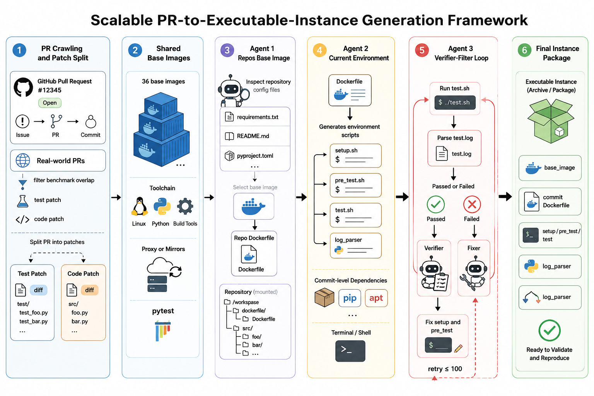

# Verified Environment Scaling for Code Agents

## Contents

- [Benchmark Timeline by Capability](#benchmark-timeline-by-capability)
  - [The Analysis Frame](#the-analysis-frame)
  - [Reading the Landscape](#reading-the-landscape)
  - [Trajectory Datasets for Training](#trajectory-datasets-for-training)
- [AutoBuilder: From Crawled PR to Verifiable Environment](#autobuilder-from-crawled-pr-to-verifiable-environment)
  - [Why Build Our Own](#why-build-our-own)
  - [Six-Stage Pipeline](#six-stage-pipeline)
  - [Three Engineering Levers](#three-engineering-levers)

## Benchmark Timeline by Capability

### The Analysis Frame

比较 benchmark 之前，先固定坐标轴。本文用三个描述性指标刻画每一个 benchmark，后续严格复用这套词：

- **任务形态（Task Form）**：issue→patch、代码补全、全周期开发、后端服务部署。它决定评测接什么 scaffold。
- **分布（Distribution）**：语言分布决定它测哪些语言的泛化；任务难度分布用 LOC 与改动文件数刻画，决定它测中等修改还是长程演化。
- **评测方式（Evaluation）**：exec-based 通过运行测试给出通过 / 失败裁决，可复现；LM-as-judge 用另一个模型打分，引入不可复现的噪声。

这三个指标共同映射到六种**能力维度（Capability）**：缺陷定位、多文件协同、多语言泛化、长程演化、全流程开发、后端服务行为。

### Reading the Landscape

> [Code Benchmarks](code-bench.md) ｜ [A Survey on Coding](blog.md)

| 发布日期 | Benchmark | Download | 任务形态 | 编程语言 | 题目数量 | 影响力 | 考察能力 / 可补强方向 |
|---|---|---|---|---|---|---|---|
| 2023 |  [SWE-bench](https://arxiv.org/abs/2310.06770) | [GitHub](https://github.com/SWE-bench/SWE-bench) | Issue→Patch | Python | 2294 | [5.4k star](https://github.com/SWE-bench/SWE-bench) | **缺陷定位 + 多文件修改的原型**：issue→patch 形态的根 |
| 2023 | [RepoBench](https://arxiv.org/abs/2306.03091) | [GitHub](https://github.com/Leolty/repobench) | 代码补全 | Python / Java | 10K+ | — | **跨文件依赖感知**：仓库级 next-line 补全，match-based |
| 2023 |  [CrossCodeEval](https://arxiv.org/abs/2310.11248) | [GitHub](https://github.com/amazon-science/cceval) | 代码补全 | Python / Java / TS / C# | 2665 | — | **跨文件上下文利用**：每题强制依赖跨文件上下文 |
| 2024 |  [SWE-bench Multilingual](https://huggingface.co/datasets/SWE-bench/SWE-bench_Multilingual) | [HF](https://huggingface.co/datasets/SWE-bench/SWE-bench_Multilingual) | Issue→Patch | ~9 种语言 | ~300 | [136k 下载](https://huggingface.co/datasets/SWE-bench/SWE-bench_Multilingual) | **多语言泛化基线**：首个系统化多语言 issue→patch |
| 2024/8 |  [SWE-bench Verified](https://openai.com/index/introducing-swe-bench-verified/) | [HF](https://huggingface.co/datasets/SWE-bench/SWE-bench_Verified) | Issue→Patch | Python | 500 | [73.9k 下载 / 107 likes](https://huggingface.co/datasets/SWE-bench/SWE-bench_Verified) | **干净信号的缺陷定位**：人工去噪 500 题，已趋饱和 |
| 2025/4 |  [Multi-SWE-bench](https://arxiv.org/abs/2504.02605) | [GitHub](https://github.com/multi-swe-bench/multi-swe-bench) | Issue→Patch | Java / TS / JS / Go / Rust / C / C++ | 1632 | [352 star](https://github.com/multi-swe-bench/multi-swe-bench) | **非 Python 泛化**：补 Pro 缺失的 Rust / Java / C++ |
| 2025/4 |  [SWE-PolyBench](https://arxiv.org/abs/2504.08703) | [GitHub](https://github.com/amazon-science/SWE-PolyBench) | Issue→Patch | Java / JS / TS / Python | 2110 | [89 star](https://github.com/amazon-science/SWE-PolyBench) | **多任务类型**：bug fix / feature / refactor，exec + AST 双指标 |
| 2025/4/19 | [R2E-Gym](https://arxiv.org/abs/2504.07164) | [GitHub](https://github.com/R2E-Gym/R2E-Gym) | 代码补全 / RL 环境 | Python | 8700+ | — | **RL 训练环境**：反向合成问题描述，双验证器 |
| 2025/5/10 |  [SWE-rebench V1](https://arxiv.org/abs/2505.20411) | [HF](https://huggingface.co/datasets/nebius/SWE-rebench) | Issue→Patch / RL 环境 | 多语言 | — | [82.4k 下载 / 68 likes](https://huggingface.co/datasets/nebius/SWE-rebench) | **训练+评测双用池**：自动 setup agent 合成可执行任务 |
| 2025/5/19 | [Terminal-Bench](https://www.tbench.ai/) | [GitHub](https://github.com/laude-institute/terminal-bench) | 终端 / CLI 代理 | 语言无关 | 80（1.0）/ 89（2.0） | — | **终端环境端到端任务**：真实终端里探索、装依赖、跑命令、验证，2.1 为当前活跃版 |
| 2025/9 |  [SWE-bench Pro](https://arxiv.org/abs/2509.16941) | [HF](https://huggingface.co/datasets/ScaleAI/SWE-bench_Pro) | Issue→Patch | 4 语言类 / 11 仓库类 | <1K | [59.3k 下载 / 152 likes](https://huggingface.co/datasets/ScaleAI/SWE-bench_Pro) | **真实工程长程能力**：企业级高难度，本文对照系 |
| 2025/9/18（2026/5/16 更新） |  [SWE-bench Live](https://arxiv.org/abs/2505.23419) | [GitHub](https://github.com/SWE-bench-Live/SWE-bench-Live) | Issue→Patch | Python；MultiLang | 1319 | [208 star](https://github.com/SWE-bench-Live/SWE-bench-Live) | **持续新鲜度 + 跨平台**：月度滚动新仓库，含 Windows 切片 |
| 2025/10/15 | Agentic-Multi-SWE-RL | [HF](https://huggingface.co/datasets/II-Vietnam/Agentic-Multi-SWE-RL) | Issue→Patch / RL 环境 | 14 种语言 | 7526 | — | **长 patch + 宽语言**：14 语言，LOC 323 远超 Pro 160 |
| 2026/1 | SWE-bench++ | [HF](https://huggingface.co/datasets/TuringEnterprises/SWE-Bench-plus-plus) | Issue→Patch | 9 种语言 | 500（已公开） | — | **大规模长程多文件修改**：平均编辑 120+ 行、7+ 文件 |
| 2026/1/16 | [ABC-Bench](https://arxiv.org/abs/2601.11077) | [GitHub](https://github.com/OpenMOSS/ABC-Bench) | 后端服务部署 | 8 种语言 | 224 | — | **真实服务行为**：容器化部署 + HTTP API 端到端测试 |
| 2026/2/9 | [ProjDevBench](https://arxiv.org/abs/2602.01655) | [GitHub](https://github.com/zsworld6/projdevbench) | 全流程开发 | 多语言 | 20 | — | **全流程规划**：需求 → 完整 codebase，含 LM-judge |
| 2026/2/27 |  [SWE-rebench V2](https://arxiv.org/abs/2602.23866) | [HF](https://huggingface.co/datasets/nebius/SWE-rebench) | Issue→Patch / RL 环境 | 20 种语言 | 32000+ | — | **训练+评测双用池（最大）**：3600+ 仓、自动 setup agent 动态切片 |
| 2026/3 | [PostTrainBench](https://arxiv.org/abs/2603.08640) | [GitHub](https://github.com/aisa-group/PostTrainBench) | AI 研发自动化 | Python | 4 模型 × 7 基准 | — | **能否自动化后训练**：CLI agent 用 SFT/GRPO/LoRA 等在限时限卡内提升模型分，K3 blog 用 Lite 变体 |
| 2026/4 | Monthly-SWEBench-2026 | [HF](https://huggingface.co/datasets/UnipatAI/Monthly-SWEBench-2026-03) | Issue→Patch | 以 Go 为主 | 600 | — | **企业级新鲜切片**：kubernetes / envoy 等，Go 为主 |
| 2026/4/9 | [SWE-EVO](https://arxiv.org/abs/2512.18470) | [HF](https://huggingface.co/datasets/Fsoft-AIC/SWE-EVO) | 长程演化 | Python | 48 | — | **长程多文件演化**：平均改 21 文件，GPT-5.4 仅 25% |
| 2026/5 | [SWE-Cycle](https://arxiv.org/abs/2605.13139) | [HF](https://huggingface.co/datasets/tubehhh/SWE-Cycle) | 全流程开发 | 多语言 | 489 | — | **全周期能力**：环境重建 + 实现 + 测试生成四模式 |
| 2026/5/5 | [ProgramBench](https://arxiv.org/abs/2605.03546) | [GitHub](https://github.com/facebookresearch/ProgramBench) | 全流程重建 | Go / Rust / C / C++ / Java 等 | 200 | — | **从零重建程序**：仅给编译产物 + 文档，重建完整 codebase，248k 行为测试判分 |
| 2026/5/6 | [SWE Context Bench](https://arxiv.org/abs/2602.08316) | — | Issue→Patch | 9 种语言 | 1476 | — | **上下文复用效率**：shared-context 任务对（未公开数据） |
| 2026/5/9 | [MLS-Bench](https://arxiv.org/abs/2605.08678) | [GitHub](https://github.com/Imbernoulli/MLS-Bench) | ML 科学 | Python | 140（Lite 30） | — | **能否发明可泛化的 ML 方法**：单次约束编辑，测泛化与扩展性，K3 blog 用 Lite |
| 2026/5/14 | [SWE-Chain](https://arxiv.org/abs/2605.14415) | [GitHub](https://github.com/CUHK-ARISE/SWE-Chain) | 长程演化 | Python | 1660 | — | **版本升级链**：链式评测，上一步输出作下一步输入 |
| 2026/5/26 | [DeepSWE](https://deepswe.datacurve.ai) | [GitHub](https://github.com/datacurve-ai/deep-swe) | Issue→Patch | 多语言 | 113（v1.1） | — | **活跃开源仓长程任务**：程序化隔离判分，GPT-5.6 model card 采用 |
| 2026/6/5 | [SWE-Marathon](https://arxiv.org/abs/2606.07682) | [GitHub](https://github.com/abundant-ai/swe-marathon) | 超长程开发 | 多语言 | 20 | — | **数小时级自主开发**：库复现 / 全栈克隆 / 编译器 / 内核优化，多层验证防捷径 |
| 2026/7 | [FrontierSWE](https://frontierswe.com) | [GitHub](https://github.com/Proximal-Labs/frontier-swe) | 前沿工程 | Zig / Rust / Haskell / Mojo / 汇编 | 17 | — | **人类能力边缘的工程**：实现 / 研究 / 性能优化三类，复合评分 |

沿时间线读，这张表是一条能力递进的线。按发布时间分五代，每一代补上前一代测不到的能力。

- **2023 — 跨文件补全奠基，issue→patch 定型**：RepoBench 与 CrossCodeEval 把仓库内多文件依赖感知变成可量化的题（next-line 补全，match-based 评测）；SWE-bench 本体把真实 GitHub issue 到多文件 patch 的完整任务形态定下来，成为后续整条主线的根。

- **2024 — 人工验证与多语言，把主线做扎实**：SWE-bench Verified 由 OpenAI 联合原作者人工验证出 500 道确定可解的题，剔除原集里的噪声，成为此后事实上的标准评测集；SWE-bench Multilingual 第一次系统考察跨语言泛化。

- **2025 上半年 — issue→patch 规模化，多语言铺开**：Multi-SWE-bench 用 7 种语言补 Rust / Java / C++；SWE-PolyBench 覆盖 bug fix / feature / refactor，exec + AST 双指标；R2E-Gym 从 commit diff 反向合成描述，偏 RL 训练。

- **2025 下半年 — 规模化、滚动更新、企业级难度**：SWE-bench Live 建立每月自动更新 50 题的流程；SWE-bench Pro 用企业级仓库构造长程高难度任务，是本文目标对照系；Agentic-Multi-SWE-RL 把语言覆盖推到 14 种、平均 LOC 达 323；Terminal-Bench 则跳出 issue→patch，只给终端和目标，测代理的环境操作能力。

- **2026 — 长程、全流程、后端垂直三线并进**：SWE-EVO 测版本化演化（平均改 21 文件）；SWE-Chain 测版本升级链；SWE-Cycle 串起全周期四模式；ABC-Bench 要求容器化服务部署加 HTTP 端到端测试，测真实服务行为；DeepSWE 用活跃开源仓 + 程序化隔离判分，与 Pro 形成互补对照。

- **2026 中 — 任务形态外扩，从改代码到造系统与做研究**：ProgramBench 只给编译产物反推整份源码；SWE-Marathon 把单题拉到数小时级的全栈 / 编译器 / 内核工作，用多层验证防捷径；FrontierSWE 换到 Zig / Mojo / 汇编等低资源语言，17 题即可分层；PostTrainBench 与 MLS-Bench 更进一步，把评测对象从「能不能写代码」抬到「能不能自动化 AI 研发」。

**如何选题。** SWE-bench Verified 是干净的基线，但当前顶级模型已在 80 分上下，剩余做不对的题存在较多假阴问题（测试描述模糊、任务本身存在歧义），不太能反映模型能力的进一步提升，训练增量有限。按补强目标反查：

- 多语言泛化 → Multi-SWE-bench、SWE-PolyBench、SWE-rebench 系的非 Python 切片
- 长 patch 与长程演化 → Agentic-Multi-SWE-RL、SWE-bench++、SWE-EVO
- 全流程与真实服务行为 → SWE-Cycle、ABC-Bench
- 低资源语言与性能优化 → FrontierSWE、ProgramBench 的系统级语言切片
- 终端 / 环境操作能力 → Terminal-Bench
- 超长时程自主执行 → SWE-Marathon
- 评测方式是硬门槛：纯 exec-based（SWE-PolyBench、SWE-bench Live、SWE-EVO、ProgramBench）可作主指标，含 LM-judge（ProjDevBench）只作参考

### Trajectory Datasets for Training

本节调研了可公开获取的 SFT / RL 轨迹数据集。由于现有数据集的教师模型大多是低版本 Opus 或能力相对较弱的开源模型，轨迹质量有限，直接用于训练的价值不高——更有参考意义的是这些数据集在轨迹筛选、质量控制、元数据标注上的处理思路。

| 发布日期 | 数据集 | 生成模型 | 轨迹数量 | 影响力 | 特性 / 训练用途 |
|---|---|---|---|---|---|
| 2025/11 |  [SWE-smith-mini_swe_agent_plus-66k](https://huggingface.co/datasets/Kwai-Klear/SWE-smith-mini_swe_agent_plus-trajectories-66k) | 更强 LLM 蒸馏 | 66000 | [1.2k 下载 / 11 likes](https://huggingface.co/datasets/Kwai-Klear/SWE-smith-mini_swe_agent_plus-trajectories-66k) | **可直接用的 SFT 素材**：快手 Klear，mini_swe_agent 在 SWE-smith 上 rollout，每实例 3 条、55 步 |
| 2025/11/25 | [claude-opus-4-5_swebench_verified_traj](https://huggingface.co/datasets/livesweagent/claude-opus-4-5_swebench_verified_traj) | Claude Opus 4.5 等五教师 | 3500 | [81 下载 / 3 likes](https://huggingface.co/datasets/livesweagent/claude-opus-4-5_swebench_verified_traj) | **长轨迹高质量 SFT**：SWE-bench Verified 完整多轮 rollout，五教师，平均 53k token |
| 2026/1/30 |  [MEnvData-SWE-Trajectory](https://huggingface.co/datasets/ernie-research/MEnvData-SWE-Trajectory) | Claude Sonnet 4.5 | 3900 | [117 下载 / 27 likes](https://huggingface.co/datasets/ernie-research/MEnvData-SWE-Trajectory) | **最长轨迹，长程交互训练**：百度 ERNIE，942 库 / 10 语言，平均 72.7k token，OpenHands |
| 2026/2 |  [nemotron-terminal-software_engineering](https://huggingface.co/datasets/nvidia/nemotron-terminal-software_engineering) | DeepSeek-V3.2 | 15559 | — | **快速 SFT + 终端交互**：NVIDIA 官方，terminus-2 生成，轨迹短（16 步），medium 占 68% |
| 2026/2/26 | [Scale-SWE-Distilled](https://huggingface.co/datasets/AweAI-Team/Scale-SWE-Distilled) | DeepSeek V3.2 | 71000 | [664 下载 / 18 likes](https://huggingface.co/datasets/AweAI-Team/Scale-SWE-Distilled) | **筛过的大规模高质量集**：600 万+ PR 漏斗筛 10 万实例，平均 62.5k token |
| 2026/3/11 |  [Nemotron-RL-Agentic-SWE-Pivot-v1](https://huggingface.co/datasets/nvidia/Nemotron-RL-Agentic-SWE-Pivot-v1) | — | 50661 | [704 下载 / 13 likes](https://huggingface.co/datasets/nvidia/Nemotron-RL-Agentic-SWE-Pivot-v1) | **step-level RL 轨迹**：每行一个 agent 操作，2484 实例 OpenHands 环境 50K+ 训练步 |
| 2026/4 |  [swe-oec-claude-expert](https://huggingface.co/datasets/ScaleAI/swe-oec-claude-expert) | 多个 Claude 版本 | 1268 | [32 下载 / 1 likes](https://huggingface.co/datasets/ScaleAI/swe-oec-claude-expert) | **100% 成功的专家轨迹**：Scale AI，直接可用，偏 Easy、LOC 低（42.6） |
| 2026/4/15 更新 | [Agentic-Hell-SWE-Master](https://huggingface.co/datasets/aaravriyer193/Agentic-Hell-SWE-Master) | — | 225170 | [17 下载 / 1 likes](https://huggingface.co/datasets/aaravriyer193/Agentic-Hell-SWE-Master) | **未加工原料**：量最大但无 resolved 标签 / 元数据，难筛质量 |
| 2026/5 更新 |  [agentic-coding-trajectories](https://huggingface.co/datasets/thoughtworks/agentic-coding-trajectories) | Claude 3.7 Sonnet + GPT-4o + Qwen3-Coder-480B | 15000 | [207 下载](https://huggingface.co/datasets/thoughtworks/agentic-coding-trajectories) | **多源多框架混合**：Thoughtworks，3 来源 × 3 框架，30.8% resolved |
| 2026/5/21 | [SWE-Next-SFT-Trajectories](https://huggingface.co/datasets/TIGER-Lab/SWE-Next-SFT-Trajectories) | Claude 4.5 Sonnet + GPT-5-mini | 3692 | [242 下载 / 1 likes](https://huggingface.co/datasets/TIGER-Lab/SWE-Next-SFT-Trajectories) | **高质量成功轨迹**：TIGER-Lab SWE-Next，平均 55 步 |

轨迹的直接可用性受制于教师模型质量，但这批数据集在处理方式上有值得参考的思路：

- **轨迹长度决定适用场景**：短轨迹（16 步量级）适合快速 SFT 与终端交互补强；长轨迹（70k token 量级）保留完整的长程交互模式，适合多步规划训练。
- **元数据质量决定可筛性**：Agentic-Hell-SWE-Master 有 22.5 万条但无任何元数据，几乎无法按质量筛选；Scale-SWE-Distilled 的 7.1 万条经过 600 万 PR 的漏斗，示范了大规模筛选的工程做法。
- **轨迹量最大不等于最能用**：决定价值的是能否施加质量筛选，以及 resolved 标签是否可信。

---

## AutoBuilder: From Crawled PR to Verifiable Environment

### Why Build Our Own

公开集的语言、仓库、难度分布，本质是别人提交的 PR 分布的投影。我们需要的某些语言、某些难度组合，在任何公开集里都凑不齐——SWE-Bench Pro 偏 Python 与 Go，Multi-SWE-bench 补了 Rust / Java / C++ 但仍受限于已有开源 PR 的分布。要拿到分布可控、语言可控、难度可控的训练环境，只能自己爬取真实仓库、自己构造。

AutoBuilder 就是这条我们完全控制的产线——爬取真实 PR，铸成能自动判分的可验证实例。它比公开集里同类的 agent 合成环境方案起步更早，控制粒度也更细：语言、难度、仓库来源都由我们决定，而非受采集到的开源 PR 分布摆布。

- 基于 AutoBuilder 的可验证环境搭建，最终合成 **22k** 验证环境，覆盖 **31 种语言**，环境合成成功率从 **12% 提升到 48%**。（SWE Expert 实验总结）

  

### Six-Stage Pipeline

整条流水线把一个真实 PR 逐级提纯成能自动判分的沙盒：

1. **PR 采集与切分**：从 GitHub 爬取真实 open PR，将每个 PR 拆成 test patch（测试改动）与 code patch（源码改动）。可验证性定义藏在这两半的关系里——只打 test patch 测试应失败，两者都打上应通过。

2. **共享基础镜像**：预置一批共享 base image 覆盖常见 Linux / Python / 构建工具链，避免每个 PR 从零搭镜像，为规模化构建打底。

3. **仓库基础镜像生成**：Agent 1 读取仓库配置文件，从共享 base image 里选最合适的一个，生成 repo 级 Dockerfile，处理整个仓库共用的依赖。

4. **Commit 环境生成**：Agent 2 在 repo Dockerfile 之上生成 `setup.sh`、`pre_test.sh`、`test.sh` 和 `log_parser`，补齐 commit 级依赖，四个产物分别负责装环境、测试前准备、运行测试、解析输出。

5. **验证-修复循环**：Agent 3 运行 `test.sh` → 解析输出 → 校验 FAIL_TO_PASS 判据。不成立时修改 `setup.sh` / `pre_test.sh` 重跑。

6. **最终打包**：循环收敛后打成自包含可执行实例，可在任意时刻、任意机器上重新运行并给出确定裁决。

### Three Engineering Levers

三个工程手段将 AutoBuilder 的可验证环境构建成功率从 **12%** 提升到 **48%**，每个手段各对应一个具体瓶颈：

1. **逐层递进构建镜像依赖**：依赖分三层叠加——共享 base image 摊薄系统级公共依赖，repo Dockerfile 加仓库级依赖，commit 脚本补 commit 级依赖。绝大多数环境的公共部分只构建一次，每个新环境只在稳定底座上增量补自己的那一层，构建复杂度从全量降到增量。

2. **判定靠真实执行，而非文本匹配**：不同语言、不同测试框架的日志格式千差万别，用正则匹配会频繁误判，误判环境流入训练就是污染 reward。多 Agent Loop 让判定完全基于真实编译与执行结果：`test.sh` 真实运行，`log_parser` 解析成结构化信号，Verifier 校验判据。真实执行是硬信号，不受日志格式差异影响。

3. **从成功/失败轨迹蒸馏先验，回注 prompt**：合环境的 Agent 单次生成成功率低，试错高度重复。对比成功与失败轨迹，蒸馏出显式的构建链专家经验作为动态先验回注到后续 Agent 的 prompt，把一次性试错固化成可复用先验。这是把成功率从个位数量级抬向近半的核心杠杆。

---

# References

**SWE-bench 官方家族**
- SWE-bench 组织主页（全部数据集）— [huggingface.co/SWE-bench](https://huggingface.co/SWE-bench)
- SWE-bench 本体 — [arXiv 2310.06770](https://arxiv.org/abs/2310.06770) ｜ [GitHub 5.4k star](https://github.com/SWE-bench/SWE-bench)
- SWE-bench Verified — [OpenAI 公告](https://openai.com/index/introducing-swe-bench-verified/) ｜ [HF dataset](https://huggingface.co/datasets/SWE-bench/SWE-bench_Verified)
- SWE-bench Multilingual — [HF dataset](https://huggingface.co/datasets/SWE-bench/SWE-bench_Multilingual)

**SWE-bench Pro 对照**
- SWE-Bench Pro — [arXiv 2509.16941](https://arxiv.org/abs/2509.16941) ｜ [Scale Leaderboard](https://scale.com/leaderboard/swe_bench_pro_public) ｜ [HuggingFace dataset](https://huggingface.co/datasets/ScaleAI/SWE-bench_Pro)

**Issue→Patch 与多语言**
- SWE-bench Live — [arXiv 2505.23419](https://arxiv.org/abs/2505.23419) ｜ [Leaderboard](https://swe-bench-live.github.io/)
- SWE-PolyBench — [arXiv 2504.08703](https://arxiv.org/abs/2504.08703) ｜ [GitHub](https://github.com/amazon-science/SWE-PolyBench)
- Multi-SWE-bench — [arXiv 2504.02605](https://arxiv.org/abs/2504.02605) ｜ [HF mini](https://huggingface.co/datasets/ByteDance-Seed/Multi-SWE-bench_mini)
- SWE-rebench V2 — [arXiv 2602.23866](https://arxiv.org/abs/2602.23866) ｜ SWE-rebench V1 — [arXiv 2505.20411](https://arxiv.org/abs/2505.20411)

**长程 / 全流程 / 后端**
- SWE-EVO — [arXiv 2512.18470](https://arxiv.org/abs/2512.18470)
- SWE-Chain — [arXiv 2605.14415](https://arxiv.org/abs/2605.14415)
- SWE-Cycle — [arXiv 2605.13139](https://arxiv.org/abs/2605.13139)
- SWE Context Bench — [arXiv 2602.08316](https://arxiv.org/abs/2602.08316)
- ABC-Bench — [arXiv 2601.11077](https://arxiv.org/abs/2601.11077)

**代码补全与训练环境**
- R2E-Gym — [arXiv 2504.07164](https://arxiv.org/abs/2504.07164)
- SWE-Gym — [arXiv 2412.21139](https://arxiv.org/abs/2412.21139)
- RepoBench — [arXiv 2306.03091](https://arxiv.org/abs/2306.03091)
- CrossCodeEval — [arXiv 2310.11248](https://arxiv.org/abs/2310.11248)

**终端 / 全流程重建 / 前沿工程**
- Terminal-Bench — [tbench.ai](https://www.tbench.ai/) ｜ [GitHub](https://github.com/laude-institute/terminal-bench)
- ProgramBench — [arXiv 2605.03546](https://arxiv.org/abs/2605.03546) ｜ [GitHub](https://github.com/facebookresearch/ProgramBench)
- SWE-Marathon — [arXiv 2606.07682](https://arxiv.org/abs/2606.07682) ｜ [GitHub](https://github.com/abundant-ai/swe-marathon)
- FrontierSWE — [frontierswe.com](https://frontierswe.com) ｜ [GitHub](https://github.com/Proximal-Labs/frontier-swe)
- DeepSWE（评测集） — [deepswe.datacurve.ai](https://deepswe.datacurve.ai) ｜ [GitHub](https://github.com/datacurve-ai/deep-swe)

**AI 研发自动化**
- PostTrainBench — [arXiv 2603.08640](https://arxiv.org/abs/2603.08640) ｜ [GitHub](https://github.com/aisa-group/PostTrainBench)
- MLS-Bench — [arXiv 2605.08678](https://arxiv.org/abs/2605.08678) ｜ [GitHub](https://github.com/Imbernoulli/MLS-Bench)

**其他对比基准**
- SWE-Lancer — [arXiv 2502.12115](https://arxiv.org/abs/2502.12115) ｜ [OpenAI 公告](https://openai.com/index/swe-lancer/)
- Commit0 — [arXiv 2412.01769](https://arxiv.org/abs/2412.01769)
- LiveCodeBench Pro — [arXiv 2506.11928](https://arxiv.org/abs/2506.11928) ｜ [Leaderboard](https://livecodebenchpro.com/)
- BigCodeBench — [HF blog](https://huggingface.co/blog/leaderboard-bigcodebench)
- Long Code Arena — [arXiv 2406.11612](https://arxiv.org/abs/2406.11612)
- DevBench / DevEval

