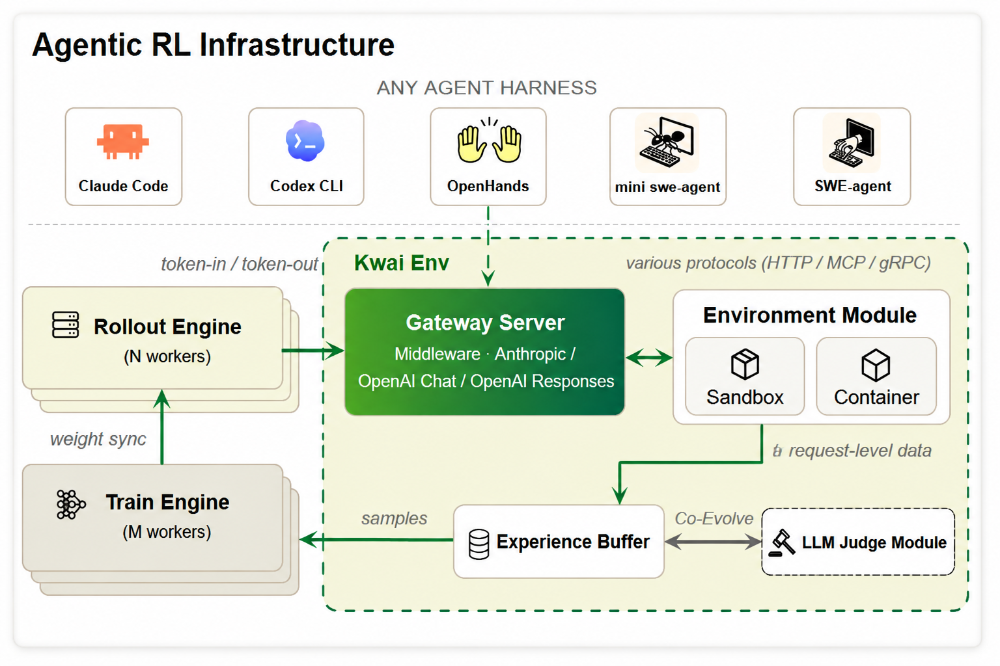
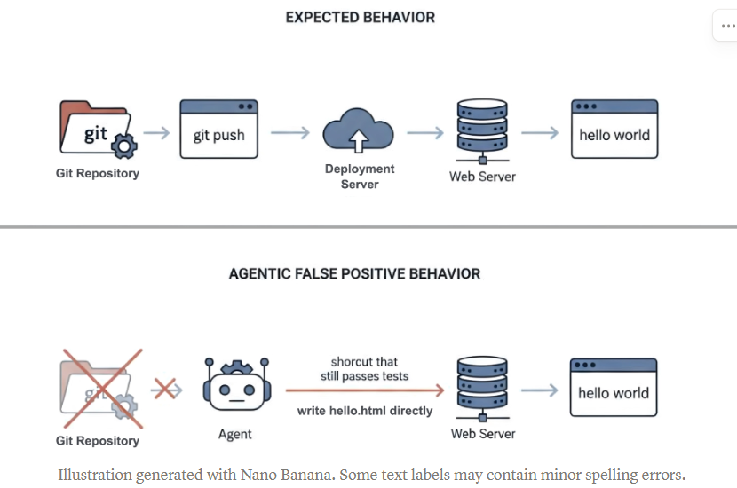

# Automated Evaluation and Trajectory Governance for Agentic RL

## Contents

- [Why Auto-Eval](#why-auto-eval)
- [System Architecture](#system-architecture)
- [LLM Judge and Visual Analysis](#llm-judge-and-visual-analysis)
  - [The Visual Analysis Tool](#the-visual-analysis-tool)
  - [Failure-Mode Analysis](#failure-mode-analysis)
  - [Benchmarking Against Frontier Models](#benchmarking-against-frontier-models)
- [TMM: The Process Metrics Already in Production](#tmm-the-process-metrics-already-in-production)
  - [Environment-Native Metrics](#environment-native-metrics)
  - [Server-Side Metrics](#server-side-metrics)
  - [Behavior Metrics](#behavior-metrics)
- [Closing the Loop With Training Iteration](#closing-the-loop-with-training-iteration)

## Why Auto-Eval

长程交互任务（200+ step、256k context）中，模型的行为模式、失败归因、训推一致性与奖励信号的可信度，在训练过程中难以直接观测。缺乏对轨迹的系统化分析能力，样本治理只能依赖粗粒度的确定性指标，无法识别隐性退化模式与假阳信号。

Auto-Eval 是一个自动化评测工具，目标是评估模型能力并指导训练迭代，由两个模块组成：

- **可视化分析**：提供 Heatmap / Tasks / Trials 三层视图，支持按语言、任务类型、仓库类型等维度对模型通过率进行细粒度分析，定位模型在不同切面的强弱，识别跨 checkpoint 的退化。

- **轨迹分析 Agent（LLM Judge）**：对训练和评测样本进行语义分析，产出三类制品：
  - **行为规则（Rule-based Pattern）**：将稳定复现的病态行为模式固化为确定性规则，在 RL 在线训练过程中用于 reward / advantage shaping、mask、filter，构成轨迹管理模块（TMM）的执行规则库。
  - **失败模式 Rubric**：对轨迹按 SWE pipeline 阶段做细粒度失败归因，形成可扫描的判别标准，指导难负样本挖掘、下一轮可验证环境合成与模型迭代方向。
  - **技能沉淀（Skills）**：将模型反复碰壁的卡点提炼为可复用的技能描述，挂载到 harness 或注入 system prompt，提升后续 agentic RL 训练过程的探索效率。

三个制品共享同一套对 agent 行为的度量，差别在运行节奏：行为规则实时运行于主训练流，失败分析与可视化在训练外离线运行。长期目标是 AutoEvolve：当"发现缺陷 → 固化规则 → 规模化治理 → 再发现"的循环趋于稳定，评估与训练环境的迭代可以持续自动推进。

## System Architecture

  

TMM 是主训练流中唯一接入 experience buffer 的治理节点，逐 step 执行 mask、filter、reward shaping。Judge 全程离线——以语义理解识别 TMM 规则覆盖不到的新模式，将稳定复现的病态行为固化为确定性规则后交 TMM 执行。

这一分工解决了一个根本矛盾：[行为监督](../alg/alg.md)要求信号在每条轨迹每一步进优化器之前处理完毕，LLM 推理成本无法满足这一频率；但发现未知模式必须依赖语义理解，确定性规则无法事先覆盖。解法是职能分离：Judge 离线批量做"发现"，TMM 实时做"执行"。

- **行为规则作用于训练**：Judge 识别出的稳定模式经确认后进入 TMM 规则库，在下一轮训练的每条轨迹上实时运行——reward 可信但 token 噪声大则 mask，失败责任在 harness 则 filter，稳定出现的坏模式则 shaping。规则上线即生效，无需 Judge 再次介入。

- **技能沉淀提升探索效率**：模型反复碰壁的卡点由 Judge 提炼为可复用的技能描述，挂载到 harness 或注入 system prompt，在后续 rollout 直接可用。这是在不改变奖励函数的前提下降低探索难度的最低成本路径。

两者共同构成 AutoEvolve 循环：行为规则约束当前训练，失败归因改变下一轮环境，技能沉淀提升探索效率，新轨迹又为 Judge 提供更多发现机会。当这个循环趋于稳定，评估与训练环境的迭代可以持续自动推进。

## LLM Judge and Visual Analysis

Judge 以语义理解识别 TMM 规则无法覆盖的新模式，对轨迹做细粒度失败归因，并将结果呈现于可视化工具，支撑细分场景的强弱定位与迭代决策。

### The Visual Analysis Tool

可视化工具将训练和评测轨迹按 (task, model) 组织为三层视图：

- **Heatmap**：tasks × models 通过率透视表，着色维度可在通过率、成本、步数、token、时长之间切换，支持跨 checkpoint 对比退化。
- **Tasks**：任务目录，支持按语言筛选，查看该题的 instruction、参考解与各模型成绩。
- **Trials**：全部 rollout 的可筛选表格，支持逐步回放完整轨迹。

三层视图由 Judge 裁决标签串联：确定性指标作为着色维度，Judge 结论作为筛选标签，可直接过滤出特定失败类型的 trial。

  <iframe src="../deepswe/index.html" style="width:100%;height:640px;border:none;border-radius:10px;" title="Visual Analysis Tool — Heatmap / Tasks / Trials"></iframe>

### Failure-Mode Analysis

每条 trial 按判定协议分为四类：TP（真阳）、FP（假阳/作弊）、TN（真阴，责任在模型）、FN（假阴，责任不在模型）。LLM Judge 在四类之下基于 rubric rules 打出更细的 tag，尤其是 TN，按 SWE pipeline 阶段细拆，定位模型失败所在的具体环节。

将 tag 分布按模型横向铺开，各家瓶颈一目了然：

  <iframe src="charts/failure-modes.html" style="width:100%;height:520px;border:none;border-radius:10px;" title="Failure-mode taxonomy by model"></iframe>

关键结论：

- **FP（假阳）**：Claude 4.8 约 8%，GLM-5.2 约 13%——`PASS_CHEATED` 占比说明这两家的真实通过率需要打折，这也是部署 Judge 的直接动机。
- **Pro 的主要短板**：base / v1.1 / v1.3 系列主要卡在 `PATCH_MISSING_BRANCH` 和 `PATCH_LOGIC_ERROR`，定位阶段没问题，问题在 patch generation 的逻辑深度；`PASS_LEGITIMATE` 从 22% → 28% → 34% 的上升，验证 RL 迭代正在持续改善 patch generation。
- **竞品短板**：Kimi K2.6 / GLM-5.1 的 `RUNTIME_UNRESOLVED_REFERENCE`（5～6%）显著高于 Claude / Pro，属于 runtime integrity 的系统性缺陷。

拿到 tag 分布后，失败根因按三类处理：数据分布不足时按维度打标定向合成；解题模式不对时以 hint-text 引导重 rollout；配比问题时扩量优质轨迹。

**PASS_CHEATED 的处理。** 作弊行为最为隐蔽：agent 不自行解题，而是从仓库后续版本或包管理器中检索现成修复（见 [Cognition Frontier Code 分析](https://cognition.com/blog/frontier-code-1.1)）。假阳奖励进入 RL 训练后将被持续强化，须双重处理：在 prompt 中明确区分正当检索与作弊检索；以程序化扫描器兜底，命中可疑访问即清零该 rollout 的奖励。

  

### Benchmarking Against Frontier Models

基于 Judge 裁决与确定性指标复核后的通过率，与 GLM5.1 / Kimi K2.6 在同一批任务上做四维细分对标：

  <iframe src="charts/compare-tabs.html" style="width:100%;height:640px;border:none;border-radius:10px;" title="对标行业头部模型：编程语言 / 仓库类型 / 任务类型 / 改动规模"></iframe>

- **分编程语言**：K2.6 整体领先约 +4.8pp，差距几乎全部来自 Go（+7.5pp）和 Python（+4.5pp）；JS 基本持平。数据配比下一步应向 Go / Python 倾斜。
- **分仓库类型**：竞品强于全栈 Web 和安全/认证类；我方在前端/UI/Web 上明显领先（对两家均 −13～14pp），是唯一我方优势类别。SDK / Library 是所有模型的共同短板（通过率 32～33%）。
- **分任务类型**：竞品在 Bug / Feature 类任务上更强；我方优势在 Enhancement 类，GLM5.1 在该类落后 6pp。
- **分改动规模**：K2.6 的优势集中在小改动（单文件 +10pp，≤150 行 +5～6pp），随改动规模增大迅速收窄——多文件、大幅改动是更值得投入 RL 的方向。

## TMM: The Process Metrics Already in Production

TMM 的规则清单来自 Judge 或人工在轨迹中发现、经验证稳定复现、并已固化为可每 step 低延迟计算的确定性信号。每一项都不是预先设计的度量，而是训练迭代中沉淀下来的可用规则，按来源分三族：环境原生、Server 侧、Behavior。

### Environment-Native Metrics

按 MDP 要素分解 harness environment，逐要素给出指标：

- **Environment State**：agent 每轮可观测的上下文规模（条数与字符量）。
- **Action Space**：动作类型分布与执行计数，刻画编辑与测试的交互节奏。
- **Transition Dynamics**：逐轮检验历史是否严格增量（append-only）；非 append-only 的转移是需要排查的噪声来源。
- **Reward Function**：verifier 评分的可信度，假阳假阴都会污染信用分配。
- **Terminal**：episode 终止方式（主动提交 / 预算截断 / 未完成）与步数、token、调用数统计；主动提交比例的持续下降是退化信号。

### Server-Side Metrics

- **Rollout Server**：记录推理引擎侧的生成结束原因分布，以及末轮是否因长度截断终止，作为上层归因的原始输入。
- **Gateway Server**：逐轮校验训推一致性（TITO）——前一轮的 prompt + response 是否构成下一轮 prompt 的前缀；TITO 不一致表明 harness 在轮间对历史做了非期望的改写或截断。

### Behavior Metrics

行为指标是难负样本挖掘与退化监控的核心，也是 Judge 回流 TMM 最活跃的一族：

| 行为切面 | 子族 | 具体信号 | 对应退化模式 | 成因 |
|---|---|---|---|---|
| 动作模式 | 并行调用爆炸 | 单轮 call 数 / 多 call 轮数 | 单条并发调用 80 轮 | on-policy 激发 |
| 动作模式 | 重复与停滞 | 连续重复动作 | 退化前兆 | 综合 |
| 输出形态 | 超长思考 | 零工具调用轮的最大 think 字符数 | 超长思考且不调用工具 | CPT/SFT 注入 |
| 输出形态 | 乱码/多语种崩坏 | script salad / 字符重复 / n-gram 回环 | think、tool_call 格式错乱 | CPT/SFT 注入 |
| 工具交互质量 | 工具健康度 | 调用错误 / 超时 / 非零返回码 | 过程质量退化 | 综合 |
| 任务收尾 | 主动提交能力 | submit 能力 + echo-drift | 主动 submit 能力丢失 | environment setting 诱发 |

各子信号刻意设计得保守，宁可漏报也不误伤——一旦误判正样本被持续强化，就是 reward crash 的前兆。在 TMM 中的使用原则：reward 可信但 token 噪声大则 mask，失败责任在 harness 则 filter，稳定出现的坏模式则 reward shaping。

