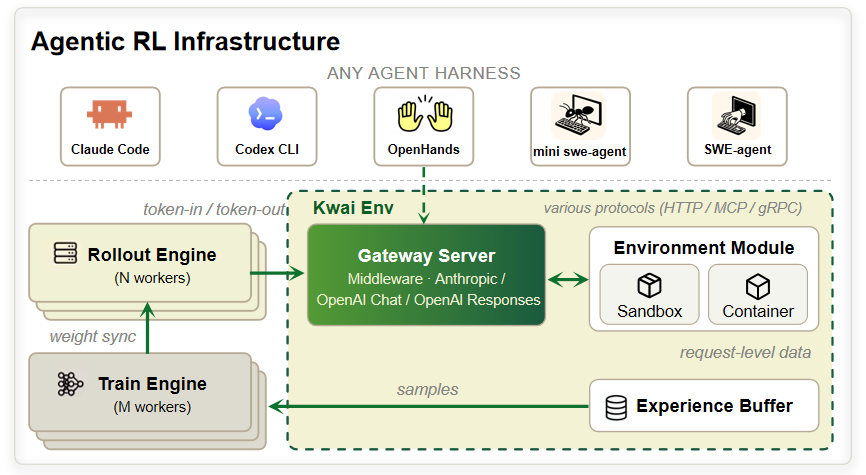

# Black-Box RL：面向真实 Harness 的 Agentic RL

## 1. Introduction

### 1.1 为什么需要专门的 Black-Box RL

Agentic RL 的训练对象已经不再是"训练器自己拥有的一段 rollout 函数",而是一整套**真实的、往往闭源的 Agent harness**——Claude Code、Codex、Qwen Code、mini-swe-agent、SWE-agent 等。这些 harness 内部自带事件循环、工具调用格式、上下文管理（压缩 / 注入 / 替换）、乃至 sub-agent 派生,通常以命令行程序、包管理工具或二进制的形式分发,内部逻辑对训练侧不可见。正如 [Polar](https://arxiv.org/abs/2605.24220) 所述,Agent RL 的训练目标本身已经从"一个简单标准化接口"变成"一个复杂的软件系统"。

要在这类目标上做 RL,传统两条路各有硬伤：

- **把 Agent 逻辑重写进 RL 框架的 Env 接口**（SkyRL-Agent、PRIME-RL 的早期做法）。每接一个新 harness 就要做一次框架特定集成,集成负担极大；更致命的是重写后的执行路径与线上原生路径不再是同一条,**训练分布与评估 / 部署分布出现系统性偏移**,原生 harness 里"价值往往就藏在工程细节中"的行为被抹掉。
- **低侵入 tracing / SDK 仪器化**（[Agent Lightning](https://arxiv.org/abs/2508.03680)、[rLLM](https://arxiv.org/abs/2504.xxxxx)）。降低了集成成本,但仍要求 Agent 服从规定好的 SDK / 回调接口——对以二进制或 CLI 分发、不暴露内部实现的 harness 依然不适用。

Black-Box RL 的答案是把集成边界推到**模型 API 这一层**：不打开盒子,也不强迫 harness 适配框架。关键观察是——**每一个基于 LLM 的 Agent,不管内部多复杂,都必须和模型对话**。模型 API 这条边界是唯一存在于所有 harness 之外的通用接口。在这条边界上放一个 Gateway/Proxy,倾听 harness 的每一次模型调用,直接捕获 token 级数据并重建成训练器可消费的轨迹,harness 全程按原样运行。这就把 Agent 同时变成了"可当黑盒"与"可被训练"。

  

这种设计的直接收益,是让 rollout 与 Agent harness、训练基础设施、RL 算法三者彻底解耦：慢且长尾的 harness rollout 可独立于 GPU 训练扩展,对外暴露一个与训练器无关的 rollout-as-a-service 接口。

### 1.2 与传统 RL 接口的区别

| | 传统 RL / RLVR | Black-Box RL |
| --- | --- | --- |
| 训练目标 | 训练器拥有的 Python 函数 / Gym Env | 不可改的真实 harness（可能是闭源二进制） |
| 集成边界 | 框架自有 Env API | **模型 API（provider 协议 / token 流）** |
| 谁适配谁 | Agent 适配框架 | 框架适配已有 Agent |
| 轨迹形态 | single-turn / append-only | 多轮、非 append-only（压缩 / 重写 / sub-agent） |
| 训练分布 | 与部署路径可能不一致 | 与原生执行路径**同一条** |

---

## 2. Black-Box RL 需要支持的特性

以下是让"把真实 harness 当黑盒来训练"这件事成立,一个 Black-Box RL 系统必须具备的能力。每一项都对应了业界工作已经踩过的坑。

### 2.1 TITO（Token-In-Token-Out）：模型 API 边界的 token 级保真

黑盒方案的第一性问题是**训练信号必须附着在 behavior policy 实际采样的那些 token 上**。而 provider API（Anthropic Messages / OpenAI Chat / OpenAI Responses）返回的是文本、tool-call JSON 或流式事件,不是推理后端实际使用的 token id 与 logprob。若训练侧把对话**解码再重新编码**,就会产生 [vLLM / Agent Lightning 指出的 re-tokenization drift](https://arxiv.org/abs/2508.03680)——re-encode 出来的 token id 与 rollout 时不一致,loss 被附到错误的 token 上,训练稳定性与 token efficiency 双输。

因此 Black-Box RL 需要 **TITO**：以 token id 直接进、token id 直接出（如走 SGLang 原生 `generate` 接口,`input_ids` 喂、`output_ids` 取,连同 `logprobs`),从物理上消除 drift。要在多轮 harness 里持续维持这一不变式,系统需要：

- **只追加的 token 历史 / 增量拼接**：committed 的 token 永不被重新 tokenize,新一轮只编码新增的 observation delta。这是 [Dressage](https://github.com/Accio-Lab/Dressage) TITO 的核心机制("只编码每一轮的 append delta 并增量拼接 token id"),[Polar](https://arxiv.org/abs/2605.24220) 的 prefix merging 也建立在同样的假设上。
- **精确的 seam 处理**：上一轮 assistant 结尾与下一轮 prompt 之间的间隙 token（server 侧的规范化渲染 + harness 插入的上下文）必须精确定位,assistant 内容从原始采样 token 复制、间隙 token 走规范渲染并被 mask。
- **Parser / template 一致性**：tool-call 解析、chat template 复用推理后端自身的配置,避免代理侧另起一套 parser / tokenizer 造成漂移。

> 取向差异：[Forge](https://www.minimax.io/news/forge-scalable-agent-rl-framework-and-algorithm) 恰恰把 TITO 作为批评对象,认为它"迫使 Agent 与底层 token 逻辑深度耦合",转而让 agent 完全不碰 token、把 token 一致性收进 trainer 侧。这是 Black-Box RL 在"token 保真放在哪一层"上的一条主要分歧线（详见 §3.3）。

### 2.2 真实 Harness 的轨迹合并 / 轨迹管理

真实 harness 的一个 session 会产生几十上百次模型调用,还夹杂上下文压缩、query rewrite、sub-agent 派生——**轨迹不是 append-only** 的。系统必须能把这一串离散的模型调用重建成训练器可用的轨迹,并处理两个层面：

- **重建策略要在"保真"与"样本膨胀"之间取舍**。最保守的 per-request（每次调用一条 trace）对单次调用无损,但会把一个连贯 session 切碎成几百条短样本、拖垮训练器,还会在广播 session 级 reward 时引入噪声信用分配、诱发 reward hacking（[Polar 消融](https://arxiv.org/abs/2605.24220) 明确观察到这一点）。因此需要 **prefix merging / segment-aware** 类策略,把满足"消息分组 key + 严格 token 前缀关系"的调用合并成更长的链,同时正确处理分裂点。
- **非 append-only 的分裂点必须被识别**。sub-agent、并行分支、上下文压缩、prompt 重写会打破 token 前缀关系,系统需让它们**自然落到不同的链 / segment**,而非强塞进同一条全局 trace。[Dressage](https://github.com/Accio-Lab/Dressage) 的 segment-aware training 即为此设计。
- **正确性不变式**：合并后,所有可训练 token 都与 rollout 时的 behavior policy 一致,所有非生成的间隙 token 都被 loss mask 屏蔽（Polar 与 Dressage 表述一致）。
- **Reward / advantage 传播**：一个 session 分裂出多个 segment / trace 后,结果级 reward 需正确广播——Dressage 把 anchor segment 的终态 advantage 广播给兄弟 segment,并用共享 `rollout_id / parent_traj_id` 保证同 step、prompt-equal 分母保证 GRPO 梯度缩放公平。

### 2.3 其余支撑能力（Black-Box RL 的完整拼图）

TITO 与轨迹管理是黑盒范式独有的核心；要跑起来还需以下能力,这些与通用 agentic RL infra 共享：

- **多 provider 协议兼容的 Gateway**：同一代理需识别并翻译 Anthropic Messages / OpenAI Chat / OpenAI Responses / Google `generateContent` 等风格,才能覆盖不同 harness（Polar 的代理即支持多协议）。
- **Rollout-as-a-Service + 异步分阶段**：运行时启动、harness 执行、轨迹重建、评估分到隔离 worker 池,把 CPU 重的运行时预热与长尾评估移出关键路径（Polar 的 `INIT/READY/RUNNING/POSTRUN`）。
- **Sandbox 与运行时隔离**：容器 / Apptainer 池化 + warm-up,统一 `start/stop/exec` 接口以无缝切换隔离后端；[Kimi-Researcher](https://moonshotai.github.io/Kimi-Researcher/) 的 K8s 混合云 + MCP stateful session 是大规模范例。
- **Partial Rollout / 长尾续跑**：长轨迹（>100k token、数百轮 tool call）需可中断、可存档、可跨轮续跑（Kimi-Researcher 的 turn-level partial rollout）。
- **可插拔 Evaluator / Reward**：结果级 reward、test-on-output、SWE-Bench/SWE-Gym harness evaluator 等按 registry 扩展。

---

## 3. 相关工作（References）

四项工作都把"真实 / 黑盒 harness 如何接入 RL"作为一等问题,分别代表不同取向。

### 3.1 Polar（NVIDIA）

[Polar: Agentic RL on Any Harness at Scale](https://arxiv.org/abs/2605.24220)（NeMo Gym 注册环境,ProRL Agent 重写版）是黑盒范式最完整的公开工作：**在 LLM API 边界放 provider 兼容代理,把 harness 当黑盒,记录 token 级请求 / 响应,重建 token 级保真轨迹**。代理接受 Anthropic / OpenAI Chat / OpenAI Responses / Google 风格请求,统一翻译成本地推理后端形态并加 `logprobs=true`。

- **架构**：rollout 服务器（任务调度）+ 网关节点（session 生命周期 + 模型代理 + 轨迹重建 + 评估），网关内 `INIT / RUNNING / POSTRUN` 三 worker 池 + 有界 `READY` 缓冲,把 CPU 重的运行时启动和长尾评估移出关键路径。
- **轨迹重建**：`per_request`（保守基线）与 `prefix_merging`（按 message-group key + 严格 token 前缀关系划分有序链，链内只把采样 assistant token 拷为可训练、屏蔽规范间隙 token）。消融显示 `prefix_merging` 把 1,185 条请求级更新压成 218 条合并 trace，wall-clock 快 **5.39×**,rollout GPU 利用率 20.4% → 87.7%。
- **结果**：仅用 GRPO，把同一个 Qwen3.5-4B 在 SWE-Bench Verified 上于 Codex / Claude Code / Qwen Code / Pi 四个 harness 分别提升 **22.6 / 4.8 / 0.6 / 6.2** 分,最大增益出现在工具 schema 最不熟悉的 Codex。

### 3.2 Dressage（Accio-Lab）

[Dressage](https://github.com/Accio-Lab/Dressage)（阿里 Accio，基于 slime）把设计拆成三条正交轴：**Paddock**（交互语义：whitebox Python tool loop vs blackbox HTTP agent）/ **Sandbox**（放置隔离：本地 bubblewrap vs 远程 E2B）/ **Slime**（训练底座），三者自由组合，以 dotted import-path hook 接入而不 fork 上游。

- **BlackboxServer**：坐落于 sandbox 内的统一 HTTP adapter，管理恰好一个后端 agent 进程 + 一个活跃 session，把 LLM 调用代理回 inference proxy；带 turn 幂等与 register-and-rebind。
- **Inference Proxy**：OpenAI 兼容,Agent 从不直连 SGLang，每个 token / logprob / loss_mask 都被捕获；支持可抢占生成与 weight version 追踪。
- **TITO**：记录 `token_id / logprob / loss_mask / token_version / token_expert`，核心机制是"只编码每一轮的 append delta 并增量拼接 token id"，以此规避 re-tokenization drift；该 token 模型同时支撑 version-aware masking 与 MoE Routing Replay（R3）。（注：其 TITO 目前仅支持 `qwen3_5`。）
- **Segment-aware training**：轨迹因历史压缩 / schema 变化而分裂时，把每个 segment 展开成训练样本，并把 anchor segment 的终态 advantage 广播给兄弟 segment。

### 3.3 Forge Gateway + Data Pool（MiniMax）

[Forge](https://www.minimax.io/news/forge-scalable-agent-rl-framework-and-algorithm)（MiniMax，M2.5 训练框架，未开源）以中间件层**物理解耦 agent 与 trainer**：

- **Gateway Server**：以标准协议处理 agent↔LLM 的 completion 请求，对 agent 屏蔽底层模型复杂度；黑盒 agent"只需把请求路由到 RL 服务 Gateway，数据采集与训练由框架在底层自动完成"。
- **Data Pool**：分布式存储，异步收集 rollout 轨迹与 report，作为 generation 与 training 之间的缓冲，承载 Efficiency vs Off-Policyness 的权衡。
- **Windowed FIFO** 调度：在宽度 W≈0.3N 的滑动窗口内允许乱序消费（缓解 HoL blocking），窗口外严格阻塞（抑制"偏向易样本"的分布漂移）。

Forge 在文中把 **TITO 架构作为对照批评对象**，认为它"迫使 Agent 与底层 token 逻辑深度耦合"，在复杂上下文管理下维持"推理抽象"与"训练表示"的严格一致"计算代价高昂"，主张用 Gateway 标准协议把 agent 高层推理与 token 表示解耦——把 token 一致性的负担收进 trainer 侧的 Prefix Tree Merge（配 Magi Attention，自报 ~40× 训练加速、数学等价）。这与 Polar / Dressage 在代理边界抓 token 的取向形成鲜明对比,是 Black-Box RL 的一条主要设计分歧。

### 3.4 Kimi-Researcher（Gym-like Serve）

[Kimi-Researcher](https://moonshotai.github.io/Kimi-Researcher/)（Moonshot）采用 **fully async rollout + Gym-like server-based 架构**，把 agent 环境以服务形式暴露、与训练解耦：

- **Turn-level partial rollout**：长尾任务存入 replay buffer 下一轮续跑而非重跑，自报 ≥1.5× 加速。
- **统一 Sandbox**：K8s 混合云 + MCP，多副本容错、零停机动态调度，"消除容器间开销同时保持隔离"；agent-tool 通信统一到支持 reconnection 的 stateful MCP session。
- **算法**：严格 on-policy REINFORCE，关闭 tool-call format enforcer 以保留模型自身分布，γ-decay 奖励短路径。

---

## 4. Reference

- Polar: Agentic RL on Any Harness at Scale — https://arxiv.org/abs/2605.24220 ([ProRL-Agent-Server](https://github.com/NVIDIA-NeMo/ProRL-Agent-Server))
- Dressage（Accio-Lab）— https://github.com/Accio-Lab/Dressage
- Forge: Scalable Agent RL Framework and Algorithm（MiniMax）— https://www.minimax.io/news/forge-scalable-agent-rl-framework-and-algorithm
- Kimi-Researcher — https://moonshotai.github.io/Kimi-Researcher/
- Agent Lightning（training-agent 解耦 / re-tokenization drift）— https://arxiv.org/abs/2508.03680
- SWE-bench — https://arxiv.org/abs/2310.06770 ｜ SWE-Gym — https://github.com/SWE-Gym/SWE-Gym
</content>

