# Distributed RL Infra in the Agentic RL Era

## 1. Industry Practice

### 1.1 Pre-LLM Era: Actor-Learner

LLM 之前，游戏 AI 阶段的大规模分布式 RL 已完成范式验证。以 [OpenAI Five](https://arxiv.org/abs/1912.06680)（Dota 2, 2019）为代表，系统为三层结构：

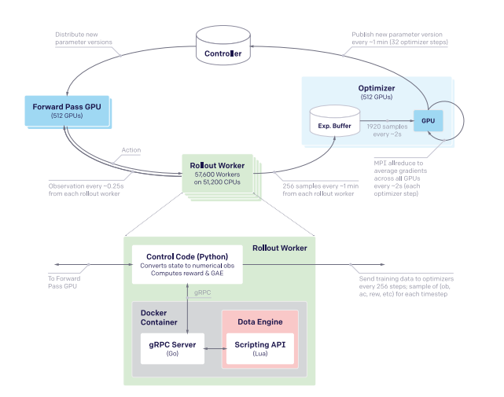

- **Rollout Worker**：CPU 侧运行，负责启动 game core、step 环境、采集 `(obs, action, reward)` 序列。游戏环境作为独立进程（Dota 2 client、StarCraft engine 等），并发规模可达 10⁴ 量级。
- **Forward Pass**：GPU 侧集中式推理服务。Rollout Worker 不在本地前向，而是将 observation 发送至推理服务 batch 后返回 action。该设计来自 [SEED RL](https://arxiv.org/abs/1910.06591)，用于避免 CPU worker 本地小 batch 推理造成的低利用率。
- **Optimizer**：从 experience buffer 读取样本，反向更新后将新参数推回 inference 侧。

三者通过 buffer 解耦，节奏无需对齐，天然异步。[IMPALA](https://arxiv.org/abs/1802.01561) 用 V-trace 修正 actor 与 learner 的策略漂移；SEED 将 inference 集中化；Dota 2 在此之上引入弹性容错与长周期训练。该架构的核心特征是 rollout / inference / train 三者解耦、样本池衔接、允许 staleness、算法侧通过 importance correction 兜底。

### 1.2 LLM-Era Open-Source Agentic RL Infra

LLM RL infra 最早的工程原型是 [OpenRLHF](https://github.com/OpenRLHF/OpenRLHF)（2023，Ray + DeepSpeed + vLLM）。[verl](https://github.com/volcengine/verl)（字节，2024）承接 OpenRLHF 的 RLHF 范式（actor / critic / ref / reward 四模型 + PPO），最初仅支持 single-turn。随社区从 RLHF 演进至 RLVR（reasoning，single-turn + rule/verifier reward），再至 agentic RL，verl 陆续补齐 agent loop、sandbox、hybrid reward。其演化路径为**由 single-turn 逐步扩展至 multi-turn**。

面向 agentic 场景原生设计的框架：

- [slime](https://github.com/THUDM/slime)（智谱/清华，**GLM 系列当前的 RL 训练框架**）：Megatron + SGLang，端到端 FP8、INT4 QAT、partial rollout 均为一等公民。

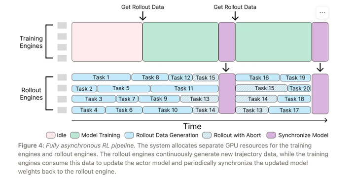

- [AReaL](https://github.com/inclusionAI/AReaL)（蚂蚁/清华，吴翼主导）：面向 fully async、staleness-bounded PPO。

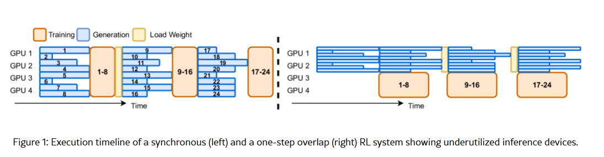

- [ROLL](https://github.com/alibaba/ROLL)（阿里，王维勋主导）：多环境并发 + 异步训推为设计起点。

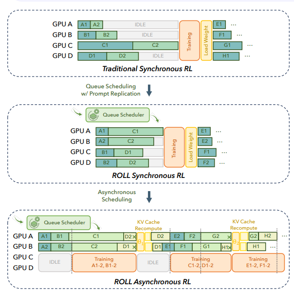

**闭源但公开了设计的两家**：

- [Kimi-Researcher](https://moonshotai.github.io/Kimi-Researcher/)（Moonshot）：未披露框架名（图为公开博客中的 Seer 架构示意）。关键设计包括 fully async rollout + Gym-like server-based 架构、turn-level partial rollout（长尾任务存入 replay buffer 下一轮续跑，自报 ≥1.5× 加速）、基于 K8s 混合云 + MCP 的统一 sandbox（多副本容错、零停机调度）。算法上采用严格 on-policy REINFORCE，关闭 tool-call format enforcer 以保留模型自身分布，使用 γ-decay 奖励短路径。

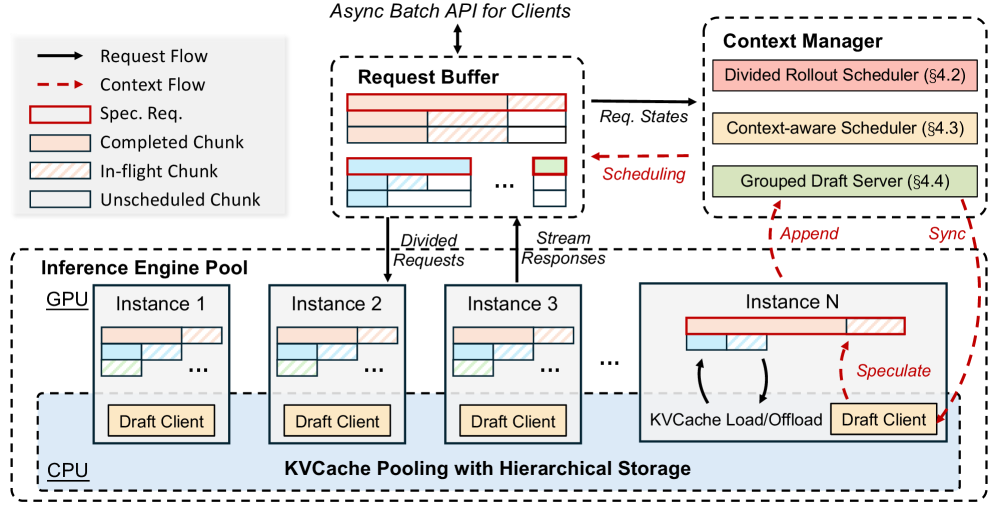

- [Forge](https://www.minimax.io/news/forge-scalable-agent-rl-framework-and-algorithm)（MiniMax，M2.5 训练框架，未开源）：三段式——Agent 侧 / Middleware（Gateway Server + Data Pool）/ Train-Infer 侧。核心设计是以**标准化 completion 协议物理解耦 agent 与 trainer**，agent 无需感知 tokenization 或训练切分，可接入任意 scaffold（已集成上百种 scaffold、上千种 tool 调用格式）。调度采用 **Windowed FIFO**（窗口 W≈0.3N 的滑动窗口，介于严格同步与贪心异步之间，缓解 HoL blocking 同时抑制"偏向易样本"的分布漂移）。算法侧基于 **CISPO** + 过程奖励 + 完成时间奖励 + Reward-to-go。训练规模：>100k 种真实 scaffold/环境、context 200k、日均百万级样本。

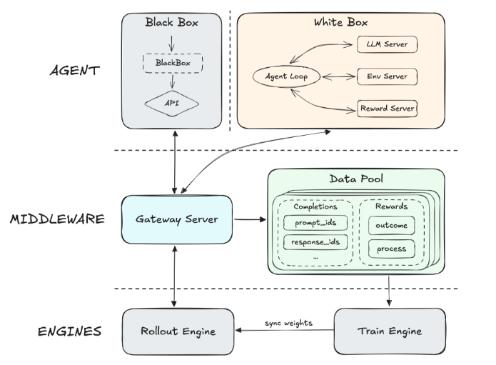

### 1.3 Agentic RL 与 RLHF / Reasoning RL 的区别

RLHF 与 reasoning RL 均可视为 agentic RL 的特例——single-turn、bandit、单次交互即出 reward。Agentic RL 的复杂度来源于：

- 黑盒 harness environment，状态转移不由训练侧控制；
- 单 episode 多轮交互，轨迹呈 **non-prefix-monotonic / non-append-only** 特征——前后轮 context 并非 append，而是被外部改写（sub-agent 返回值替换、query rewrite、summary 压缩，或 VLA 场景下观测不连续）；
- 环境沙箱需 CPU 大规模并发，并处理超时、冷启动、隔离。

LLM RL infra 的演进路径因此从游戏 AI 的全异步 Actor-Learner 出发，经过 RLHF 的同步简化版本，最终在 agentic RL 阶段回归 Actor-Learner 范式。

---

## 2. Acceleration

### 2.1 Training Acceleration

训练侧的瓶颈集中在三处：长序列 attention 复杂度、padding 浪费、MoE 在小 global batch 下的 all-to-all / pipeline bubble。Agentic RL 由于轨迹动辄 >100k token、单 prompt 多样本（GRPO 家族）、轨迹间共享长前缀，前两个问题被进一步放大。下面四项是当前 verl / slime / Megatron 等框架已落地的训练加速手段。

- **Forge Prefix Tree Merge**（[原文](https://www.minimax.io/news/forge-scalable-agent-rl-framework-and-algorithm)）：agent 多轮轨迹中，同一 rollout 产生的多样本及不同 branch 的 completion 普遍共享长前缀（system prompt、历史 turn、context 管理前状态）。常规做法将每条样本作为独立序列，共享前缀被重复 forward。Forge 将样本**在样本级合并为 prefix tree**，一次 tree-structured forward 覆盖全部分支，依赖 Magi Attention 等原语保证与标准 forward 数学等价，forward 后按 metadata 拆回以计算 loss。官方报告 **~40× 训练加速**，loss / metric 无变化。对 multi-sample-per-prompt（GRPO 家族）、multi-turn rollout 共享历史场景收益尤为显著。

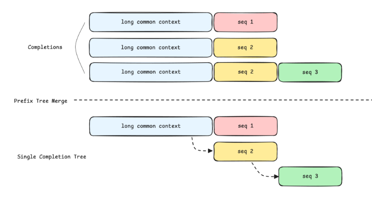

- **Dynamic batch + remove padding**：按 `max_token_len` 切 micro-batch，配 THD / varlen。verl 在 Megatron 与 FSDP 路径均默认启用；FSDP 下需配合 [Ulysses SP](https://arxiv.org/abs/2309.14509) 支持长序列切分。

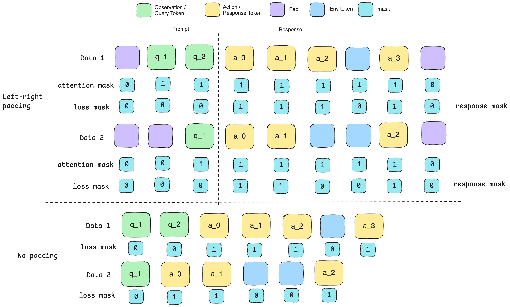

- **MoE overlap**：EP comm overlap、1F1B overlap、VPP micro-batch 重排，在 RL 小 global batch 下收益显著高于预训练。

### 2.2 Rollout Acceleration

[RollPacker](https://arxiv.org/abs/2510.01180) 的测量表明 rollout 阶段占 RL post-training 70% 以上时间，是 RL infra 的首要瓶颈。**Rollout 长尾**是核心成因：同一 batch 内 response 长度方差极大，同步 RL 需等待最长样本完成；agentic 场景进一步包含超时工具调用与卡住的环境。Rollout 加速可分为三层——**Model-Side**（生成侧的量化、spec decoding、KV cache 复用、PD 分离）、**Sandbox-Side**（环境侧的容器池化、MCP 会话、并发与超时控制）、以及业界其他工程实践。

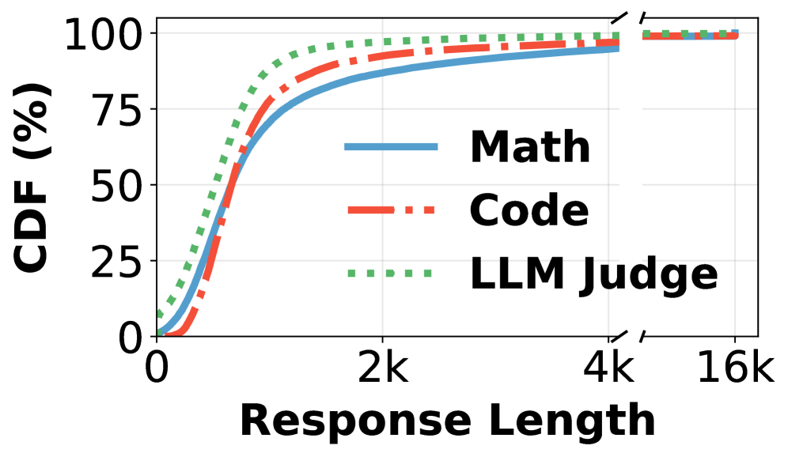

**Model-Side**（以下 Quantization、MTP spec decoding、KV cache reuse 三项的工程方案来自 [GLM-5 技术报告](https://arxiv.org/pdf/2602.15763)）：

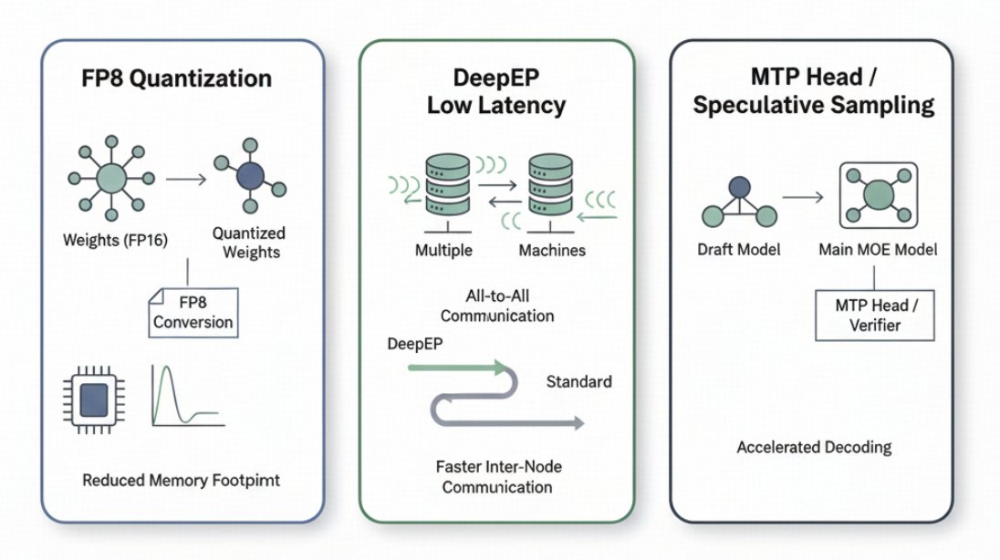
 

- **Quantization**：verl / slime 端到端 FP8（TransformerEngine blockwise + vLLM FP8 rollout + FP8 optimizer）；slime 支持 INT4 QAT（rollout INT4 + train fake-quant）。精度收益显著，但引入 train-infer diff，需算法侧配合。
- **MTP / Speculative Decoding**：[GLM-4.6](https://github.com/zai-org/GLM-4.5)、[DeepSeek-V3/R1](https://arxiv.org/abs/2412.19437)、[Qwen3-Next](https://github.com/QwenLM/Qwen3)、[MiMo](https://github.com/XiaomiMiMo/MiMo) 等自带 MTP head 的模型，verl/slime 均支持在 RL rollout 阶段启用 spec decoding。Forge 以 Top-K KL loss **在线微调 MTP head**，使 draft 跟随 RL policy 的分布漂移，避免 acceptance rate 随训练衰减。
- **KV Cache Reuse**：DP-aware routing（[sglang-router](https://github.com/sgl-project/sglang) `consistent_hashing`）将同前缀请求路由至同一 DP rank，agentic 多轮 / prefix 重复场景收益显著。Forge 进一步采用 **Global L3 KV Cache Pool**：DFS 支撑的全局 cache + cost-aware scheduler（在排队延迟与 cache 迁移开销间权衡路由）。
- **PD Disaggregation**：Forge 的 Heterogeneous PD disaggregation 将 prefill 与 decode 物理分离，MoE 混合调度下互不干扰，两侧可独立选择并行策略，对长 horizon agent 任务的 tail latency 收益明显。
- **Operator Layer**：[FlashAttention](https://arxiv.org/abs/2307.08691)、fused kernels、[PagedAttention](https://arxiv.org/abs/2309.06180)，不展开。

**Sandbox-Side**：agentic RL 的 rollout 时间中相当比例消耗在环境侧——code sandbox 启动、browser 页面加载、shell 执行、MCP server 调用。工程实践包括：

- **Container Pooling + Warm-up**：冷启动延迟常高于单次 LLM decode，warm pool、keep-alive、容器复用（带状态 reset）为基本配置。[Kimi-Researcher](https://moonshotai.github.io/Kimi-Researcher/) 的 K8s 混合云采用零停机动态调度 + 多副本容错，统一架构"消除容器间开销同时保持隔离"。
- **MCP + Stateful Session**：Kimi 将 agent-tool 通信统一至 MCP，支持 reconnection 的 stateful session，避免每次调用重建上下文。
- **Sandbox Bypass**：高频、纯函数工具（如 Python 执行 sandbox）可走轻量 subprocess + seccomp，免除 container 拉起；代价为隔离强度下降，仅适用于受控工具集。
- **Async Tool Call + Concurrency Control**：单 rollout 内的独立 tool call（并行搜索、并行文件读取）走 async concurrency，但每环境需设全局并发上限避免击穿外部 API。Forge 的完成时间奖励亦在算法侧激励并行工具调用。
- **Timeout Isolation**：长尾工具（卡住的 browser、死循环代码）须配硬超时 + 结构化 error 返回，避免单环境拖累整条轨迹；与 partial rollout 配合实现续跑。
- **Observability**：tool latency 分布、容器冷启动率、MCP 重连率、超时比例，在 agentic RL 中与 GPU MFU 同等重要。

**Additional Industry Practices**：按"创新点 / 可借鉴度"由高到低组织，并标注其优化对象（Rollout / Train / Env / 整体调度）。

**A. 跨 Rollout–Train 的算子级 / 数据流协同**

- **Disaggregated Stream Generation**（Rollout，**面向 disaggregated 部署**）：[StreamRL](https://arxiv.org/abs/2504.15930)（StepFun + 北大，2025，与 RLHFuse 同一团队的后续工作，正面对应 disaggregated 时代的优化轴）在物理分离 generation 与 training 集群的基础上，把两者之间的接口从"完整 trajectory"降到"token chunk 流"。需要澄清——**streaming 并不打破 outcome-reward RL 的算法假设**：PPO / GRPO / GSPO / CISPO 等仍需完整 trajectory 才能算 advantage，trainer 不会在 trajectory 未结束时就做梯度更新。Streaming 真正加速的是 trajectory 完成前可并行启动的下游 pipeline：

  - **Ref model logprob 流式计算**：ref policy logprob 仅依赖前缀，每出一个 token 即可算其在 ref 下的 logprob，与 generation 重叠。
  - **Process / Step-level reward** 可流式打分（outcome reward 仍需等终止）。
  - **数据准备流水线**（tokenize / pad / shard）在 token chunk 到达时增量进行，trajectory 一完成立刻进 forward/backward。
  - **Skewness-aware dispatch**：调度器观测 token 产出速率，把预测会长尾的样本提前送出、与短样本错峰，让短样本的 ref/reward 流水线在长尾结束前就准备好。

  本质：把"trajectory 完成后才能启动的串行后续 pipeline"压成与 generation 重叠的流式 pipeline。

- **Rollout–Train Stage Fusion**（Train + Rollout，**仅适用于 colocated 同步 RLHF**）：[RLHFuse](https://arxiv.org/abs/2409.13221)（StepFun + 北大，2024）的部署前提是同一 GPU 池既跑 rollout 又跑 train、stage 之间分时切换（OpenRLHF / 早期 verl 同步范式）。其核心观察是 stage 串行（generation → ref logprob → reward → critic → actor train）下长尾 rollout 期间多数 GPU 已空闲，把下一 stage 的算子提前调度到空闲 GPU，让 decode 与 train 算子在不同 SM / stream 上并发——decode 吃 HBM 带宽（memory-bound）、train 吃 Tensor Core（compute-bound），同卡内不互相挤占。报告端到端 **1.3×–2.1× 加速**。

  **对 agentic RL 的适用性**：有限。Agentic RL 主流走 fully-disaggregated（rollout 长尾 + sandbox CPU 并发使 colocated 几乎不可行，参见 StreamRL / AReaL / Forge / 美团 M17 fully async），rollout 集群与 train 集群物理分离、权重不在同一张卡上，RLHFuse 的同卡 stage fusion 无法直接照搬。其 insight 在 disaggregated 场景的对应物是 StreamRL 的跨集群流水线 overlap。RLHFuse 仍可作为 colocated 同步 reasoning RL 的优化参考。

**B. 环境侧状态复用**（Env，针对特定任务类型的可观工程收益）

- **Repository-Level State Caching**（Env）：[SWE-RL](https://arxiv.org/abs/2502.18449)（Meta/FAIR，2025）在代码 agent RL 中复用 repository 级别状态（git worktree、依赖环境），避免每轨迹重建 repo；配合 rule-based reward 在 Llama-3 70B 上 SWE-Bench Verified 达 41.0%。该思路可推广到任何"环境构建昂贵但任务间高度同构"的场景（数据库、浏览器配置、容器镜像）。

- **Parallel Tool Calling**（Rollout + Env）：单 turn 内将多个独立 tool call（并行搜索、并行文件读、独立 sub-agent 调用）打包并发发出，而非串行等待。[Kimi-Researcher](https://moonshotai.github.io/Kimi-Researcher/) 内置 parallel search tool；[Forge](https://www.minimax.io/news/forge-scalable-agent-rl-framework-and-algorithm) 在算法侧通过完成时间奖励（task-completion-time reward）激励模型学会并行调工具。注意这是**并行**而非投机——不预测未来 tool call，只是把已经决定要发的多个调用并发执行。

**C. 系统集成与生态对接**（工程价值高，理论 insight 较低）

- **Agent–Trainer Disaggregation**（整体调度）：[Agent Lightning](https://arxiv.org/abs/2508.03680)（Microsoft，2025）将 agent 执行层（LangChain / AutoGen / OpenAI Agents SDK）与 RL 训练层解耦，agent 仅暴露 trace，训练侧从 trace 采样 tuples，便于复用已有 agent 生态并并发起任意多实例。
- **Long-Horizon Agent Rollout**（Rollout + Env）：[SkyRL-v0](https://novasky-ai.github.io/posts/skyrl/)（Berkeley NovaSky，2025）针对 SWE-Bench 类长 horizon（数百轮 tool call）任务，组合 async rollout + trajectory checkpoint + sandbox 池化，单轨迹 >50 轮 tool call 仍保持训练稳定。是已有技术的工程组合验证。

### 2.3 Train-Infer Scheduling

**2.3.1 Decoupling: Sync → One-Step Async → Fully Async**

训推同步的 bubble 是仅次于 rollout 长尾的第二大瓶颈。严格 on-policy 下 rollout 与 train 串行，GPU 大比例时间空转；colocation 可缓解但引入显存竞争，无法解决本质。

- **Synchronous**：on-policy 最稳，bubble 最大。
- **One-Step Async**：rollout 使用上一步权重，train 与下一轮 rollout 重叠，off-policyness 1 step，基本无害。
- **Fully Async**：Dota 2 / IMPALA / SEED / AReaL 路径。[verl-recipe](https://github.com/volcengine/verl) 的 Fully Async Policy Trainer（美团 M17）报告：
  - Dense 7B：16 train + 16 infer vs 32 sync，throughput / MFU ~2×；
  - MoE 30B-A3B：96 train + 32 infer vs 128 sync，~2×。

代价为必须引入 staleness 上限、单样本最大复用次数、producer/consumer 速率监控、以及 [TIS](https://fengyao.notion.site/off-policy-rl) / [GSPO](https://arxiv.org/abs/2507.18071) / IcePop / R3 / Keep-Routing 等 importance correction。

Forge 的 **Windowed FIFO** 提供了同步与全异步之间的第三档：严格 FIFO 受长尾阻塞，贪心 FFFO 使训练信号偏向易样本，Windowed FIFO 仅在宽度 W（≈0.3N）的滑动窗口内允许乱序消费，窗口随头部任务完成前移，兼顾局部异步与全局分布稳定。

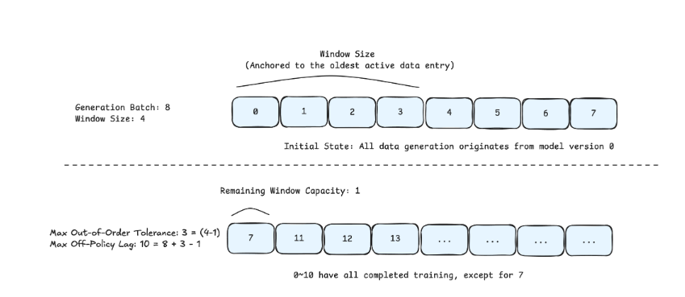

**2.3.2 Partial Rollout**

- **Sync + Over-sampling + Abort**：超采一批 prompt，凑够 batch 即 abort 长尾，断点存档以**下一轮续跑而非重跑**。[Kimi K1.5](https://arxiv.org/abs/2501.12599) 的 100K CoT 即基于此机制，slime 原生支持。

- **Async Partial Rollout**：打断主要用于参数同步，断点续跑为默认行为（verl / slime / AReaL / Kimi-Researcher 的 turn-level partial rollout）。
- **[APRIL](https://arxiv.org/abs/2508.00404)**：在 slime 上主动决定打断对象。
- **[RollPacker](https://arxiv.org/abs/2510.01180)**：从 batching 角度打包短样本、隔离长样本。

---

## 3. Conclusion: Agentic RL Infra 的必要能力

Agentic RL 的训练对象从 single-turn bandit 扩展到多轮、多环境、多 scaffold 的 harness environment，白盒（rule / verifier）与黑盒（sandbox、真实 API、browser、MCP 工具）并存，任务跨越代码、搜索、浏览、多 agent 协作。要在此场景下稳定训练，RL infra 框架须在**环境、训练、推理、调度**四个层面同时具备能力。

### 3.1 Environment Layer

1. **Environment–Rollout 解耦**。Trainer 与 harness environment 不直接交互；rollout 侧以标准化协议（[Forge](https://www.minimax.io/news/forge-scalable-agent-rl-framework-and-algorithm) Gateway + Data Pool、[Kimi-Researcher](https://moonshotai.github.io/Kimi-Researcher/) Gym-like server）为边界，agent / scaffold 只产生 trace，不感知 tokenization 与训练切分。这是支持任意 harness 接入、复用已有 agent 生态（LangChain / AutoGen / OpenAI Agents SDK，参见 [Agent Lightning](https://arxiv.org/abs/2508.03680)）的前提。
2. **白盒/黑盒环境统一抽象**。rule / verifier（白盒，RLVR）与 sandbox / 真实 API / browser（黑盒）走同一 env 接口；reward 组合（outcome + process + format + latency）在框架层可插拔，新增任务类型不需要改训练栈。
3. **Non-Prefix-Monotonic 轨迹处理**。黑盒环境下 context 被外部改写（sub-agent 返回值替换、query rewrite、summary 压缩、VLA 场景观测不连续），轨迹不再是 append-only。loss mask、IS 边界、断点拼接由框架层一次性解决，而非分散到算法侧。
4. **CPU 大并发 Sandbox 基础设施**。code / browser / shell / MCP server / game env 在 CPU 侧的 10³–10⁴ 量级并发，需提供：容器池化与 warm-up、K8s 混合云调度、MCP stateful session、轻量 subprocess + seccomp 旁路、硬超时与结构化 error、多副本容错。

### 3.2 Training Layer

1. **共享前缀的训练复用**。GRPO 家族每 prompt 多样本、multi-turn rollout 共享历史的场景下，[Forge Prefix Tree Merge](https://www.minimax.io/news/forge-scalable-agent-rl-framework-and-algorithm) 类技术（样本级合并 + tree-structured forward + Magi Attention 数学等价，~40× 加速）应作为框架原生能力，而非业务侧 hack。

2. **训练侧 MFU 基本盘**。dynamic batch + remove padding（THD / varlen）、MoE overlap（EP comm / 1F1B / VPP 重排）。

### 3.3 Rollout / Inference Layer

1. **Rollout 吞吐栈**。端到端 FP8 / INT4 量化、MTP spec decoding（含 Forge 的在线 MTP head 微调）、DP-aware routing（sglang-router consistent_hashing）/ Global L3 KV Cache、PD disaggregation——共同压低 rollout 占比（业界目前 70%+）。工程方案参见 [GLM-5 技术报告](https://arxiv.org/pdf/2602.15763)。
2. **Train-Infer Consistency 监控**。异步 + 低精度 + MoE router 不一致组合会在某一刻将训练带偏。train-infer prob diff、rollout IS ratio、router agreement、staleness 分布、tool latency / 超时率须作为一等指标实时暴露。

### 3.4 Scheduling Layer

1. **Fully Async 训推 + Staleness 控制**。同步架构在 agentic 长尾下 MFU 封顶；fully async 或 [Forge Windowed FIFO](https://www.minimax.io/news/forge-scalable-agent-rl-framework-and-algorithm)（W≈0.3N）是必选，配合 staleness 上限、单样本最大复用次数、producer/consumer 速率监控，与算法侧的 [TIS](https://fengyao.notion.site/off-policy-rl) / [GSPO](https://arxiv.org/abs/2507.18071) / IcePop / R3 / Keep-Routing 兜底。
   
2. **Partial Rollout 原生支持**。长尾任务可中断、可存档、可跨轮续跑（slime / AReaL / [Kimi K1.5](https://arxiv.org/abs/2501.12599) / Kimi-Researcher turn-level partial rollout），而非重跑。长轨迹（>100k token）场景无此能力即失速。配合 [APRIL](https://arxiv.org/abs/2508.00404) 主动选择打断对象、[RollPacker](https://arxiv.org/abs/2510.01180) 短样本打包。

LLM RL infra 的收敛方向是 OpenAI Dota 2 时代的全异步 Actor-Learner 范式：Actor 为 vLLM/SGLang，Learner 为 Megatron/FSDP，环境由 game core 替换为 sandbox + agent loop。上述四层能力是此范式在 agentic 场景落地的最小集。

