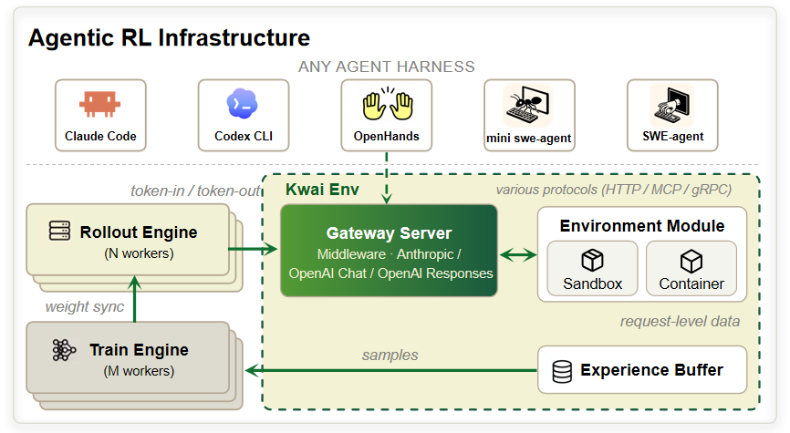
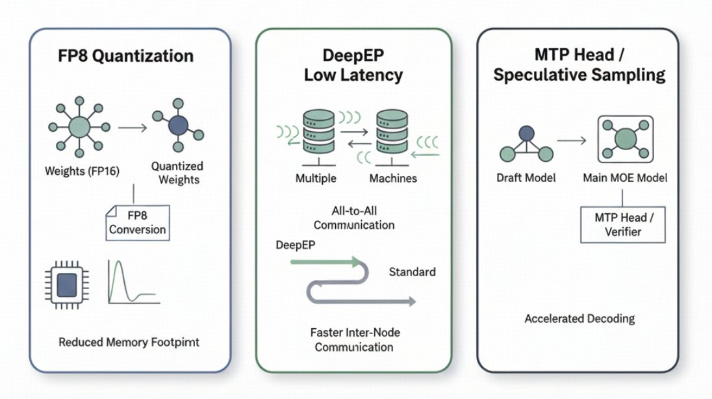
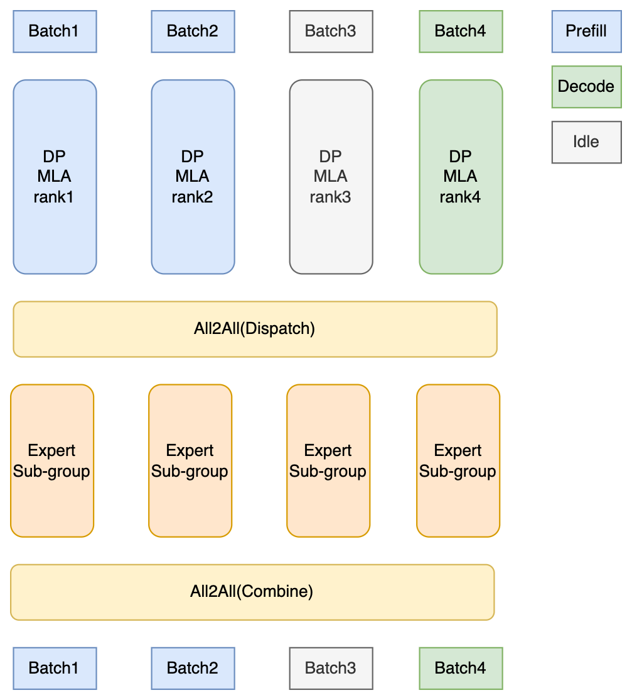
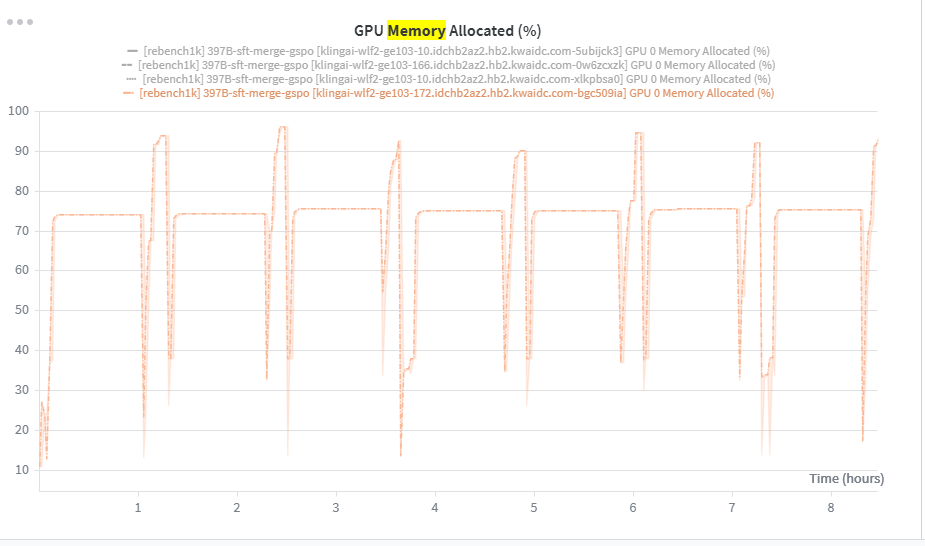

# Training TB-level Models at 1M Context

## Contents

- [Where Long-Context Training Gets Stuck](#where-long-context-training-gets-stuck)
- [Every RL Framework Is the Same Four-Component Dataflow](#every-rl-framework-is-the-same-four-component-dataflow)
  - [Why Algorithm and Infra Must Be Co-Designed](#why-algorithm-and-infra-must-be-co-designed)
- [Rollout Sets the Pace](#rollout-sets-the-pace)
  - [Session Affinity Is the Lever Everyone Forgets](#session-affinity-is-the-lever-everyone-forgets)
  - [Splitting Prefill From Decode Kills the Jitter](#splitting-prefill-from-decode-kills-the-jitter)
  - [DeepEP Takes MoE All-to-All off the Critical Path](#deepep-takes-moe-all-to-all-off-the-critical-path)
  - [FP8 KV Cache Buys Concurrency at a Controlled Cost](#fp8-kv-cache-buys-concurrency-at-a-controlled-cost)
  - [DP-Attention With Big EP: Optimize for Latency, Not Fit](#dp-attention-with-big-ep-optimize-for-latency-not-fit)
  - [Why We Left Speculative Decoding Off](#why-we-left-speculative-decoding-off)
- [Megatron: Fewer Levers, Harder Memory Walls](#megatron-fewer-levers-harder-memory-walls)
  - [Cutting the Peak Beats Adding GPUs](#cutting-the-peak-beats-adding-gpus)
  - [Repeated JIT Compilation Is a Shape-Count Problem](#repeated-jit-compilation-is-a-shape-count-problem)
  - [From 6400 to 16k Tokens per GPU](#from-6400-to-16k-tokens-per-gpu)
  - [Big EP Is a Memory Play, Not a Compute Play](#big-ep-is-a-memory-play-not-a-compute-play)
- [Code Gym: Multi-Harness Code Training at Scale](#code-gym-multi-harness-code-training-at-scale)
  - [Multi-Harness, Multi-Task](#multi-harness-multi-task)
  - [Harness 挂载而非镜像内置](#harness-挂载而非镜像内置)
  - [Sandbox Engineering](#sandbox-engineering)

## Where Long-Context Training Gets Stuck

本部分回答一个具体问题：在没有成熟 infra 团队、算力有限的前提下，如何把 TB 级模型训到长上下文、实现 2000 并发沙箱 rollout 轨迹，并在真实的生产力脚手架（harness）上跑通高效的 agentic RL 训练。

相比静态数据集上的 RLHF / RLVR，agentic RL 的 infra 难度来自三个方向的叠加：

- **Rollout**：多轮 harness 交互让轨迹长度天然不齐，少数超长轨迹拖住整批收尾；256k 序列下 KV cache 压力与通信开销同时放大。
- **Train**：TB 级参数量让单卡显存峰值远超均值，编译耗时随 shape 多样性非线性增长。
- **Harness Env**：沙箱启动与工具执行的不确定性进入训练回路，数据契约、异步控制、off-policy 程度需要算法与 infra 协同才能正确设计。

瓶颈不在单步算力，而在显存峰值、编译开销、环境吞吐。下文分别在 rollout、trainer、数据契约三条线上拆解这三堵墙。

## Every RL Framework Is the Same Four-Component Dataflow

RL infra 从游戏 AI 时期走到 RLHF（OpenRLHF、trl）、RLVR，再到今天的 agentic RL，框架换了一茬又一茬，底层的数据流拓扑从未变过。

RL 与 Supervised Learning（SL）的根本区别在于 dataflow 的拓扑复杂度。SL 的改动集中在数据管线、损失函数、网络结构三处，dataflow 是简单的单向图。RL 是多个组件之间的持续通信：用 OpenAI Five 的术语，一套 RL 系统由四个组件构成——Forward Pass GPU、Rollout Worker、Experience Buffer、Optimizer。Forward Pass GPU 与 Rollout Worker 交互生产样本，样本填入 Experience Buffer，Optimizer 消费它更新参数。

**组件的名字随时代变，职能不变**（OpenAI Five 的术语即 game AI 时期的叫法）。

| 组件 | LLM 时期 | Game AI 时期 |
|---|---|---|
| Forward Pass GPU | Rollout Engine（SGLang / vLLM） | Actor |
| Optimizer | Train Engine（Megatron / FSDP） | Learner |
| Experience Buffer | - | - |
| Rollout Worker | 含 Black-box env 通信的 harness adapter | 含 GameCore 通信的 gRPC server |

Rollout Worker 始终是居中的 middleware：LLM 时期它用 harness adapter 兼容各种黑盒环境，game AI 时期它用 gRPC 与 GameCore 对话。形态在变，位置不变。

笔者 2022 年做 game AI 期间，在初创公司搭过[分布式 RL infra 框架](https://my.feishu.cn/docx/HasGdqprjoMkAixWFkqce4LKnPd)，也在腾讯主导过并发上万 CPU 核的[大规模分布式 PPO 训练](https://my.feishu.cn/docx/VE1Jd40pVouvCBxalZNcwFbYnYc)。进入 LLM 时期，对主流 LLM RL infra 框架做了[系统调研](distribute-rl/distribute-rl.md)，并对 verl 和 slime 做了源码级拆解（[Verl 核心代码解读](https://my.feishu.cn/docx/TMZ3dU0dvokHGZxM23Fc9BevnPf)、[Slime 核心代码解读1](https://my.feishu.cn/docx/FOk1dMs9MoQX8WxAuIscJh5dn0g)、[Slime 核心代码解读2](../slime/slime-overview.md)、[Verl Agentic RL 特性](https://my.feishu.cn/docx/Y8g2dRGMGoYZkexdJ81cOpuAnwh)）。基于这些积累，KAT-Coder 2.5 训练工作在 slime 上搭建及优化，充分利用了 slime 内部优化版 SGLang 的推理特性与 Megatron 侧的最新优化。其中一个结构性不对称需要说明：slime 里 SGLang 有内部优化版，Megatron 基本还是开源原样，所以 rollout 侧能站在已优化的底座上，Megatron 的显存与编译问题需要自己啃。

<div align="center">
  
</div>

### Why Algorithm and Infra Must Be Co-Designed

alg-infra codesign 是 RL 训练正确性的前提，不只是效率问题。纯粹的算子优化（Megatron 的 FlashQLA、SGLang 的推理加速）可以由 infra 独立完成，算法无需介入。但一旦触及 dataflow 本身，算法必须主导——否则 infra 交付物是否正确，算法无从验收。以下两个例子说明这一点。

- **Gateway server 的正确性**：harness adapter 需要保证推理引擎严格执行 token-in token-out（TITO）语义——即输入 token 序列与输出 token 序列在 tokenization 层面完全对称、无中间转换。KAT-Coder 2.5 发版时重构过 gateway server，起因是发现此前 infra 在实现 harness env 与 SGLang 的通信时，使用了对话接口而非底层生成接口，并引入了多次 re-tokenization，导致实际只有约 40% 的样本严格满足 TITO 要求。这是算法把验收标准交给 infra 执行、但没有从数据层面闭环核查的直接后果。

- **Rollout 数据结构的改造**：slime / verl 的数据 workflow 以单次 rollout 生成一条样本为默认假设，每条轨迹对应一段前缀一致的连续生成序列。harness 环境下的轨迹结构与此不同——单次 session 内模型会被多次调用，每次调用生成一个独立的 segment，多个 segment 共享同一个 session 上下文但各自对应不同的生成断点。框架的数据 workflow 必须支持这种一个 session 对应多个生成 segment 的结构，才能正确拼出可训练的样本。

- **异步框架的 off-policyness 控制**：全异步训练框架必须显式控制 off-policy 程度——样本复用次数上限、partial rollout 的截断策略、stale 样本的过滤阈值，这些约束只有算法能提前给出，infra 无法自行决定。如果 infra 只在简单同步场景验证收敛便交付，这些约束在实际异步训练中会完全缺失，导致优化目标与实际数据分布的偏差随训练步数累积。

算法不懂 infra 架构，就无法验收交付物的正确性；infra 不懂算法的实现细则，就无法正确实现。两者必须协同设计。

## Rollout Sets the Pace

rollout 与 train 的时间占比约为 **3:1**，整体训练的吞吐瓶颈在 rollout 侧。多轮 harness 交互让轨迹长度天然不齐，少数超长轨迹拖住整批收尾——这是 agentic RL 特有的长尾问题，与静态数据集上的 RLHF 根本不同。围绕 SGLang 压这条长尾，是 rollout 提速的主线。

[SGLang 特性](../sglang/sglang-overview.md)涵盖投机解码、稀疏 attention 后端、权重与 KV 量化、EP + DeepEP 通信、PD 分离、CUDA Graph、cache-aware 路由等方向。TB 级 / 长上下文训练中对这些特性的选取遵循一个原则：只启用能同时提升 rollout 吞吐、又不引入额外训练回路约束的手段——这个取舍标准决定了最终的[配置应用](../sglang/sglang-detail.md)。

下面按「加速收益 × 对训练稳定性的影响」从高到低，拆开这次实际用到的几项：请求调度、PD 分离、DeepEP、KV 量化、并行配置，最后交代为什么没上投机解码。

<!-- TODO: 换图 —— 现图含 MTP 投机采样，但本次未用投机解码；替换成 请求调度 / PD 分离 / DeepEP / FP8 KV 的示意 -->

<div align="center">
  
</div>

### Session Affinity Is the Lever Everyone Forgets

每个沙箱将 LLM 调用打到 gateway server，gateway 转发给 SGLang router，router 在多个 engine 副本间选一个落。agentic 轨迹是多轮的，同一条轨迹的每一轮 prompt 都携带前面所有轮的历史——如果 router 按负载轮询分散，不同轮次会落到不同副本，历史前缀 KV 无法复用，整段上下文被迫从头重算。256k context 下这个代价不可忽视。

解法是给每个沙箱分配一个唯一的 session-id，gateway 转发时携带该 id，router 用 consistent hashing 将同一 session 的所有请求绑定到同一 engine 副本——KV cache 因此可以跨轮复用。这个改动不在任何推理引擎参数里，而在 gateway 的路由层，所以最容易被忽视。

### Splitting Prefill From Decode Kills the Jitter

prefill 是 compute-bound，一次前向吃进整个 prompt；decode 是 memory-bound，逐 token 生成数万步。两者混在同一个 engine 里，prefill 的大 batch 会周期性抢占正在运行的 decode，decode 的单步延迟抖动，P99 远高于 P50。

PD 分离将两段拆到独立的 engine 池，各自按最优 batch 策略运行。对 RL 更重要的不是峰值吞吐，而是**稳定性**：训练循环要等最慢的那条轨迹（P99）收尾，抖动消除后 steps/hour 的提升远比 tokens/s 显著——PD 分离买的是**可预测的收尾时间**。

### DeepEP Takes MoE All-to-All off the Critical Path

MoE 每层 forward 需要两次 all-to-all（dispatch + combine），将 token 按 router 分发到目标专家再收回。大 EP 下这是多机通信的最大瓶颈，卡在 decode 的关键路径上。NCCL all-to-all 面向定长对称消息，MoE 路由每步消息大小不规则，效率有限。

[DeepEP](https://github.com/deepseek-ai/DeepEP) 用 RDMA 原语专门处理这种不规则 dispatch / combine，将 all-to-all 从关键路径上移除。它消除的不是计算延迟，而是等待通信的时间。

### FP8 KV Cache Buys Concurrency at a Controlled Cost

decode 的瓶颈在 KV 读带宽：每步只生成一个新 token，却要读回整条历史 KV。FP8 量化将读带宽减半，腾出的显存直接换成更多并发槽位。

代价是训推数值存在微小偏差，但这是**可控的取舍**：量化误差量级约 1e-3，被 rollout 侧的 importance sampling 覆盖，落在 RL 优势估计的噪声范围内。反向对比更直观——BF16 KV 在 256k 序列下会让并发直接砍半，损失远超量化误差。

### DP-Attention With Big EP: Optimize for Latency, Not Fit

<div align="center">
  
</div>

rollout 走 DP-Attention + 大 EP 的组合：

| 并行维度 | 原因 |
|---|---|
| DP-Attention（dp=64） | 每 rank 本地算 attention 与 lm-head，消掉 TP 的 all-reduce；大词表下只算 1/64 logits，省掉 all-gather |
| 专家并行（ep=64） | 将专家权重摊到多卡，降低单卡显存压力 |
| Dense 层不切 TP | dense 参数量小，复制比切 TP 更划算；切到 tp=64 会让 GEMM 过小导致利用率崩塌 |

这套并行骨架与模型结构解耦。Pro（线性注意力）与 GLM-5.2（稀疏 attention）在注意力 backend 的配置上不能直接互套，但 DP-Attention + 大 EP + dense 层不切 TP 的骨架是通用的。

### Why We Left Speculative Decoding Off

投机解码用轻量 draft 一次提议多个 token、主模型并行验证，加速比取决于 draft 的接受率。SL fine-tuning 场景下模型参数冻结，接受率稳定，加速收益持续。

RL 里主模型每步都在更新，冻结的 draft 随策略偏移持续失准，接受率单调衰减。一旦跌破盈亏平衡点，加速比转负。维持加速需要同步训练 draft，这引入额外的训练成本和回路约束——得不偿失。关掉投机解码换来的是 rollout 行为的确定性和训练回路的简洁性。

## Megatron: Fewer Levers, Harder Memory Walls

trainer 是同步的前向反向，负载天然对齐，加卡就能近线性摊平吞吐。trainer 侧的重点不在于榨吞吐，而在于让 TB 级 / 长上下文训练先跑起来——显存峰值和启动期的编译耗时是两堵比算力更早撞上的墙。

[Megatron 特性](../Megatron-LM/megatron-overview.md)涵盖五维并行、MoE Parallel Folding、细粒度重算、精度感知优化器、FP8、各类注意力变体与融合 kernel 等方向。TB 级 / 长上下文训练聚焦其中两个核心目标：**压低显存峰值**从而在单卡上放下更多 token，以及**消除重复编译**减少 JIT Compile 耗时。下文按这两条线分别拆开。

### Cutting the Peak Beats Adding GPUs

TB 级的参数与优化器状态、长上下文的激活叠加后，单卡显存峰值远高于均值。加卡能摊平吞吐，摊不平单卡那一瞬间的显存尖峰——削峰直接决定能否跑起来。削峰有三条线：

- **换更省显存的注意力算子**：Pro 走 GQA 结构，将原有 flash 算子换成 Qwen 针对 GQA 专项优化的 [FlashQLA](https://github.com/QwenLM/FlashQLA) 融合 kernel，长序列下显存占用与计算开销一起压低。

- **定位 RL 一步中的峰值段**：slime 的异步训练主循环结构如下——

  ```
  train(args)
    ├─ create_placement_groups(args)
    ├─ create_rollout_manager(args, pgs["rollout"])
    ├─ create_training_models(args, pgs, rollout_manager)
    ├─ actor_model.update_weights()                        — 首次同步训练权重到 SGLang
    └─ for rollout_id in range(...):
         ├─ rollout_manager.generate.remote(rollout_id)    — 采样 + reward + 打包
         ├─ if offload_rollout: pause_generation() + offload()
         ├─ actor_model.async_train(rollout_id, ref)       — Megatron 训练一次
         ├─ offload_train()
         ├─ if offload_rollout: onload_weights()
         ├─ actor_model.update_weights()                   — 训练权重 → SGLang
         └─ if offload_rollout: onload_kv() + continue_generation()
  ```

  这个 pipeline 有两处显存特征值得关注：

  - SGLang offload 后仍有显存残留（KV cache、CUDA graph 等状态），相比 SL 的单向 dataflow，RL 的 rollout-train 交替执行天然存在一定显存浪费。

  - 峰值发生在 `actor_model.async_train` 中的 train actor 步骤。该步骤包含两个子阶段：compute log-prob 和 train actor，前者在 248320 的词表维上物化 logits（16k token 分块光 logits 就吃 7.6 GiB），后者叠加激活、梯度、优化器状态。解法是对 log-prob 计算做分块滚动投影（chunk log-prob），将词表带来的瞬时峰值压下去。

<div align="center">
  
</div>

- **GDN 层的 CP 显存冗余**：Pro 中 GDN（线性注意力）层开 CP 时的显存行为与 attention 层完全相反——现行实现先 all-gather 完整序列、每 rank 独立计算整段，CP 不但没降显存，峰值反而是单卡无 CP 时的 cp_size 倍。根因是 recurrent state 未跨 rank 传递，每个 rank 都从头算起。[修法](../slime/slime-detail.md)是将数据布局从 zigzag 改为 contiguous、以 P2P ring 传递 recurrent state，使每 rank 只算自己的 chunk。

### Repeated JIT Compilation Is a Shape-Count Problem

dynamic batch size 消除了样本 pad 浪费，但引入一个隐藏代价：输入形状不再固定。

Triton / FlashQLA 类算子以序列长度为编译缓存的 key，每遇到新长度就触发一次 autotune + 编译，单个 kernel 耗时几秒到几十秒。dynamic batch size 让每卡序列长度在连续区间内变化，编译被反复触发——训练最初几个 step 慢得像卡死，不是计算慢，是编译在跑。**这不是算力问题，是 shape 种类问题**：编译总开销正比于不同 shape 的种数。

#### Pinning Shapes Into a Few Buckets

解法是配一个 data pad 对齐参数：将每卡序列长度向上对齐到固定粒度的倍数，把连续的长度区间归拢到有限的几档 shape。粒度这一个旋钮决定 shape 档数与 pad 浪费之间的权衡：

| pad 对齐粒度 | 每卡 shape 档数 | 稳态算力浪费 |
|---|---|---|
| 细 | ~100 档 | <1% |
| 中 | ~13 档 | ~4% |
| 极粗（锁到单档） | 1 档 | 可达 ~28% |

核心发现：长训练用中粒度更划算——稳态省下的算力远超一次预热的编译代价。细粒度稳态不浪费算力但冷启动编译时间长；极粗粒度编译零摩擦但每 batch 损失近三成前向算力。

把编译结果落盘复用才能让预热开销真正消失。使用 flash 系算子时开 Triton cache；换成 [FlashQLA](https://github.com/QwenLM/FlashQLA) 后对应用 TileLang cache。两者都把「遇到新 shape 就重编译」变成「编译一次、之后命中缓存」。pad 对齐策略与编译缓存两侧同时下手，才能既拿到 dynamic batch size 的吞吐收益，又保住训练稳定性。

### From 6400 to 16k Tokens per GPU

削峰与固定形状两条线合起来，收益落在同一个指标上——单卡能承载的 token 数。

**核心发现：显存优化直接决定单卡能承载的序列长度，也就直接决定 256k 训练能否跑起来、以及跑得多快。**

| 阶段 | 每卡吞吐（tokens per GPU） | 状态 |
|---|---|---|
| 起初 | 6400 | 频繁 OOM，利用率极低 |
| 显存与编译攻坚后 | 16384 | 稳定运行 |

数据解读：起初 256 卡每卡只能开到 6400 tokens per GPU，频繁 OOM，有效吞吐极低。削峰、控碎片、收敛 shape 之后稳定跑到 16384 tokens per GPU，是这一段攻坚的核心收益。它验证的不是「数字更好看」，而是显存效率这条约束被真正推开了——单卡能吃满 256k / CP 的那一片，256k 训练才成立。

### Big EP Is a Memory Play, Not a Compute Play

放下更多 token 的另一半靠并行配置。本次沿用 **MoE Parallel Folding**：同一批 256 卡上，注意力层和 MoE 层用彼此独立的切分网格——注意力用高 TP + CP 省激活显存，专家层用 `ETP=1 + 大 EP` 保 GEMM 效率，两套网格折叠在同一批卡上，把高带宽通信都压在 NVLink 域内。TB 级 / 长上下文的实跑配置：

```
TP_SIZE=2        # GQA KV 头数少，TP 的硬上界就低，只能到 2
CP_SIZE=16       # 256k 序列切 16 段，每卡只算 256k/16 = 16384 token
PP_SIZE=8        # 60 层切 8 段（不均匀：last stage 4 层）
EP_SIZE=32       # 512 专家分 32 路，A2A 边界与 PP stage 对齐
ETP_SIZE=1       # 专家不做 TP，每个 expert 的 GEMM 保持满幅
SEQUENCE_PARALLEL=1              # 配 TP 切 LayerNorm 激活
OPTIMIZER_CPU_OFFLOAD=1         # DP=1 无处分片，优化器状态搬 CPU
USE_PRECISION_AWARE_OPTIMIZER=1 # CPU offload 的硬前置依赖
```

为什么开大 EP，答案在显存账里。粗算：Pro 里约 95% 的参数在 routed experts，剩下约 5% 才是 attention 与 dense 路径。两组参数走不同的并行组，显存缩放因子也不同：

- **routed experts**：被 PP 和 EP 同时切，每卡只剩 `1 / (PP × EP)`。386B 专家权重经 `PP8 × EP32` 摊到每卡约 1.5B。
- **attention / dense**：被 PP 和 TP 切，每卡 `1 / (PP × TP)`。
- **激活**：被 TP 和 CP 切，每卡每层约 `1 / (TP × CP)`；CP=16 正是把 256k 激活摊平的那一维。

代入 [显存估算脚本](../calculate_pro_mem.py)（bf16 权重 + fp32 梯度 + fp32 Adam），最重 PP stage 单卡约 49 GiB，其中优化器状态占 33 GiB：

| 分项 | 单卡显存 |
|---|---|
| 权重（bf16） | 5.5 GiB |
| 梯度（fp32） | 11.0 GiB |
| 优化器状态（fp32 Adam） | 32.9 GiB |
| 合计（不含激活） | 49.4 GiB |

数据解读：DP=1 下分布式优化器无处分片，这 33 GiB 优化器状态只能靠 CPU offload 腾出来，剩下的显存才轮得到激活和 KV cache。所以开大 EP 的本质不是提算力，是压显存——把专家权重摊薄，让单卡省出的显存换成更多 token。在 256 卡上跑 TB 级模型、长上下文序列，这套 `TP2 × CP16 × PP8 × EP32` 已经是相当极限的配置：再加长序列或再减卡，都得回到算子和 CP 层面继续抠显存。

## Code Gym: Multi-Harness Code Training at Scale

真实的 coding agent 脚手架（Claude Code、mini-agent、Codex、Kilocode 等）以 CLI 或二进制形式分发，不暴露内部实现。对这类黑盒 harness 做 RL，集成边界只有一个：**模型 API**。在模型 API 上放置一个 Gateway/Proxy，拦截每一次 LLM 调用，还原出 token 级轨迹，而 harness 全程按原样运行——这是 KAT-Coder [环境模块](../code-gym/code-gym-overview.md)的核心设计原则。

### Multi-Harness, Multi-Task

**脚手架支持。** 环境模块通过 Gateway 的协议适配层，将 Claude Code（Anthropic 协议）、mini-agent、Codex、Kilocode、Cline、RooCode、Goose 等脚手架统一接入，无需修改任何脚手架源码。每种脚手架只需实现三个钩子（环境变量注入、模型名格式、任务命令），新脚手架的集成成本恒定。

**任务类型与 Verifier。** 当前支持的任务集覆盖 SWE 家族（SWE-bench Verified / Multilingual、SWE-rebench V2、Multi-SWE-bench）、自建 AutoBuilder 训练集，以及代码理解类任务。每种任务类型对应独立的 Verifier——调官方 harness 脚本的 exec-based Verifier 供公开评测集使用，手搓评测 Verifier 适配官方 harness 覆盖不到的训练集。

### Harness 挂载而非镜像内置

任务环境有数十万条实例，脚手架有数十种。若将脚手架直接写入每个任务镜像，镜像数量与任务 × 脚手架的笛卡尔积成比例，迅速不可维护。解法是**挂载式集成**：环境镜像只包含任务所需的仓库与依赖，脚手架在容器启动后动态加载，Agent 与 Env 解耦。镜像数量与任务规模线性，不随脚手架种类增长。

### Sandbox Engineering

稳定性和结果准确性不足会让奖励信号失真，启动耗时直接挤压 rollout 效率。系统性优化了四个方向：

1. **稳定性**：镜像拉取超时率从 15% 降至 0.5%；针对物理机镜像堆积引发的频繁 GC，设计了历史镜像清理机制；504 网关超时的长程任务中断问题通过统一超时机制修复。

2. **结果校对**：修复了远程沙箱 verify 结果与本地不一致的四类问题——系统环境配置差异、warning 被误判为错误中断 verify、结果错位（第 N 步拿到第 N−1 步结果）、IO 返回为空。

3. **兼容性修复**：集成 SWE-rebench V2 时，部分 Go / JS 镜像在沙箱初始化阶段安装必备 Python 库失败；通过外挂 Python env 统一修复，同步优化了启动性能。

4. **启动链路优化**：挂载式加载软件包替代镜像内预装，沙箱平均启动耗时降低约 3 min，长尾 case 优化尤为显著。

