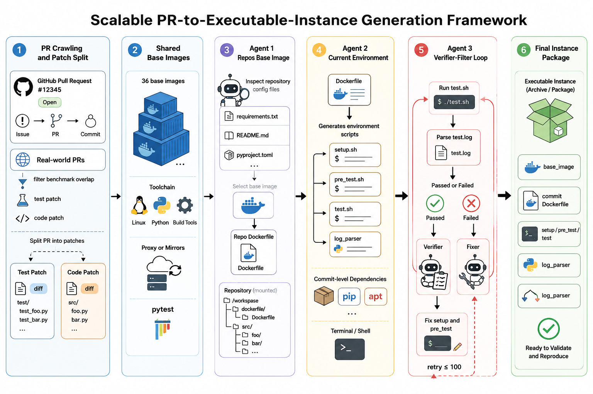
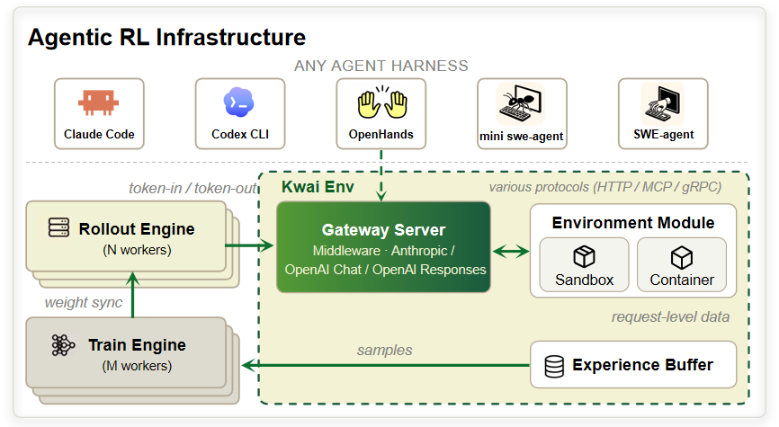

## Contents

- [Environment](#environment)
- [Infra](#infra)
- [Algorithm](#algorithm)
- [Evaluation](#evaluation)

**KAT-Coder V2.5** 以 Agentic RL 为核心，聚焦真实软件工程任务的代码能力提升——从可验证环境构造、训练基建搭建、长程信用分配算法，到自动化评测与轨迹治理，打通完整闭环。

## Environment

沿时间线读公开 SWE benchmark，每一代考察维度的上移都对应代码 Agent 要补强的一种新能力。当公开集的语言与难度分布凑不齐所需组合时，[AutoBuilder](env/env.md) 从真实 GitHub PR 自建可验证环境。

- 最终合成 **22k** 验证环境，覆盖 **31 种语言**，环境构建成功率从 12% 提升到 48%。
- 三个关键工程手段：逐层递进构建镜像依赖、多 Agent Loop 靠真实执行做强验证、从成功/失败轨迹蒸馏显式技能回注 prompt。

  

## Infra

  

[训练基建](infra/infra.md)把 rollout 与 harness、训练栈、算法彻底解耦——在模型 API 边界放 Gateway Server，不修改任何脚手架源码即可接入。

- **Rollout 提速**：PD 分离、DeepEP 低延迟 MoE 通信、FP8 KV cache、session-affinity 路由，rollout 与 train 时间占比约 3:1。
- **Megatron 攻坚**：FlashQLA、分块 log-prob 投影、shape 分桶编译缓存，单卡吞吐从 6,400 提升到 16,384 tokens/GPU（256 卡 256k 上下文）。
- **Code Gym**：支持 Claude Code、mini-agent、Codex、Kilocode 等多种脚手架的挂载式训练环境，百万级任务规模下镜像数量线性可控。

## Algorithm

[算法](alg/alg.md)针对 long-horizon Agentic RL 的两个核心难题：200+ step episode 下的信用分配不稳，以及 CPT/SFT 注入或 on-policy 正样本强化出的退化行为。

- **Asym Actor-Critic PPO**：chunk-level 信用分配替代 GRPO 家族的全轨迹标量优势广播，在 256k 上下文下稳定训练。
- **行为监督**：mask / filter / reward shaping 在样本进优化器前治理，实时切断并行调用爆炸、乱码、echo-drift 等退化模式。

## Evaluation

[Auto-Eval](eval/eval.md) 把训练期实时样本治理与训练后离线轨迹归因收进同一套系统，共享同一套 agent 行为度量。

- **LLM Judge**：按 SWE pipeline 阶段（定位、patch 生成、runtime 完整性）做细粒度失败归因，产出 TMM 规则库与 harness 技能沉淀。
- **评测结论**：RL 迭代将 PASS_LEGITIMATE 从 22% → 28% → 34% 逐版提升；K2.6 / GLM-5.1 存在系统性 RUNTIME_UNRESOLVED_REFERENCE 缺陷，我方模型在前端/UI/Web 类任务上领先。

  <iframe src="eval/charts/failure-modes.html" style="width:100%;height:520px;border:none;border-radius:10px;" title="Failure modes by model"></iframe>

